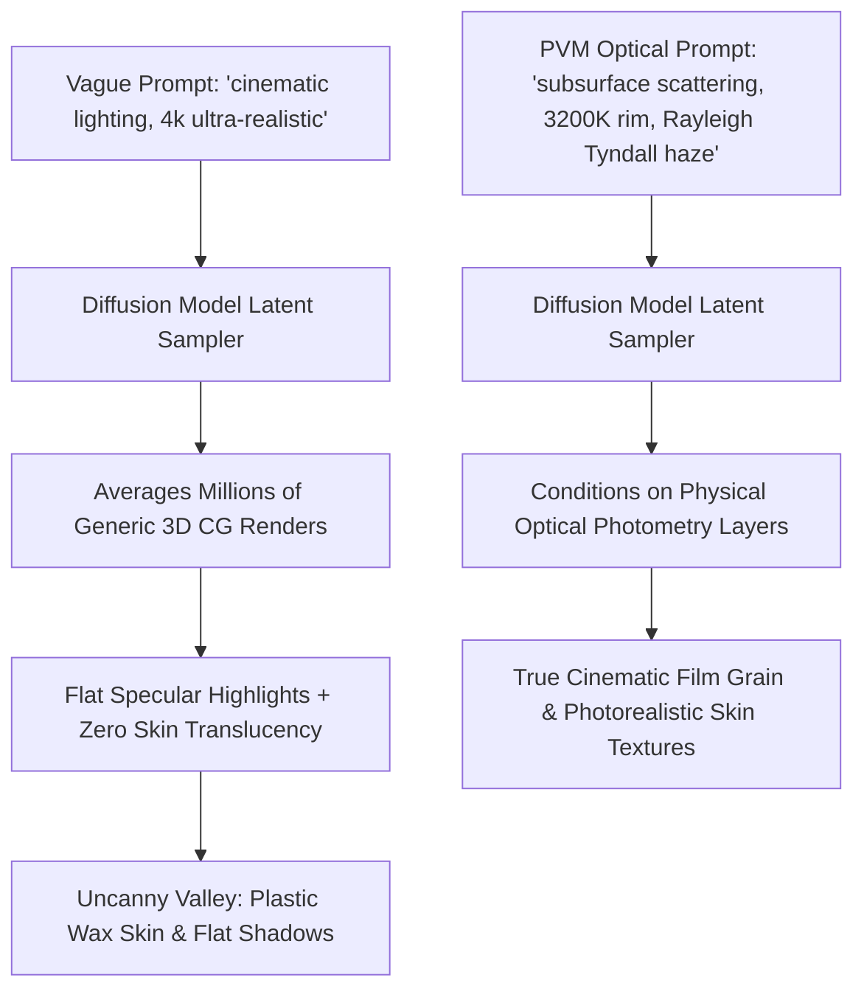

When generating AI video clips in 2026, the primary visual defect is rarely low resolution. High-end diffusion models (Sora, Runway Gen-3, Kling, Luma) render pixels at blistering 4K clarity.

Instead, the dead giveaway of AI video is **the "Synthetic Plastic Sheen"**:
* Skin looks like polished silicone mannequin wax.
* Lighting acts as a flat, omnidirectional mathematical fill rather than interacting with atmospheric dust.
* Reflections behave like mirrored glass rather than exhibiting physical micro-facet roughness.

To achieve true cinematic realism, you must stop treating lighting as an afterthought and start programming **physical optics into your diffusion latents**.

This practitioner guide breaks down the physics of digital cinematography and introduces **The Photometric Volumetric Matrix (PVM)** to direct studio-grade lighting, atmospheric haze, and material scattering.

---

## 1. Why Diffusion Models Default to "Plastic Wax"

Generative models trained on millions of web images inherit a severe bias: digital 3D renders and over-processed smartphone photos dominate stock training sets.



Without explicit instructions specifying **optical scattering, color temperature, and atmospheric density**, the latent sampler collapses to the mean, producing flat, unconvincing CGI.

---

## 2. The Photometric Volumetric Matrix (PVM)

Cinematographers manipulate physical photons. To reproduce their results in AI video, format your prompt using **The Photometric Volumetric Matrix (PVM)** across three physical axes:

```
┌─────────────────────────────────────────────────────────────────┐
│ 1. The Light Source Vector (Photometry & Color Temp)            │
│    - Direction, Kelvin rating (e.g., 2800K Tungsten vs 5600K)  │
├─────────────────────────────────────────────────────────────────┤
│ 2. The Atmospheric Medium (Particulate Volume & Tyndall Effect) │
│    - Fog, steam, suspended mineral dust, airborne moisture      │
├─────────────────────────────────────────────────────────────────┤
│ 3. The Surface Scattering Dynamics (BRDF & Subsurface)          │
│    - Micro-porous skin epidermis, anisotropic brushed metal     │
└─────────────────────────────────────────────────────────────────┘
```

| Optical Parameter | Amateur Prompt Mistake | PVM Studio Directive Syntax | Resulting Visual Fidelity |
| :--- | :--- | :--- | :--- |
| **Skin Materiality** | *"Extremely detailed skin, pores"* | `subsurface scattering (SSS), epidermal translucency, micro-skin pores, unpolished sebum specular sheen` | Natural flesh tones with warm red back-scattering |
| **Atmospheric Light**| *"Cool sun rays through window"* | `dense Rayleigh atmospheric haze, visible Tyndall effect volumetric light shafts, illuminated floating dust motes` | True three-dimensional volumetric depth |
| **Key/Rim Ratio** | *"Dramatic lighting, high contrast"*| `harsh 3:1 chiaroscuro contrast ratio, 5600K daylight key light, 2700K tungsten hair-light rim separation` | Sculpted subject contours isolated from background |
| **Lens Aberrations** | *"Photorealistic, shot on 35mm"* | `anamorphic streak flare, subtle chromatic aberration at frame edges, spherical vintage lens breathing` | Organic optical lens imperfections |

---

## 3. Production Cinematic Prompt Recipes

Copy and customize these production-verified lighting setups:

### Recipe 1: The Noir Volumetric Venetian Blind (Tyndall Shafts)
```text
Medium close-up of a weathered detective in a dimly lit 1940s office.
Lighting: Sharp low-angle morning sunlight slicing through half-open venetian blinds. Dense volumetric light beams with visible swirling atmospheric dust particles (Tyndall effect). Strong 4:1 chiaroscuro contrast, deep rich shadows with zero digital noise.
Materials: Natural epidermal subsurface scattering on cheekbones, subtle forehead sweat specular highlights, heavy textured wool trench coat. Anamorphic lens distortion, 24fps motion blur.
```

### Recipe 2: The Cyberpunk Neon Rain Rim (Anisotropic Wet Scattering)
```text
Full-body portrait of a courier standing on a drenched concrete alleyway at midnight.
Lighting: Dual-color rim illumination. Sharp 4000K cyan neon tube on the left shoulder, contrasting 6500K magenta sign backlight creating high-intensity edge separation. 
Atmosphere: Rising steam vents from manhole covers refracting neon light shafts. 
Materials: Wet pavement displaying anisotropic specular reflections, water droplets beading and trickling down a matte leather jacket with realistic micro-roughness.
```

### Recipe 3: The Golden Hour Rim Silhouette (Warm Subsurface Translucency)
```text
Over-the-shoulder shot of an archer drawing a composite bow on a sunlit grassy ridge.
Lighting: Low-horizon 2800K golden hour rim lighting. Direct sun flares bleeding over subject contours with soft halation. 
Materials: Warm red subcutaneous light bleeding through the earlobes and fingertips (subsurface scattering), backlit fine vellus facial hairs, oiled walnut bow texture. Natural shallow depth of field, 85mm f/1.4 aesthetic.
```

---

## Trying a text prompt in NavoKit

[NavoKit AI Video Generator](/en/tools/free-ai-video-generator) accepts a text prompt, a format, and an automatic or approximately 3, 5, 10, or 18 second duration preset. You can preview and download a generated clip. The result panel and returned file determine the actual dimensions and duration.

Describe the lighting in the prompt, then inspect the generated clip. There are no lighting-style presets, 4K output controls, or camera/character locks. A phrase such as “cinematic lighting” is a creative request, not an output specification.

Start with one simple shot and change one prompt detail between attempts. Queue time varies, and the output needs a human check for quality and accuracy.

## Summary

Resolution does not create realism; **the physics of light does**.

Ditch vague adjectives like "4k" and "ultra-detailed." Program your diffusion models using the Photometric Volumetric Matrix, schedule your light temperatures, and unlock true studio cinema quality in every frame.
