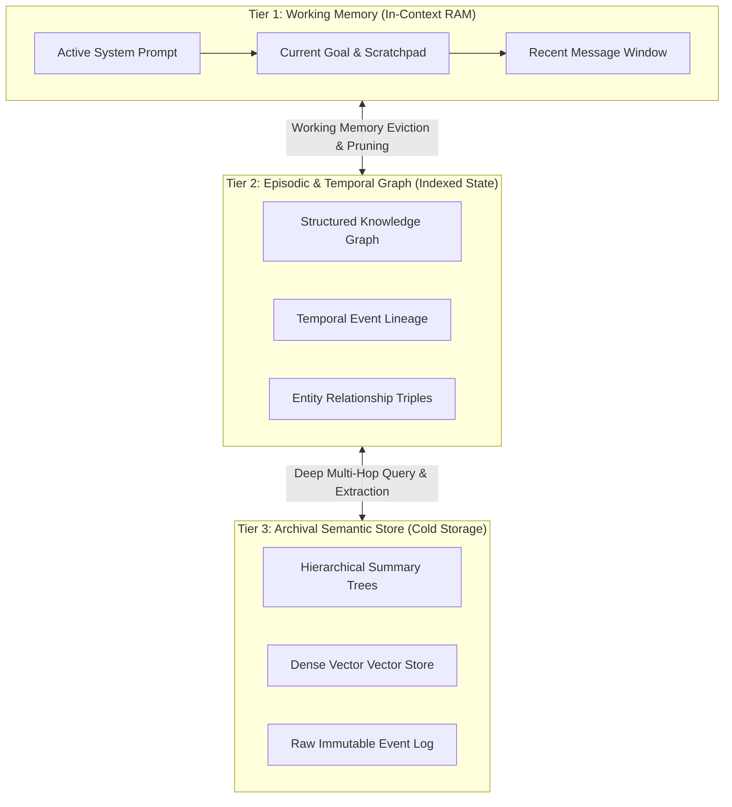

In late 2023, the standard playbook for giving an LLM "memory" was deceptively simple: take a conversational transcript, split it into 512-token chunks, compute dense embeddings with OpenAI's `text-embedding-ada-002` or `text-embedding-3-small`, dump them into Pinecone, Weaviate, or Qdrant, and perform Top-$K$ cosine similarity lookup at runtime.

By 2026, anyone building enterprise-grade autonomous agents has realized that **naive vector retrieval for agent memory is a computational and cognitive dead end**.

When an agent is tasked with running multi-week workflows—such as refactoring a legacy monolithic codebase, conducting clinical trial surveillance, or autonomously managing multi-channel ad spend—flat vector search begins to collapse under the weight of its own semantic ambiguity.

This article dissects the fundamental mathematical failures of pure vector memory, introduces **The Tri-Layer Cognitive Memory Hierarchy**, and explains why graph-augmented associative recall is becoming the industry standard for production AI agents.

---

## 1. The Mathematical Failure of Flat Vector Memory

Why does standard vector RAG fail when applied to persistent agent memory? The core issue boils down to **temporal blindness, semantic flattening, and context drift**.

```
                  ┌──────────────────────────────────────────────┐
                  │    Flat Vector Memory (Cosine Similarity)    │
                  └──────────────────────┬───────────────────────┘
                                         │
        ┌────────────────────────────────┼────────────────────────────────┐
        ▼                                ▼                                ▼
┌─────────────────┐            ┌───────────────────┐            ┌──────────────────┐
│ Temporal        │            │ Polysemy & Noise  │            │ Relational       │
│ Blindness       │            │ Smearing          │            │ Fracture         │
│                 │            │                   │            │                  │
│ Recency & state │            │ Top-K brings back │            │ Cannot traverse  │
│ transitions are │            │ similar syntax,   │            │ multi-hop causal │
│ ignored.        │            │ wrong context.    │            │ links A->B->C.   │
└─────────────────┘            └───────────────────┘            └──────────────────┘
```

### A. The Loss of State Progression (Temporal Blindness)
Cosine similarity measures angular distance in high-dimensional latent space. It contains zero intrinsic concept of time.
* If an agent was told on Monday: *"Deploy to staging cluster `us-east-1`"*, and on Thursday: *"Staging cluster moved to `eu-west-1`"*, a semantic search for *"Where is staging deployed?"* returns high similarity scores for **both** chunks.
* Without explicit temporal scoring, the agent has an equal mathematical probability of retrieving outdated states, causing catastrophic execution regressions.

### B. Relational Fracture (The Multi-Hop Blind Spot)
Agents make decisions based on relational causality: $Entity_A \xrightarrow{rel_1} Entity_B \xrightarrow{rel_2} Entity_C$.
In a pure vector database:
* Querying for $Entity_A$ will never surface $Entity_C$ unless they happen to share overlapping lexical tokens within the same embedding chunk.
* The agent cannot perform logical deduction across disjoint events (e.g., "The customer upgraded to Tier 3" $\rightarrow$ "Tier 3 unlocks Priority API" $\rightarrow$ "Rate limit shouldn't be enforced").

---

## 2. The Tri-Layer Cognitive Memory Hierarchy

To solve the limitations of flat vector retrieval, state-of-the-art agent frameworks (such as MemGPT/Letta, Zep, and enterprise cognitive architectures) have converged on a structured three-tier architecture: **The Tri-Layer Cognitive Memory Hierarchy**.



### Layer 1: In-Context Working Memory (Fast, Ephemeral)
* **Storage Medium**: Active LLM Context Window (Token-budget constrained, e.g., 8k–32k reserved tokens).
* **Role**: Acts as the CPU cache/RAM. Houses the current execution stack, immediate tool calling scratchpads, and the active task execution state.
* **Mechanism**: When token thresholds reach 80%, a recursive background worker triggers **Working Memory Eviction**, summarizing the immediate thread and pushing structured entities to Tier 2.

### Layer 2: Episodic & Relational Graph Memory (Associative, Stateful)
* **Storage Medium**: Hybrid Graph-Relational Engine (e.g., Neo4j, FalkorDB, or embedded SQLite with edge tables).
* **Role**: Preserves entities, preferences, relationships, and temporal dependencies.
* **Mechanism**: Every interaction is decomposed into subject-predicate-object triples `(User, prefers, Rust)` accompanied by temporal validity intervals `[t_start, t_end]`.

### Layer 3: Archival Vector & Summary Store (Deep, Inactive)
* **Storage Medium**: Hierarchical Vector Embeddings + Raw Log cold storage.
* **Role**: Long-tail retrieval for unstructured documentation, historical codebase snapshots, or old dialogues that haven't been accessed in weeks.

---

## 3. Vector RAG vs. Graph-Enhanced Agent Memory

| Architecture Dimension | Naive Vector DB (Top-K) | Tri-Layer Graph Memory |
| :--- | :--- | :--- |
| **Retrieval Mechanism** | Cosine distance over chunk embeddings | Hybrid Graph Traversal + Vector Hybrid Search |
| **Temporal Awareness** | None (requires manual metadata filtering) | Native edge timestamps and state versioning |
| **Multi-Hop Reasoning** | Fails (limited to chunk boundaries) | $O(1)$ to $O(k)$ graph traversal across connected nodes |
| **Contradiction Resolution** | High hallucination risk (conflicting chunks) | Explicit edge invalidation when new truths arrive |
| **Context Compaction** | Fixed chunk overlap (high token bloat) | Hierarchical summary nodes (dense semantic packing) |
| **Latency Benchmark** | 15–40ms (Single vector query) | 40–90ms (Graph traversal + vector lookup) |

---

## 4. Engineering a Graph-Augmented Memory Pipeline

Building an enterprise agent memory engine requires shifting away from passive storage toward **Active Memory Synthesis**.

```
[Incoming User Interaction / Tool Result]
                   │
                   ▼
       [Entity & Triple Extraction]
                   │
        ┌──────────┴──────────┐
        ▼                     ▼
[Entity Resolution]   [Conflict Detection Engine]
(Merge synonyms)      (Is new fact contradicting old edge?)
        │                     │
        │                     ├─► YES: Mark old edge [t_end = now], append new edge.
        │                     └─► NO:  Link new relational edge with confidence score.
        ▼
[Commit to Knowledge Graph & Update Hierarchical Summary Node]
```

### Key Engineering Practices:
1. **Dynamic Edge Invalidation**: Never simply "append" vectors. When an agent learns that a user has switched cloud providers from AWS to GCP, the memory engine must execute an invalidation query that marks the active relationship edge `(Company)-[:HOSTED_ON]->(AWS)` with `status: deprecated, valid_until: 2026-08-18`.
2. **Context Pruning Before Re-injection**: Rather than feeding raw retrieved chunks back into the prompt, the agent extracts the sub-graph neighborhood and converts it into a concise Markdown relationship block:
   ```markdown
   - [User] -> prefers -> [Async Python / FastAPI] (Confirmed: 2026-08-10)
   - [Project] -> deployed_on -> [Kubernetes us-central1] (Updated: 2026-08-17)
   ```

---

## Summary & What's Next

The era of treating LLM memory as a bag of vector embeddings is over. Autonomous systems that operate over long horizons require deterministic, graph-backed relational storage where temporal changes and state transitions are explicitly tracked.

In the next phase of agent development, the winning architectures won't be those with the largest context windows, but those with the smartest **Active Memory Synthesis** engines.
