Over 84% of all video content consumed globally today is viewed on handheld smartphones held vertically.

Platforms like TikTok, YouTube Shorts, and Instagram Reels have made the **9:16 vertical aspect ratio (1080 $\times$ 1920 pixels)** the mandatory canvas of the modern attention economy.

For filmmakers, commercial directors, and video editors, this dominance presents a severe creative dilemma:
* Cinema and high-end video are natively framed in horizontal widescreen: **16:9 (1.78:1)** or **Anamorphic Panavision (2.39:1)**.
* When video teams attempt to re-purpose horizontal masterpiece footage for mobile feeds, they inevitably resort to two terrible legacy compromises:
  1. **The Letterbox / Pillarbox Hack**: Slapping ugly black bars on the top and bottom. This squanders 60% of the mobile screen’s physical real estate, causing user thumbs to swipe past within 0.8 seconds.
  2. **The Blind Center-Crop Hack**: Zooming in 300% to fill the vertical frame. This brutally cuts off peripheral actors, crops out vital background cinematography, and exposes pixelated, blurry compression artifacts.

In 2026, professional studios have retired both legacy hacks in favor of **Generative Video Outpainting**.

By combining spatial diffusion inpainting with temporal optical flow tracking, creators can dynamically re-frame cinematic clips into immersive, full-screen vertical formats while procedurally generating photorealistic ceilings, floors, and extended environments.

This practitioner guide breaks down the mathematics of aspect ratio conversion and introduces **The Generative Dynamic Focal Anchor (GDFA) Protocol**.

---

## 1. The Anatomy of Framing Failure: Why Cropping Destroys Storytelling

Why does a traditional mechanical zoom fail when converting horizontal cinema to vertical social video?

```mermaid
graph TD
    subgraph TraditionalCrop ["The Blind Center-Crop Disaster (65% Information Lost)"]
        W1["Original 16:9 Horizontal Shot: 2 Characters Interacting at Opposite Edges"]
        W1 --> Zoom["300% Center Crop to Fill 9:16 Vertical Screen"]
        Zoom --> Cut["Actor A & Actor B Chopped in Half!"]
        Cut --> Pixelate["Cropping may remove useful scene context"]
    end

    subgraph GDFAPipeline ["The GDFA Generative Outpainting Pipeline (Full-Screen Immersion)"]
        W2["Original 16:9 Horizontal Shot"] --> Anchor["Detect Optical Saliency Anchor (Track Main Actors)"]
        Anchor --> Pan["Smooth Virtual Camera Re-Centering Trajectory"]
        Pan --> Outpaint["Generative DiT Outpainting: Synthesize Photorealistic Ceiling & Floor Extension"]
        Outpaint --> Master["Review the reframed result for visual consistency"]
    end
```



### The 3 Creative Bottlenecks of Mechanical Re-Framing:
1. **The Two-Shot Decapitation**: In dialogue scenes where two characters sit across a table, a center crop leaves viewers staring at the empty space between them, cutting both actors out of frame.
2. **Vanishing Point Parallax Distortion**: Simply expanding pixels vertically using basic neural filters distorts the camera's perspective. If the horizontal shot had a low-angle perspective, expanding the floor without re-calculating the 3D vanishing point creates bizarre, funhouse-mirror physics.
3. **Temporal Flicker in Outpainted Margins**: If the extended top and bottom vertical margins are generated frame-by-frame without strict temporal latent locking, the extended sky or floor exhibits violent strobing and texture drift.

---

## 2. The Generative Dynamic Focal Anchor (GDFA) Protocol

To convert wide-angle cinematic masterpieces into award-winning vertical shorts without artifacts, professional creators deploy **The Generative Dynamic Focal Anchor (GDFA) Protocol**:

```
┌─────────────────────────────────────────────────────────────────────────────┐
│ The Generative Dynamic Focal Anchor (GDFA) Protocol                         │
│                                                                             │
│ [Step 1: Multi-Subject Saliency Bounding]                                   │
│ Computer vision tracks high-intent human faces, gestures, and action points.│
│ ─────────────────────────────────────────────────────────────────────────── │
│ [Step 2: Bezier Camera Trajectory Smoothing]                                │
│ Compute continuous virtual pan-and-scan camera curves (no jerky camera cuts)│
│ ─────────────────────────────────────────────────────────────────────────── │
│ [Step 3: Perspective-Aware Generative Outpainting]                          │
│ Video DiT synthesizes missing vertical headroom and floor canvas extension. │
│ ─────────────────────────────────────────────────────────────────────────── │
│ [Step 4: Temporal Phase-Locked Latent Blending]                             │
│ Optical flow vectors enforce frame-to-frame texture coherence across edges. │
└─────────────────────────────────────────────────────────────────────────────┘
```

### Deconstructing the Protocol Stages:

#### 1. Multi-Subject Saliency Bounding
Using automated saliency segmentation, the algorithm generates bounding boxes around all active narrative subjects in the scene. Rather than locking rigidly to the center of the frame, the system establishes a dynamic focal center of gravity ($C_{\text{focal}}(t)$).

#### 2. Bezier Camera Trajectory Smoothing
When characters move across the frame, the virtual 9:16 viewport pans smoothly to keep them within safe margins. Using cubic Bezier interpolation, camera movements mimic the deliberate pan of an expert Steadicam operator, eliminating disorienting jerky snaps.

#### 3. Perspective-Aware Generative Outpainting
To fill the top and bottom vertical canvas, the video diffusion model analyzes the original scene's lighting vectors, focal length, and depth map. It procedural synthesizes realistic atmospheric details: the continuation of vaulted stone ceilings, chandelier light spills, reflective wet marble floors, or dramatic storm clouds.

#### 4. Temporal Latent Edge Blending
A bilateral temporal filter locks the noise latents of the newly generated outpainted margins to the motion vectors of the original center footage. This completely eradicates edge seam lines and video strobing across long takes.

---

## Trying a text prompt in NavoKit

[NavoKit AI Video Generator](/en/tools/free-ai-video-generator) accepts a text prompt, a format, and an automatic or approximately 3, 5, 10, or 18 second duration preset. You can preview and download a generated clip. The result panel and returned file determine the actual dimensions and duration.

The format options request landscape 3:2 (1152 × 768), portrait 2:3 (768 × 1152), or square 1:1 (768 × 768). They generate a new clip from text; they do not convert an existing clip. Video upload, generative outpainting, subject tracking, and a 9:16 export preset are not available. Use a separate editor to crop or pad a downloaded clip for a different delivery ratio.

Start with one simple shot and change one prompt detail between attempts. Queue time varies, and the output needs a human check for quality and accuracy.

## Summary

The vertical mobile screen is not a creative limitation; it is the definitive broadcast medium of the modern world.

Refusing to adapt widescreen video to 9:16 wastes millions in production budgets, while lazy center-cropping mutilates the cinematographer's vision.

By leveraging **The Generative Dynamic Focal Anchor (GDFA) Protocol**, creators can unlock the best of both worlds: preserving the integrity of horizontal cinematic storytelling while filling the mobile viewport with breathtaking, immersive, full-screen visual magic.
