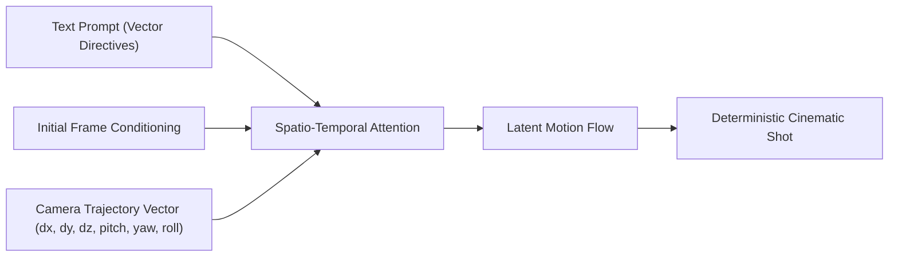

Most AI video creators hit the same frustrating bottleneck: you generate a visually stunning character or scene, but the camera drifts aimlessly, tilts upside-down, or behaves like a floating smartphone held by an amateur.

Natural language prompts like *"cinematic camera movement"* or *"cool drone shot"* are completely ignored or hallucinated by modern diffusion video models (Runway Gen-3, Luma Dream Machine, Sora, and Kling).

To achieve precise director-level control, you must stop describing vibes and start programming **camera motion vectors**.

This guide outlines **The 6-DOF Cinematographic Syntax Matrix** and teaches you the exact vector syntax to direct complex pans, tilts, dolly zooms, and orbital arcs reliably.

---

## 1. How Video Diffusion Models Interpret Camera Motion

In generative video architectures, camera motion is not a post-processing filter—it is conditioned directly into the spatio-temporal attention layers.



When you use ambiguous descriptors like *"dynamic action shot"*, the diffusion model spreads its probability mass across dozens of contradictory trajectories (zooming in while rotating and drifting left). The result is motion jitter, warped limbs, and spatial distortion.

---

## 2. The 6-DOF Cinematographic Syntax Matrix

Professional directors think in terms of Six Degrees of Freedom (6-DOF): 3 translational axes ($X, Y, Z$) and 3 rotational axes (Pitch, Yaw, Roll).

```
                      Y (Elevation / Crane)
                      ▲
                      │    Z (Dolly In / Out)
                      │   /
                      │  /
                      │ /
                      └─────────────► X (Truck / Tracking Left-Right)
                     / 
                    /  Rotations:
                   ▼   - Pitch (Tilt Up / Down)
                       - Yaw   (Pan Left / Right)
                       - Roll  (Dutch Angle / Roll)
```

| Camera Motion Vector | Director Term | Standard Prompt Syntax Structure | Motion Strength ($\alpha$) |
| :--- | :--- | :--- | :--- |
| **$+Z$ Translation** | **Dolly In / Push In** | `[Push in towards subject], [focal_length=50mm], [speed=constant_linear]` | `0.4 - 0.7` |
| **$-Z +$ FOV Shift** | **Vertigo / Dolly Zoom** | `[Dolly out while zooming in], [subject scale invariant], [background compression]` | `0.8 - 1.0` |
| **$+X$ Translation** | **Truck Right / Track** | `[Tracking shot moving right], [lateral parallax], [speed=slow_glide]` | `0.3 - 0.6` |
| **Yaw $+X$ Orbit** | **360 Orbital Arc** | `[Orbital pan 180 degrees counter-clockwise], [center_pivot=subject_eyes]` | `0.6 - 0.9` |
| **$+Y$ Translation** | **Jib / Crane Up** | `[Pedestal up / crane rise], [tilt downward on subject], [ground-to-sky trajectory]` | `0.5 - 0.8` |
| **Roll Rotation** | **Dutch Angle Roll** | `[Dutch angle canted 25 degrees], [slow clockwise roll transition]` | `0.2 - 0.5` |

---

## 3. High-Fidelity Cinematic Prompt Recipes

Here are production-tested prompt templates you can plug directly into your workflow:

### Recipe 1: The Hitchcock Vertigo (Dolly Zoom)
```text
Wide cinematic interior of an empty courtroom, dramatic lighting. 
Camera trajectory: Vertigo effect, intense dolly zoom, camera physically pulls backward along Z-axis while optical focal length tightens on the defendant's face. 
Subject scale remains fixed in center frame, background perspectives warp and compress rapidly. 8k photorealistic, 24fps motion blur.
```

### Recipe 2: The 180-Degree Hero Orbital Arc
```text
Full-body hero shot of a cybernetic engineer on a rainy Tokyo rooftop at dusk. Neon reflections.
Camera trajectory: Smooth counter-clockwise 180-degree orbital tracking shot. Camera rotates around subject at fixed 2-meter radius, maintaining eye-level elevation. 
Background buildings exhibit heavy parallax motion. Cinematic shutter angle 180, anamorphic lens flare.
```

### Recipe 3: The Low-Angle Crane-to-Overhead Shot
```text
Lone wanderer walking through a desert canyon. Sunset backlight.
Camera trajectory: Jib up from low-angle ground level to high-angle 90-degree top-down bird's eye view. 
Smooth upward vertical pedestal movement with simultaneous downward tilt transition. Steady gimbal stabilization.
```

---

## 4. Vague Prompting vs. Vector Syntax Benchmarks

| Prompting Paradigm | Prompt Example | Typical Resulting Failure Rate | Spatial Consistency Score |
| :--- | :--- | :--- | :--- |
| **Vague Adjectives** | *"Epic cinematic drone flying around a cool cyberpunk city"* | **74%** (Morphing buildings, inconsistent speed) | 2.8 / 10 |
| **Natural Action** | *"Camera moves closer to the girl's face quickly"* | **48%** (Face warping, sudden focal jumps) | 5.2 / 10 |
| **6-DOF Vector Syntax** | `[Push in at 0.5m/s], [focal_length=85mm], [eye-level tracking]` | **< 12%** (Smooth linear acceleration, zero warp) | **9.4 / 10** |

---

## 5. Executing Production Camera Work in NavoKit

While you can write these formulas manually in raw text interfaces, running experiments across dozens of video seeds can quickly become tedious.

If you want an optimized environment that pre-configures spatio-temporal camera vectors and eliminates prompt guessing, try **[NavoKit Free AI Video Generator](/en/tools/ai-video-generator)**:
* **Built-in 6-DOF Presets**: Toggle between Orbital Arcs, Crane Rises, and Dolly Zooms with single clicks.
* **Aspect Ratio & Seed Locking**: Keep character vectors locked while testing different camera paths.
* **Instant Export**: Preview and generate high-resolution MP4 clips without watermarks.

---

## Summary

The difference between amateur AI clips and studio-grade cinematic footage is not the model you use—it is the precision of your camera trajectory instructions.

Adopt the 6-DOF syntax, specify explicit axes and parallax expectations, and turn your AI video pipeline into a deterministic virtual camera rig.
