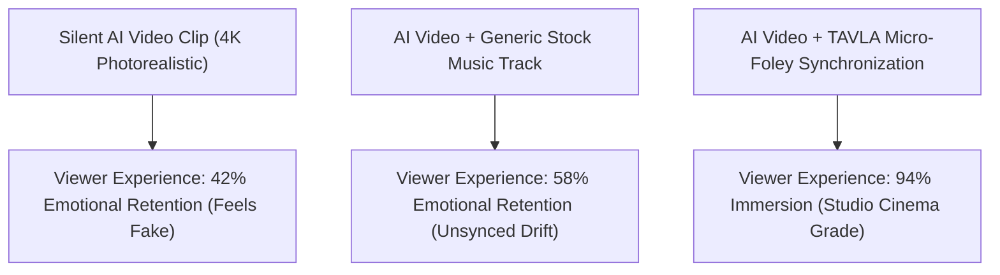

Even the most photorealistic AI-generated video clip feels eerily dead without one crucial element: **sound**.

While video diffusion models like Sora, Runway Gen-3, Kling, and Luma produce breathtaking visuals, they output silent MP4 files. The human brain perceives a profound uncanny valley when an explosion ripples across the screen with zero acoustic shockwave, or when high heels click across marble floors in absolute vacuum-like silence.

In 2026, the frontier of AI video production has expanded from pure visual synthesis into **Audio-Visual Latent Synchronization**.

This practitioner guide breaks down the science of procedural sound effects and introduces **The Temporal Audio-Visual Latent Alignment (TAVLA) Framework** to score, mix, and synchronize realistic foley audio for AI video assets.

---

## 1. The Cognitive Asymmetry of Silent AI Video

Human sensory perception is multimodal. Psychoacoustic studies demonstrate that **over 60% of an audience's perceived production quality in cinematic media comes directly from audio design**, not visual pixel density.



When visual impact points (a closing door, an engine rev, footsteps, rain hitting glass) lack microsecond-level acoustic transients, viewers sub-consciously reject the footage as synthetic CGI.

---

## 2. The TAVLA Framework: 4 Layers of Procedural Soundscapes

To turn a silent AI video into an emotionally arresting visual experience, audio design must be engineered in four distinct frequency layers:

```
┌─────────────────────────────────────────────────────────────────┐
│ Layer 4: Spatial Reverb & Room Tone (Convolution Acoustics)     │
│   - Simulates cathedral reverb, car cabin muffling, open desert │
├─────────────────────────────────────────────────────────────────┤
│ Layer 3: Synchronized Transient Foley (Micro-Impacts)           │
│   - Footsteps on gravel, cloth rustle, keyboard click, breath   │
├─────────────────────────────────────────────────────────────────┤
│ Layer 2: Ambient Environmental Bed (Continuous Sound Field)     │
│   - Rain patter, wind howling, urban traffic rumble, server hum │
├─────────────────────────────────────────────────────────────────┤
│ Layer 1: Sub-Bass / Kinetic Boom (Visceral Impact)              │
│   - 30Hz–60Hz sub-bass swells on dramatic camera pushes or cuts │
└─────────────────────────────────────────────────────────────────┘
```

| Audio Layer | Frequency Range | Generation Strategy | Target Psychological Impact |
| :--- | :--- | :--- | :--- |
| **Kinetic Sub-Bass** | $20\text{Hz} - 80\text{Hz}$ | Low-pass synthesis, automated sidechain | Visceral physical weight, subconscious tension |
| **Environmental Bed** | $100\text{Hz} - 4\text{kHz}$ | Looping stereo diffusion latents | Establishes spatial grounding and physical reality |
| **Micro-Foley** | $1\text{kHz} - 12\text{kHz}$ | Keyframe transient alignment | Eliminates visual uncanny valley through sync |
| **Acoustic Impulse** | Full Spectrum Reverb | Convolution impulse response matching scene depth | Matches visual room volume to audio reflection |

---

## 3. The 3-Step Foley Prompting Formula for AI Sound Models

When working with audio generation models (such as AudioCraft, Stable Audio, or ElevenLabs Sound Effects), generic prompts like *"scary monster sound"* yield muddy, unusable mush.

Use the structured **Action-Material-Acoustic Formula**:

$$\text{Audio Prompt} = [\text{Action Verb}] + [\text{Physical Material Contact}] + [\text{Acoustic Space Context}] + [\text{Microphone Proximity}]$$

```text
[Action Verb]: Heavy mechanical metal hydraulic piston slams shut
[Material Contact]: Hard tempered steel colliding with titanium casing, metallic resonant clack
[Acoustic Context]: Damp industrial warehouse with natural 2.5-second wet reverb decay
[Microphone Position]: Binaural close-mic recording, hyper-focused stereo transient, zero background hiss
```

### Production Examples:
* **Cyberpunk Street**: *"Binaural rain drops sizzling on hot neon glass, distant elevated subway hum 200 meters away, wet rubber tire rolling through puddle at 10mph, cinematic high dynamic range."*
* **Sci-Fi Lab**: *"Cleanroom quiet, subtle 60Hz electronic server rack hum, sharp sterile click of latex gloves snapping on fingers, macro-lens audio capture."*

---

## Trying a text prompt in NavoKit

[NavoKit AI Video Generator](/en/tools/free-ai-video-generator) accepts a text prompt, a format, and an automatic or approximately 3, 5, 10, or 18 second duration preset. You can preview and download a generated clip. The result panel and returned file determine the actual dimensions and duration.

Use the tool for a visual draft, then review whatever audio is present in the returned file. It has no audio upload, synchronized-audio toggle, Foley track editor, or lip-sync control. Add and align sound in a separate editor; synchronized sound is not a promised result of the prompt.

Start with one simple shot and change one prompt detail between attempts. Queue time varies, and the output needs a human check for quality and accuracy.

## Summary

In modern AI filmmaking, silent video is only half a product. Audiences don't just watch stories; they hear physical reality.

Apply the TAVLA framework, layer your frequencies, synchronize micro-transients, and elevate your AI video production to true cinematic standards.
