In cinema, there is a legendary engineering axiom attributed to George Lucas:  
**"Sound is 50 percent of the movie-going experience."**

Yet in the explosive rise of generative AI video through 2025 and 2026, over 90% of content distributed across the web remained completely deaf:
* High-definition clips of a glass vase shattering on marble render in glorious 4K 60fps—in absolute, eerie silence.
* When creators manually drag stock sound effects into a timeline, the audio impacts occur 150 milliseconds too late or early, immediately breaking the illusion.
* In character dialogue scenes, speech phonemes drift out of sync with actor lip visemes within four seconds of sustained generation.

Audiences can forgive a slightly blurry background texture; **they cannot forgive audio-visual desynchronization**. The human brain's auditory-visual cortex detects latency mismatches greater than **45 milliseconds** as an uncanny, jarring distraction.

To master professional cinematic audio-visual generation, directors must apply **The Audio-Visual Latent Alignment (AVLA) Workflow**.

---

## 1. The Physics of Audio-Visual Drift in Generative Video

Why is generating synchronized sound for AI video exponentially harder than simply creating an image and an MP3 separately?

```mermaid
graph TD
    subgraph NaiveDubbing ["Traditional Manual Dubbing (Uncanny Valley & Drift)"]
        V1["Video Generation Engine (Diffusion DiT)"] --> Frames["Render 5s Video (120 frames)"]
        A1["Separate TTS / Stock Audio Library"] --> Waveform["Fixed-Rate 44.1kHz Audio Track"]
        Frames & Waveform --> Editor["Manual NLE Timeline Drag & Drop"]
        Editor --> Desync["Auditory Cortex Rejects Mismatch (> 45ms Phase Drift)"]
    end

    subgraph AVLAPipeline ["The AVLA Latent Synchronous Pipeline"]
        Prompt["Cinematic Action Prompt: 'Thunder strikes iron tower'"] --> SharedClock["Master Frame Timecode Clock (24 / 60 fps)"]
        SharedClock --> VideoEngine["Video DiT: Tracks Optical Motion Vectors"]
        SharedClock --> FoleyEngine["Acoustic Diffusion: Maps Transients to Kinetic Peaks"]
        VideoEngine & FoleyEngine --> PhaseLock["Sub-Frame Latent Phase Alignment (< 10ms Jitter)"]
        PhaseLock --> Output["Native Audio-Visual Co-Generated Master Video"]
    end
```



### The 3 Fatal Sound Flaws of Early AI Video:
1. **Phoneme-to-Viseme Phase Drift**: Human speech generates specific mouth shapes (visemes) corresponding to audio phonemes (such as bilabial plosives /p/, /b/, /m/). If a video model does not condition its reverse diffusion directly on acoustic spectrogram latent frames, the actor's lips begin to flutter independently of the voice track after 48 frames.
2. **Acoustic Kinetic Misalignment**: When an object impacts a surface (a ceramic cup hitting oak, a sword parrying steel), the auditory transient peak must align with the exact video frame of kinetic velocity reversal ($\frac{dv}{dt} \approx 0$). A 3-frame delay transforms a heavy, visceral punch into comical slapstick.
3. **Dry Sound Isolation (Lack of Spatial Reverberation)**: Stock sound effects recorded in a dry vocal booth sound fake when applied to an AI scene set in a cathedral or a wet tunnel. Audio must inherit the volumetric physics of the virtual environment through dynamic Room Impulse Response (RIR) convolution.

---

## 2. The Audio-Visual Latent Alignment (AVLA) Workflow

To guarantee frame-accurate sync and visceral audio impact, modern AI creators utilize **The Audio-Visual Latent Alignment (AVLA) Workflow**:

```
┌─────────────────────────────────────────────────────────────────────────────┐
│ The Audio-Visual Latent Alignment (AVLA) Architecture                       │
│                                                                             │
│ [Stage 1: Kinetic Peak Detection]                                           │
│ Optical flow tracking isolates frames with maximum velocity inflection.     │
│ ─────────────────────────────────────────────────────────────────────────── │
│ [Stage 2: Acoustic Transient Synthesis]                                     │
│ Synthesize Foley sound waveforms with attack transients locked to frame t.  │
│ ─────────────────────────────────────────────────────────────────────────── │
│ [Stage 3: Sub-Frame Viseme Warping]                                         │
│ Align facial landmarks to audio spectral envelope at 240Hz sub-intervals.   │
│ ─────────────────────────────────────────────────────────────────────────── │
│ [Stage 4: Volumetric Impulse Convolution]                                   │
│ Apply spatial reverberation matching virtual camera distance and room scale.│
└─────────────────────────────────────────────────────────────────────────────┘
```

### Deconstructing the 4 Stages:

#### 1. Kinetic Peak Frame Extraction
Using optical flow velocity vectors, calculate the kinetic energy gradient across sequential frames. The precise timestamp of physical impact ($t_{\text{impact}}$) is flagged as an immutable sync anchor.

#### 2. Acoustic Transient Synthesis (Foley Matching)
Generate Foley sound effects—such as gravel crunching, rain patter, or metal grinding—using audio diffusion models conditioned on the material tags specified in the prompt (*"wet granite"*, *"rusty iron"*). The initial attack transient of the sound waveform is hard-locked to $t_{\text{impact}}$ with less than $5\text{ms}$ variance.

#### 3. Sub-Frame Viseme Phase Locking
For talking-head dialogue, interpolate facial landmark coordinates at 240Hz (four times faster than a standard 60fps video feed). This prevents "jaw popping" and guarantees that closed-lip phonemes match closed-lip video frames identically.

#### 4. Volumetric Room Impulse Response (RIR)
Calculate the virtual 3D room volume from the video depth map. If the scene is set in an open meadow, apply free-field acoustic decay with zero early reflections. If set in an industrial warehouse, apply a 2.4-second decay with dense metallic reverberation.

---

## Trying a text prompt in NavoKit

[NavoKit AI Video Generator](/en/tools/free-ai-video-generator) accepts a text prompt, a format, and an automatic or approximately 3, 5, 10, or 18 second duration preset. You can preview and download a generated clip. The result panel and returned file determine the actual dimensions and duration.

Use the tool for a visual draft, then review whatever audio is present in the returned file. It has no audio upload, synchronized-audio toggle, Foley track editor, or lip-sync control. Add and align sound in a separate editor; synchronized sound is not a promised result of the prompt.

Start with one simple shot and change one prompt detail between attempts. Queue time varies, and the output needs a human check for quality and accuracy.

## Summary

Silent video belongs to the nineteenth century. As AI video models push spatial photorealism to the limit, the ultimate differentiator of cinematic quality is sound.

By understanding the physiological sensitivity of human perception and implementing **The Audio-Visual Latent Alignment (AVLA) Workflow**, creators can bridge the uncanny valley, marry picture with sound, and produce immersive stories that captivate audiences from the very first frame.
