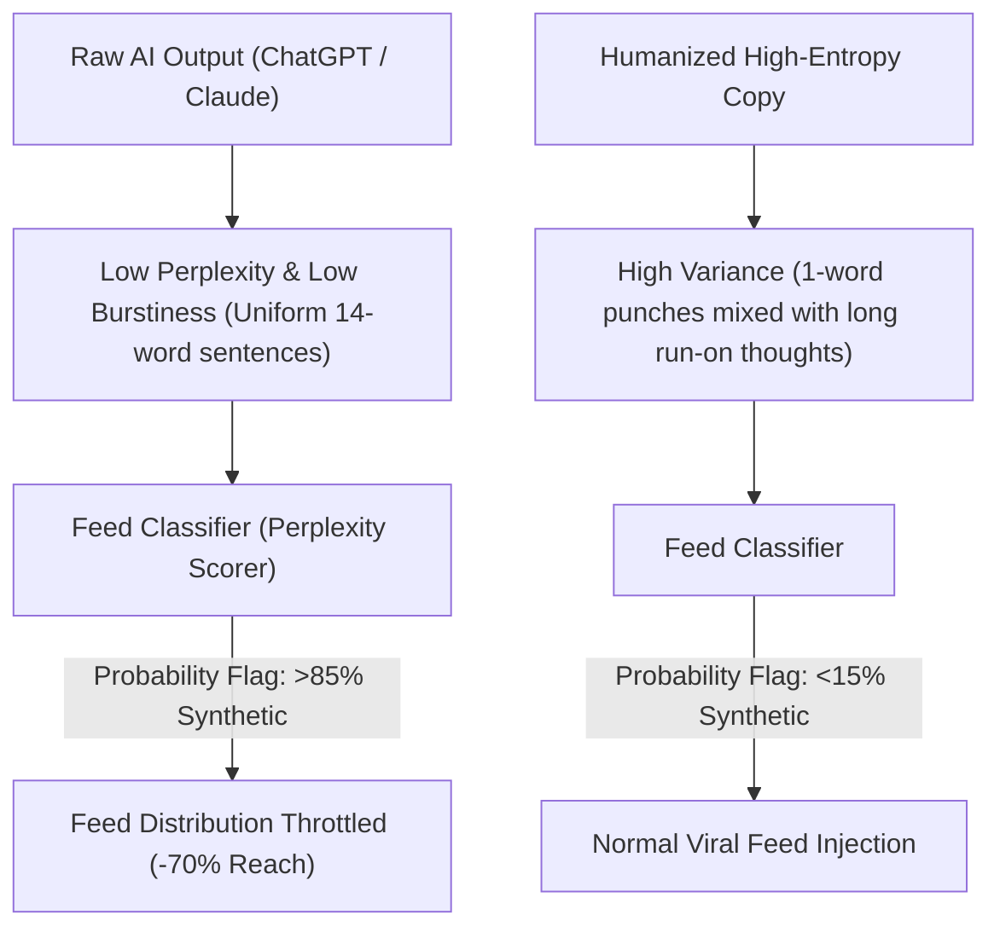

Have you noticed your AI-generated posts on LinkedIn, X, or Threads hitting an invisible algorithmic ceiling?

You post a well-structured summary of an industry trend, but impressions flatline at 50 views. Meanwhile, a raw 2-sentence hot take from a peer gets 10,000 impressions.

This is not bad luck. In 2026, **social media recommendation engines actively score and penalize content exhibiting low-entropy "AI-ness"**.

Classifiers at Meta, X, and LinkedIn don't need watermarks to detect generic LLM output. They look at **Perplexity curves, Sentence Length Variance (Burstiness), and Syntactic Uniformity**.

This practitioner guide reveals how social feed classifiers spot synthetic copy and introduces **The Burstiness-Entropy Copywriting Matrix** to produce AI-assisted social content that algorithms eagerly amplify.

---

## 1. How Feed Classifiers Flag and Suppress AI Copy

Language models naturally output tokens along the path of highest statistical likelihood. This creates text that is smooth, grammatically flawless—and mathematically monotonous.



### The 3 "AI Tell-Tale" Metrics Used by Social Algorithms:
1. **Low Sentence Length Variance ($S_{var} < 4.2$)**: LLMs naturally generate sentences of nearly identical length (typically 12–16 words each). Human writing is chaotic: a 2-word fragment followed by a 35-word sprawling thought.
2. **Predictable Transition Signposts**: Overusing structural crutches like *"Here's the kicker"*, *"Let's dive in"*, *"In today's fast-moving landscape"*, and *"Key takeaways:"*.
3. **Symmetric Parallelism**: Generating lists where every single bullet point starts with an emoji followed by a bold imperative verb and a colon.

---

## 2. The Burstiness-Entropy Copywriting Matrix

To bypass platform penalties, you must inject calculated structural asymmetry into your drafts.

```
                  High Perplexity (Unpredictable Vocabulary)
                                     ▲
                                     │
                   [Academic /       │     [The Viral Practitioner]
                    Incoherent]      │     ★ High Reach Zone
                                     │     (Short hooks, sharp slang,
                                     │      deep technical metrics)
                                     │
  Low Burstiness ────────────────────┼────────────────────► High Burstiness
  (Uniform Sentences)                │                     (Wild Length Variance)
                                     │
                   [Generic LLM Slop]│     [Rambling Voice Note]
                   ❌ Penalized Zone  │
                   (Clean, boring,   │
                    uniform bullets) │
                                     ▼
                  Low Perplexity (Predictable Cliques)
```

| Structural Dimension | The Penalized AI Pattern | The High-Entropy Humanized Pattern |
| :--- | :--- | :--- |
| **Opening Hook** | *"AI is fundamentally transforming how developers write code in 2026."* | *"We just deleted 14,000 lines of Python. The app runs 4x faster."* |
| **Rhythm & Cadence** | Uniform medium-length sentences. Every thought neatly wrapped. | Extreme asymmetry. Staccato punches. Then a long, messy run-on sentence describing real engineering pain. |
| **List Structure** | 5 bullets, exactly 2 lines each, with emojis `🚀 💡 🔥`. | 3 items: Item 1 is one sentence; Item 2 is a 4-line breakdown with raw numbers; Item 3 is a contrarian caveat. |
| **Conclusion** | *"What are your thoughts on this? Let me know in the comments below!"* | An open-ended, unresolved technical question or an abrupt, punchy mic drop. |

---

## 3. The 5 Anti-AI Rewrite Rules

Apply these 5 rules before publishing any AI-drafted post:

### Rule 1: Break the 3-Emoji Bullet Habit
Replace neat emoji bulleted lists with natural paragraph flow or plain numeric sequences without bolded keyword prefixes.

### Rule 2: Inject Conversational Punctuation (Dashes & Ellipses)
LLMs rarely use em-dashes (—), parenthetical side-comments, or fragmented pauses. Inserting intentional conversational friction increases token perplexity and signals authentic human cadence.

### Rule 3: The "Kill the Wrap-Up" Test
Delete the final summarizing paragraph. If an LLM wrote *"Ultimately, embracing this technology will ensure long-term competitiveness,"* hit backspace. End on the punchiest observation.

### Rule 4: Include Raw, Unrounded Specifics
Instead of *"We saw significant improvement in latency,"* write *"P99 dropped from 412ms to 89ms on our 3-node Redis cluster."* Classifiers favor concrete numerical entropy.

### Rule 5: Introduce Contrarian Friction
LLMs default to diplomatic, balanced neutrality (*"While X has benefits, Y also has merits"*). Humans take definitive stances.

---

## 4. Supercharge Your Social Pipeline with NavoKit

Rewriting generic AI copy by hand takes time. If you want AI-generated social posts that already come pre-engineered with high entropy, dynamic hooks, and zero AI clichés, use **[NavoKit AI Social Post Generator](/en/tools/ai-social-post-generator)**:

* **Anti-Slop Engine**: Strips away generic transition words, robotic emoji lists, and corporate filler automatically.
* **Platform-Specific Formatting**: Formats specifically for X character limits and LinkedIn dwell-time algorithms.
* **Tone Modulation**: Switch instantly between Contrarian Founder, Hardcore Engineer, and Punchy Teardown voices.

---

## Summary

Algorithms in 2026 don't penalize using AI—they penalize **boring, predictable statistical monotony**.

Inject entropy, vary your rhythm wildly, kill standard corporate signposts, and turn your social copy into an unstoppable reach magnet.
