Look through your LinkedIn or X feed today. You will encounter dozens of well-meaning, thoroughly researched posts that read something like this:

> *"AI is transforming software engineering. While some developers worry about automation, thoughtful collaboration between humans and LLMs will create better outcomes for everyone. What are your thoughts?"*

The result?
A polite trickle of 4 likes, zero reposts, and exactly one comment from someone saying *"Great insights, agree!"*. Within two hours, the platform’s recommendation engine permanently retires the post.

Why did this post fail?  
Because it committed the single most unforgivable sin of modern algorithmic distribution: **consensus apathy**.

Social media recommendation algorithms in 2026—from X's open-source Heavy Ranker to LinkedIn’s topical relevance graph—are mathematically optimized around one primary signal: **comment thread velocity and cross-network debate density**.

If everyone agrees with your post, nobody comments. If nobody comments, the algorithm calculates an engagement score near zero and cuts off organic impression flow.

To reliably break out of your immediate network, you need **The Bipolar Discourse Funnel (BDF)**.

---

## 1. The Algorithm’s Secret Metric: Thread Velocity & Controversy Weight

Social recommendation engines do not treat all engagements equally. A like is cheap. A bookmark indicates quiet appreciation. But a heated, multi-reply comment debate signals **irresistible viral tension**.

```mermaid
graph TD
    subgraph ConsensusPost ["The Lukewarm Consensus Post (Dead on Arrival)"]
        A1["Post: 'AI helps developers be more productive'"] --> B1["Reader Thinks: 'Yeah, obviously'"]
        B1 --> C1["Passive Like Given (Low Algorithm Weight: +1pt)"]
        C1 --> D1["Zero Comments Triggered"]
        D1 --> E1["Algorithm Flags as Low Velocity -> Feed Suppression"]
    end

    subgraph BDFPost ["The Bipolar Discourse Funnel Post (Viral Explosion)"]
        A2["Post: 'Senior Engineers who refuse to let AI write 80% of their PRs will be unemployable by 2027'"] --> B2["Friction Triggered: Camp A Applauds, Camp B Feels Personally Attacked"]
        B2 --> C2["Camp B Writes 4-Paragraph Rebuttal in Comments"]
        C2 --> D2["Camp A Jumps In to Defend Original Thesis (Multi-Level Threading)"]
        D2 --> E2["Algorithm Heavy Ranker: High-Velocity Debate Detected (+150pts)"]
        E2 --> F2["Post Forced into 2nd & 3rd Degree Feeds (10x Distribution Spike)"]
    end
```



### How the Ranking Engine Values User Interactions:
1. **Lurker Dwell Time (Baseline)**: A user pauses for 6 seconds (+2 weight).
2. **Standard Like (+1 weight)**: Passive affirmation, virtually zero downstream reach impact.
3. **Repost / Retweet (+5 weight)**: Moderately expands 1st-degree network reach.
4. **Original Comment (+15 weight)**: Strong signal that the post provoked an active cognitive response.
5. **Sub-Thread Rebuttal Velocity (+75 weight)**: When User B replies to User A's comment, and User A fires back, the algorithm recognizes an active community discourse. It flags your post as "high conversational value" and distributes it outside your follower bubble.

---

## 2. The Bipolar Discourse Funnel (BDF) Framework

Constructive controversy is not cheap rage-bait. Low-effort trolling burns professional reputation and triggers user mutes.

**The Bipolar Discourse Funnel (BDF)** balances professional authority with sharp ideological division:

```
┌─────────────────────────────────────────────────────────────────────────────┐
│ The Bipolar Discourse Funnel (BDF)                                          │
│                                                                             │
│ [Stage 1: The Razor-Sharp Cleave Hook]                                      │
│ "80% of companies building internal RAG wrappers will fail by Q4."          │
│ ─────────────────────────────────────────────────────────────────────────── │
│ [Stage 2: The Empirical Triangulation]                                      │
│ Present hard benchmarks, real data, and architectural failure points.       │
│ ─────────────────────────────────────────────────────────────────────────── │
│ [Stage 3: The Validated Nuance Pivot]                                       │
│ Acknowledge the counter-argument with surgical respect.                       │
│ ─────────────────────────────────────────────────────────────────────────── │
│ [Stage 4: The Polarizing Micro-Inquiry]                                     │
│ "Are you deprecating your bespoke vector stack, or doubling down?"          │
└─────────────────────────────────────────────────────────────────────────────┘
```

### The 4 Structural Beats of a High-Discourse BDF Post:

#### 1. The Razor-Sharp Cleave Hook (Lines 1–2)
State an opinion that instantly splits your target audience into two vocal camps (approximately 60% agreement vs. 40% dissent).  
*Avoid*: Universally accepted platitudes (*"Code quality matters"*).  
*Use*: Defensible technical line-drawing (*"Microservices in early-stage startups are not an engineering strategy—they are a resume-driven liability"*).

#### 2. Empirical Triangulation (Lines 3–7)
Do not back up your claim with emotional rhetoric. Anchor your position in cold, empirical metrics: cloud infrastructure invoices, latency p99 degradations, hiring market data, or CPU profiling stats. This prevents your post from looking like petty opinion and forces critics to formulate technical counterarguments.

#### 3. The Validated Nuance Pivot (Lines 8–11)
Acknowledge the opposing viewpoint before your detractors can comment it:  
*"To be fair, if your data compliance strictly mandates isolated tenant VPCs with zero multi-tenancy, this overhead is the cost of doing business. But for everyone else..."*  
This disarms lazy critics and forces them to write substantive, in-depth replies.

#### 4. The Polarizing Micro-Inquiry (Closing Line)
Never end with an open-ended snooze-fest like *"Thoughts?"*. End with a binary or forcing-function question:  
*"Which side of this trade are you on: are you migrating back to a modular monolith, or are you doubling down on your Kubernetes microservices cluster?"*

---

## Drafting and reviewing with NavoKit

Enter your position, its evidence, and a reasonable counterargument in [NavoKit AI Social Post Generator](/en/tools/ai-social-booster). You can describe the audience and desired tone in the same text field. The tool requests X, LinkedIn, Instagram, and opening-line drafts for you to review, edit, and copy.

There is no tone-preset selector, readability-scoring loop, or promised boost in reach. The draft does not prove any framework or performance claim made elsewhere in this article.

Keep only facts you can substantiate. Remove invented numbers, experiences, and outcome claims, then check length and tone before publishing the draft yourself.

## Summary

The social internet of 2026 has zero patience for lukewarm platitudes. If you want your technical writing and company announcements to achieve organic distribution, you must respect the mathematics of recommendation algorithms.

By adopting **The Bipolar Discourse Funnel (BDF)**, you transform passive lurkers into passionate comment contributors, engineering vibrant technical conversations that algorithms push to the top of every feed.
