If you are a Developer Relations (DevRel) engineer, open-source maintainer, or technical founder trying to promote an API or SDK on social media, you have likely experienced this agonizing scenario:

You spend three weeks polishing a high-performance Rust library or an innovative AI SDK. You draft a thoughtful announcement on LinkedIn or X. You paste a snippet of elegant code directly into the post body or attach a low-resolution screenshot taken from your terminal.

The result?
Crickets. Less than 200 impressions, three polite likes from your coworkers, and zero repository stars.

Meanwhile, a competing team releases a mediocre wrapper around an existing API, packages their documentation into a stunning, swipeable, 5-slide visual carousel, and racks up 450,000 views, 1,200 retweets, and 2,500 GitHub stars in 48 hours.

**The uncomfortable reality of 2026 developer marketing is simple:**  
Developers do not read wall-of-text changelogs on social platforms while commuting or scrolling through their timeline. Their brains filter out mono-spaced plain text in fractions of a second.

To capture the attention of busy engineers and engineering managers, your code must be packaged into **The Visual Code Narrative (VCN) Carousel Architecture**.

---

## 1. The Scroll Physics: Plain Code vs. Visual Micro-Decks

Why do algorithms on LinkedIn, X, and Threads aggressively punish raw text code and reward structured visual cards?

```mermaid
graph TD
    subgraph RawTextSnippet ["The Raw Text / Terminal Screenshot Path (92% Drop-Off)"]
        A1["Developer Scrolls Feed on Mobile"] --> B1["Encounters Monospace Raw Code Block"]
        B1 --> C1["Syntax Breaks on Small Screen (Line Wrapping Disaster)"]
        C1 --> D1["Zero Visual Hierarchy or Context Callouts"]
        D1 --> E1["Immediate Thumb Swipe (< 0.8s Dwell Time) -> Algorithm Buries Post"]
    end

    subgraph CarouselDecks ["The Visual Code Narrative Carousel Path (6.4x Engagement)"]
        A2["Developer Scrolls Feed on Mobile"] --> B2["High-Contrast, Beautiful Dark Mode Card Catches Eye"]
        B2 --> C2["Slide 1: Problem Statement + Architecture Diagram (4.2s Dwell Time)"]
        C2 --> D2["Swipe to Slide 2: Input / Request Payload with Syntax Highlight"]
        D2 --> E2["Swipe to Slide 3: Execution Output / Benchmarks"]
        E2 --> F2["Swipe Action Signals High Intent -> Platform Boosts Feed Reach by 500%+"]
    end
```



### The 3 Hard Behavioral Metrics of Developer Feeds:
1. **Dwell Time Primacy**: Social recommendation algorithms prioritize "dwell time" (how many seconds a user spends paused on your post). A multi-slide document carousel requires active horizontal swiping, increasing dwell time from an average of 1.1 seconds to over 9.4 seconds.
2. **Mobile Line-Wrapping Destruction**: Over 78% of LinkedIn and X consumption happens on mobile screens (375px to 430px wide). Monospace code blocks wrapped into standard post bodies break indentation and word wrap illegibly, transforming clean code into unreadable noise.
3. **Cognitive Chunking**: Developers review pull requests and architectural specs using structured headings. A carousel enforces natural cognitive chunking: Slide 1 (The Pain), Slide 2 (The Setup), Slide 3 (The Method), Slide 4 (The Execution), Slide 5 (The Production Benchmark).

---

## 2. The Visual Code Narrative (VCN) Architecture

To turn a complex API endpoint or SDK method into a high-converting visual carousel, apply the 5-slide **Visual Code Narrative (VCN)** framework:

```
┌─────────────────────────────────────────────────────────────────────────────┐
│ The 5-Slide Visual Code Narrative (VCN) Architecture                        │
│                                                                             │
│ [Slide 1: The Bottleneck]      [Slide 2: The Naive Fix]                     │
│ ┌───────────────────────────┐  ┌───────────────────────────┐                │
│ │ Headline: "Why X Fails"   │  │ Traditional 40-line REST  │                │
│ │ Big Metric: 1,200ms p99   │  │ Spaghetti Code (De-Emph)  │                │
│ └───────────────────────────┘  └───────────────────────────┘                │
│                                                                             │
│ [Slide 3: The 3-Line API]      [Slide 4: Under the Hood]    [Slide 5: Action]│
│ ┌───────────────────────────┐  ┌───────────────────────────┐┌──────────────┐│
│ │ High-Contrast Clean Code  │  │ Micro-Architecture Diagram││ GitHub Link  ││
│ │ Highlight Key Parameters  │  │ Latency Benchmark Table  ││ Star CTA     ││
│ └───────────────────────────┘  └───────────────────────────┘└──────────────┘│
└─────────────────────────────────────────────────────────────────────────────┘
```

### Breakdown of the 5 Slides:
* **Slide 1: The Bottleneck (The Hook)**  
  State the architectural problem immediately. Use a high-contrast label: *"Why standard HTTP connection pooling starves under 10k WebSockets"*. Do not show code yet. Establish technical credibility.
* **Slide 2: The Legacy Anti-Pattern**  
  Display the painful, verbose traditional approach that every engineer hates writing (e.g., 35 lines of nested error handling and boilerplate setup). Dim the syntax highlighting slightly to symbolize deprecated complexity.
* **Slide 3: The Modern Solution (The "Aha!" Moment)**  
  Showcase your API's signature method. Keep it under 8 lines of code. Use vibrant syntax tokens (Monokai or Tokyo Night theme). Highlight the specific function call that replaces the 35 lines from Slide 2.
* **Slide 4: Internal Mechanics & Benchmark Metrics**  
  Engineers are naturally skeptical of magic. Slide 4 answers *"How does it actually work?"*. Pair a compact Mermaid/flow diagram with a comparative latency/memory table.
* **Slide 5: Implementation & Call to Action (CTA)**  
  Provide the single-line installation command (`npm i @your-lib` or `cargo add your-crate`) and invite technical critique. Ask: *"How are you currently handling connection teardown in your pipeline?"*.

---

## Making a Markdown card with NavoKit

Paste an API example with a short explanation into [NavoKit Markdown to Image](/en/tools/markdown-to-image). Organize it with headings, lists, tables, or code blocks, inspect the live preview, and export a PNG. Conversion runs in the browser and the image includes a NavoKit mark.

The current interface uses a fixed white card style. It has no theme, syntax-highlighting, window-frame, transparent-background, or aspect-ratio selector, and does not offer PDF, vector, or batch export. The image height follows the content, so split long material before exporting.

For a carousel or presentation, prepare and export each card separately, then assemble it in your publishing or presentation tool. Keep the original text and code links available for readers who need to copy them.

## Summary

In modern tech distribution, your documentation is your product marketing. If your code snippets look like an unformatted stack trace on a smartphone screen, developers will scroll past your hard work.

By structuring your release notes and API guides into the **Visual Code Narrative (VCN)** carousel format, you turn dense architectural concepts into bite-sized, high-converting technical assets that algorithms amplify and engineers love to bookmark.
