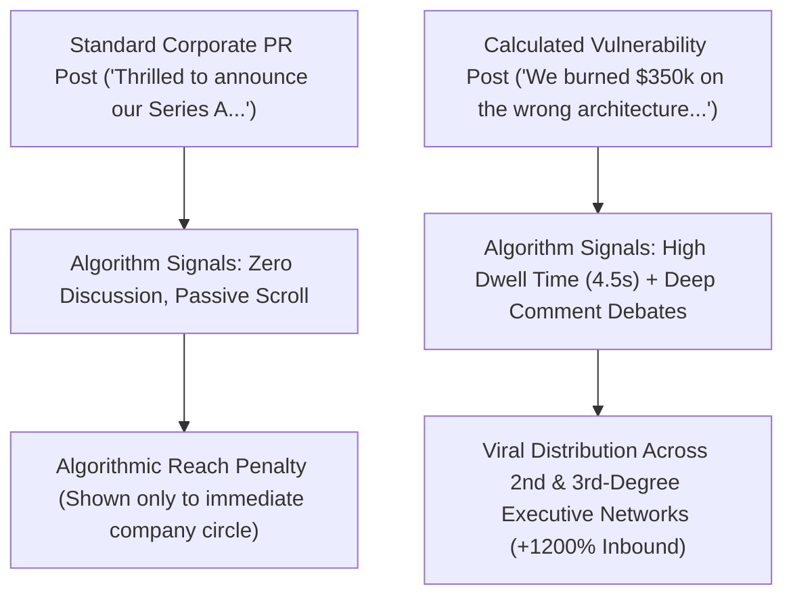

Look at your LinkedIn feed right now. It is likely drowning in a sea of corporate self-congratulation:

*"Thrilled to announce that we were named Leader in the 2026 Q3 Enterprise Cloud Quadrant!"*
*"Humbled to share our Q2 earnings report. Massive thank you to our incredible rockstar team! 🚀"*

The engagement on these posts? A polite scatter of 24 "Congrats!" comments from employees and suppliers. Zero inbound enterprise leads. Zero viral distribution.

In 2026, **the professional internet has developed total immunity to corporate bravado**.

LinkedIn's modern feed algorithm, refined to maximize authentic professional discussion, ruthlessly down-ranks sanitized PR announcements. What the algorithm actively rewards—and what technical decision-makers eagerly share—is **Calculated Vulnerability: raw admissions of operational failure, architectural near-death experiences, and transparent post-mortems**.

This practitioner guide reveals **The Calculated Vulnerability Arc (CVA)** to turn founder vulnerability into your highest-converting B2B inbound engine.

---

## 1. The Death of the Corporate Press Release

Why do boastful corporate announcements fail so miserably on modern professional networks?



### The 3 Psychological Pillars That Drive Modern B2B Engagement:
1. **The Anti-Hubris Reflex**: True enterprise buyers know that building software is painful and messy. When a founder claims everything is perfect, buyers assume they are hiding product deficiencies.
2. **The "Post-Mortem" Value Magnet**: A transparent breakdown of a catastrophic outage or botched migration provides immediate educational utility to peer CTOs and engineering directors, driving massive bookmarking.
3. **The Empathy-Conversion Bridge**: Vulnerability establishes rare authentic trust. When you eventually present your product, buyers view you as an honest battle-tested partner, not a sleazy salesperson.

---

## 2. The Calculated Vulnerability Arc (CVA)

Calculated vulnerability is not an unhinged emotional diary entry; it is an **engineered pedagogical narrative**.

Structure your high-impact LinkedIn posts using **The 4-Step Calculated Vulnerability Arc**:

```
┌─────────────────┐   ┌─────────────────┐   ┌─────────────────┐   ┌─────────────────┐
│ 1. The Confession│  │ 2. The Root Cause│  │ 3. The Rebuild  │   │ 4. The Principle│
│                 │   │                 │   │                 │   │                 │
│ Exact dollar /  ├──►│ The arrogant    ├──►│ The unglamorous ├──►│ Universal rule  │
│ metric failure  │   │ technical error │   │ tactical remedy │   │ for peer leaders│
└─────────────────┘   └─────────────────┘   └─────────────────┘   └─────────────────┘
```

| CVA Stage | The Boastful PR Trap | The Calculated Vulnerability Execution |
| :--- | :--- | :--- |
| **The Opening Hook** | *"Excited to share our latest product updates and architectural improvements."* | *"Last Tuesday, our enterprise billing pipeline doubled-charged 412 customers. I had to personally call 35 angry CFOs."* |
| **The Crisis Reality** | *"Every startup faces challenges on the road to growth."* | *"I sat in our dark kitchen at 4:00 AM wondering if we had just destroyed three years of enterprise trust in 45 minutes."* |
| **The Technical Audit**| *"We rapidly deployed industry-standard safeguards."* | *"The root cause wasn't a complex distributed systems bug. It was a single junior developer missing an idempotency key because our onboarding doc was outdated."* |
| **The Business Law** | *"Innovation requires taking calculated risks."* | *"Rule of thumb: If your billing database does not enforce idempotency at the database constraint layer, you do not have an enterprise system—you have a ticking time bomb."* |

---

## Drafting and reviewing with NavoKit

Enter a real project setback and the lesson you can substantiate in [NavoKit AI Social Post Generator](/en/tools/ai-social-booster). You can describe the audience and desired tone in the same text field. The tool requests X, LinkedIn, Instagram, and opening-line drafts for you to review, edit, and copy.

There is no tone-preset selector, readability-scoring loop, or promised boost in reach. The draft does not prove any framework or performance claim made elsewhere in this article.

Keep only facts you can substantiate. Remove invented numbers, experiences, and outcome claims, then check length and tone before publishing the draft yourself.

## Summary

In 2026, perfection is unconvincing and boastfulness is invisible.

Stop publishing sterile press releases that algorithms ignore. Master the Calculated Vulnerability Arc, share the scars behind your milestones, and build an authentic B2B inbound pipeline that drives real enterprise revenue.
