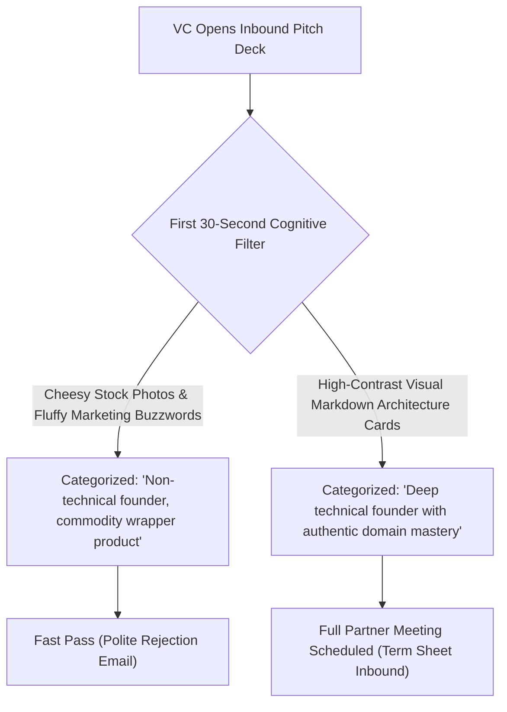

Technical founders trying to raise early-stage capital frequently suffer from a fatal communication mismatch:

You build an extraordinary technical breakthrough—a novel consensus mechanism, a deterministic agent orchestrator, or a zero-copy database engine. But when venture capitalists ask for your pitch deck, you open PowerPoint or Canva, spend three painful days dragging mismatched rectangles and cheesy stock photos, and end up with a deck that looks like an insurance agency brochure.

Investors look at it for 2 minutes and pass.

Why? Because in 2026, **sophisticated tech investors (Founders Fund, a16z, Benchmark) do not invest in flashy marketing slides; they invest in technical clarity, architectural conviction, and structural elegance**.

When a technical founder pitches using **Visual Markdown Cards**—combining crisp code snippets, deterministic flowcharts, and minimalist typography—investors instantly recognize authentic engineering authority.

This practitioner guide reveals **The 5-Card Technical Narrative Loop (TNL)** to convert your Markdown documentation into term-sheet-winning visual pitch assets.

---

## 1. The Investor Cognitive Scan: Why Fluffy Decks Fail

Venture capitalists review hundreds of slide decks weekly. They spend an average of **2 minutes and 18 seconds** on a pitch before making a pass/partner-meeting decision.



### The 3 Signals Top VCs Look for in Technical Founders:
1. **The Code-First Moat**: Can you show a 5-line code snippet that demonstrates why your architecture is $10\times$ faster or simpler than the legacy incumbent?
2. **Deterministic Systems Thinking**: Can you express your business model as a clean state machine diagram rather than vague hand-waving?
3. **Extreme Information Density**: Can the investor understand your value proposition without wading through decorative graphical fluff?

---

## 2. The 5-Card Technical Narrative Loop (TNL)

Instead of a 20-slide rambling PowerPoint, modern technical founders close seed rounds using **The 5-Card Technical Narrative Loop**:

```
┌─────────────────────────────────────────────────────────────┐
│ Card 1: The Incumbent Architecture Nightmare               │
│ - Visual diff showing 12 bloated tools & brittle glue code  │
├─────────────────────────────────────────────────────────────┤
│ Card 2: The Core Abstraction (The 5-Line Breakthrough)      │
│ - Elegant, syntax-highlighted code proving simplification   │
├─────────────────────────────────────────────────────────────┤
│ Card 3: The Unfair Physics (Benchmark Graph & Latency Cost) │
│ - Concrete numerical metrics: 10x faster, 85% cheaper       │
├─────────────────────────────────────────────────────────────┤
│ Card 4: The Market Surface (Developer Distribution Loop)   │
│ - Open-source growth flywheel or bottom-up adoption vector │
├─────────────────────────────────────────────────────────────┤
│ Card 5: The Team & Capital Ask                              │
│ - Engineering pedigree, milestones, and funding target      │
└─────────────────────────────────────────────────────────────┘
```

| Card | Core Question Answered | Visual Asset Strategy | High-Impact Format |
| :--- | :--- | :--- | :--- |
| **Card 1: The Anti-Pattern** | *"Why is the existing way painful?"* | Complex legacy spaghetti diagram | High-contrast dark theme with red callout annotations |
| **Card 2: The Breakthrough** | *"What is your unfair secret?"* | **Syntax-highlighted code diff** | 5–8 lines of elegant Rust/TypeScript API snippet |
| **Card 3: Hard Metrics** | *"Prove it works."* | Clean comparative metric table | Latency, throughput, and cloud bill comparisons |
| **Card 4: Distribution** | *"How do you acquire customers?"* | Cyclical flywheel state diagram | Minimalist Mermaid flowchart |
| **Card 5: Capital Terms** | *"What are you raising and why?"* | Milestones roadmap strip | Clean monospace execution checklist |

---

## Making a Markdown card with NavoKit

Paste one technical point for a presentation into [NavoKit Markdown to Image](/en/tools/markdown-to-image). Organize it with headings, lists, tables, or code blocks, inspect the live preview, and export a PNG. Conversion runs in the browser and the image includes a NavoKit mark.

The current interface uses a fixed white card style. It has no theme, syntax-highlighting, window-frame, transparent-background, or aspect-ratio selector, and does not offer PDF, vector, or batch export. The image height follows the content, so split long material before exporting.

For a carousel or presentation, prepare and export each card separately, then assemble it in your publishing or presentation tool. Keep the original text and code links available for readers who need to copy them.

## Summary

In 2026, code is the ultimate business narrative.

Stop hiding your engineering genius behind generic corporate slide templates. Write your pitch in Markdown, embrace the 5-Card Technical Narrative Loop, and build a visually stunning deck that speaks directly to the minds of tier-one investors.
