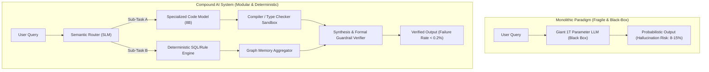

Between 2020 and 2024, the enterprise AI playbook was straightforward: wait for the next frontier base model release (GPT-3 $\rightarrow$ GPT-4 $\rightarrow$ Claude 3 Opus), throw larger prompts at it, and hope its emergent reasoning would magically resolve production edge cases.

By 2026, the industry has collided head-on with the limits of this brute-force approach.

Scaling base model parameters from 100B to 1T+ yields diminishing marginal benchmark gains while exponentially inflating inference costs, token latency, and probabilistic hallucinations. In mission-critical workflows—such as financial reconciliation, automated compliance, and real-time medical triage—a monolithic 92% accurate model is functionally useless.

The paradigm has decisively shifted toward what researchers at Berkeley BAIR, Stanford, and leading enterprise engineering teams call **Compound AI Systems**.

This architectural teardown explores why modular pipelines are rendering monolithic LLMs obsolete and introduces **The 4-Pillar Compound System Reliability Index**.

---

## 1. The Monolithic Dead End vs. Compound System Synergy

A monolithic AI system attempts to perform data retrieval, validation, tool orchestration, and response formatting inside a single forward pass of a massive neural network.

A **Compound AI System** tackles the problem as an engineered software pipeline with multiple interacting components: specialized SLMs, deterministic rule engines, semantic routers, and formal verifiers.



### Why Modular Pipelines Mathematically Outperform Monoliths:
1. **Error Isolation & Localized Retries**: If a monolithic model hallucinates in step 4 of an 8-step chain of thought, the entire generation is ruined ($100\%$ wasted FLOPs). In a compound pipeline, individual components validate their outputs locally and retry failed micro-tasks in milliseconds.
2. **Deterministic Verification Loops**: Neural networks are probabilistic; compilers, parsers, and regex matchers are deterministic. Wrapping small models in deterministic sandboxes (e.g., executing Python in Pyodide/Docker) elevates system reliability from ~88% to >99.8%.
3. **Extreme Cost Efficiency (The $10\times$ Rule)**: Routing 70% of routine sub-tasks to ultra-fast 3B–8B specialized models and reserving the frontier reasoning model strictly for arbitration slashes operational inference costs by 85–90%.

---

## 2. The 4-Pillar Compound System Reliability Index

To evaluate enterprise architectures, we use **The 4-Pillar Compound System Reliability Index ($R_{sys}$)**:

$$R_{sys} = w_1 \cdot \text{Verifiability} + w_2 \cdot \text{State Isolation} + w_3 \cdot \text{Cost Elasticity} + w_4 \cdot \text{Continuous Composability}$$

```
                          1. Deterministic Verifiability
                                     ▲
                                     │
                 [Formal Code        │     [Enterprise Compound System]
                  Verification]      │     ★ Production Grade
                                     │     (Modular, testable,
                                     │      deterministic boundaries)
                                     │
4. Composability ────────────────────┼────────────────────► 2. State Isolation
(Plug & Play SLMs)                   │                     (Air-Gapped Modules)
                                     │
                 [Fragile Agent      │     [Monolithic LLM Wrapper]
                  Frameworks]        │     ❌ High Hallucination Risk
                                     │     (Single prompt black box)
                                     ▼
                          3. Cost & Latency Elasticity
```

| Dimension | Monolithic LLM Approach | Compound AI System Pipeline |
| :--- | :--- | :--- |
| **Component Granularity** | Single giant generalist model ($>70\text{B}-1\text{T}$) | Dynamic swarm of fine-tuned SLMs ($3\text{B}-14\text{B}$) + Code Wrappers |
| **Debugging & Observability** | Opaque latent vector states (Black Box) | Explicit telemetry at every microservice hop (Distributed Tracing) |
| **Upgrade Lifecycle** | Total redeployment & full prompt re-tuning | Independent modular hot-swaps (e.g., update the parser without touching the router) |
| **Verification Guarantees** | Probabilistic hope (Soft prompting) | Hard deterministic gating (AST type-checking, JSON schema validation) |
| **Cost per 1M Reliable Tokens** | \$15.00 – \$30.00 | **\$0.80 – \$2.40** (Up to $15\times$ cheaper) |

---

## 3. Engineering a Production Compound Pipeline

Building a robust compound system requires three core architectural patterns:

```
[Inbound Request] ──► [Semantic Classifier (DistilBERT / Llama-3-3B)]
                             │
            ┌────────────────┴────────────────┐
            ▼                                 ▼
   [Path A: Structured Query]       [Path B: Deep Reasoning Task]
            │                                 │
   [Deterministic SQL / Tool]         [Draft & Self-Refine Loop]
            │                                 │
            └────────────────┬────────────────┘
                             ▼
                 [Formal Type-Check Gate]
                 (Passed? Yes: Emit; No: Retry step)
                             ▼
                     [Final Response]
```

### Key Engineering Directives:
1. **Dynamic Semantic Routing**: Never let a frontier model answer a simple lookup query. Deploy a microsecond router to steer requests to cached databases, arithmetic engines, or lightweight SLMs.
2. **Sandboxed Code as the Universal Intermediate Representation (IR)**: Instead of asking models to solve math or business logic through text reasoning, instruct them to generate executable Python/Rust scripts and execute them in secure WebAssembly sandboxes.
3. **Decoupled Verification Heads**: The agent generating a candidate solution should never be the agent approving it. Deploy an independent adversarial verifier model paired with hard schema linters.

---

## Summary

The frontier of AI is no longer defined by how many billions of parameters you can cram into a single model, but by **how intelligently you can compose specialized, deterministic components into a resilient pipeline**.

Stop waiting for a magical "AGI in a single prompt." Build compound, modular, verifiable AI systems today.
