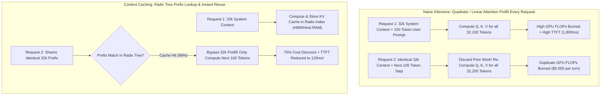
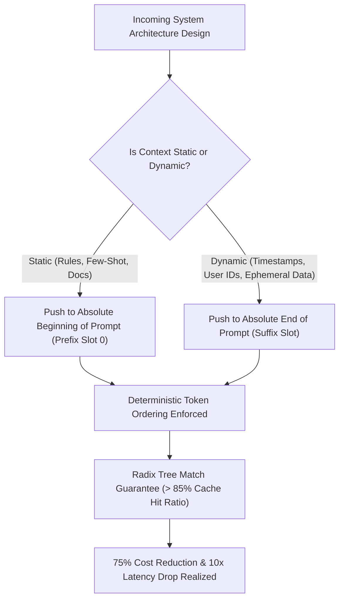

In the early days of enterprise LLM deployment, API cost calculations were deceptively straightforward: multiply your total prompt tokens by the provider's input price, add the completion tokens, and multiply by query volume:

$$\text{Cost} = (T_{\text{in}} \times P_{\text{in}}) + (T_{\text{out}} \times P_{\text{out}})$$

As agentic architectures, RAG pipelines, and multi-turn autonomous coding systems took over enterprise production in 2025 and 2026, this simplistic economic model broke down. When an autonomous coding agent executes a 30-turn debugging loop over a 50,000-token repository context, re-transmitting and re-computing the attention matrices for those 50,000 static tokens on *every single interaction step* is financial insanity.

Enter **Context Caching** (also known as Prompt Prefix Caching).

By persisting the Key-Value (KV) attention states of identical prefix tokens in GPU high-bandwidth memory (HBM) and host DRAM across requests, context caching cuts input token pricing by 50% to 80% while simultaneously slashing Time-to-First-Token (TTFT) by up to 90%.

This technical deep-dive analyzes the mechanics of KV cache prefix matching and introduces **The Prefix Cache Amortization Framework (PCAF)** for architecting cost-effective LLM systems.

---

## 1. The Physics of Attention Recomputation vs. KV Cache Sharing

To understand why prompt caching is an economic game-changer, we must look at what happens at the GPU level during the transformer's "Prefill" phase.



### The Prefill Bottleneck
During inference, transformer attention consists of two distinct operational phases:
1. **Prefill Phase**: The model processes the prompt tokens concurrently, computing the Query ($Q$), Key ($K$), and Value ($V$) projections and materializing the attention tensor. This phase is heavily compute-bound (matrix multiplication on Tensor Cores).
2. **Decode Phase**: The model generates tokens auto-regressively one by one. This phase is memory-bandwidth bound, fetching the accumulated KV cache for prior tokens from VRAM to compute the next token's attention distribution.

Without caching, if an agent issues 40 consecutive function calls, the model recalculates the attention states for the identical 32,000-token system prompt and codebase schema 40 separate times. With Context Caching, the inference engine computes the KV projection for the prefix **exactly once**, storing the resulting tensors in an indexed memory structure.

---

## 2. Under the Hood: Radix Trees and Chunked Prefill

How do modern inference engines (such as vLLM with PagedAttention, SGLang, and proprietary provider APIs) match arbitrary incoming prompts against cached KV states in real time?

They utilize a **Radix Tree (Prefix Tree)** data structure:

```
┌─────────────────────────────────────────────────────────────┐
│ GPU HBM / Distributed Host Memory Radix Tree               │
│                                                             │
│ [Root Node: Empty String]                                   │
│    │                                                        │
│    ▼                                                        │
│ [Node A: System Prompt (Company Guidelines + Tone) - 4k Tk] │
│    │                                                        │
│    ├─────────────────────────────┐                          │
│    ▼                             ▼                          │
│ [Node B: Codebase AST - 28k Tk]  [Node C: SQL Schema - 12k] │
│    │                                │                       │
│    ▼                                ▼                       │
│ [Node D: User Query 1]          [Node E: BI Prompt]         │
│ (Dynamic Leaf - Decoded)        (Dynamic Leaf - Decoded)    │
└─────────────────────────────────────────────────────────────┘
```

### Key Technical Pillars of Prefix Caching:
1. **Radix Attention Indexing**: Prompts are broken into deterministic token chunks (typically in blocks of 16 to 64 tokens, matching PagedAttention page boundaries). Incoming prompts are tokenized and matched from the root node down the tree. Any exact prefix match avoids re-tokenization and prefill matrix multiplication.
2. **Chunked Prefill & Pipeline Interleaving**: Large incoming prefill requests are chunked into smaller batches and scheduled alongside active decode steps, preventing a new 64k-token prompt from pausing ongoing generation for other users.
3. **Hierarchical Storage Offloading**: Hot KV blocks live directly in ultra-fast GPU HBM ($> 3\text{ TB/s}$ bandwidth). When HBM fills up, an LRU (Least Recently Used) daemon offloads idle prefixes to host DDR5 system memory or NVMe storage via PCIe Gen 5, swapping them back in milliseconds when a matching agent re-engages.

---

## 3. The Prefix Cache Amortization Framework (PCAF)

To mathematically design prompts that maximize cache hit rates and minimize cost, software architects must adopt **The Prefix Cache Amortization Framework (PCAF)**.



### The 4 Rules of PCAF Prompt Engineering:
* **Rule 1: Static-to-Dynamic Ordering (The Golden Rule)**  
  Never place volatile variables (such as timestamps, session UUIDs, or random seed numbers) at the top of your prompt. A single differing token at index 5 invalidates the entire subsequent 50,000-token cache down the Radix tree. Always place invariant system prompts, documentation, and schemas first; place volatile user inputs last.
* **Rule 2: Minimum Cache Threshold Amortization**  
  Most cloud providers (e.g., Anthropic, Google, DeepSeek) enforce a minimum token threshold for caching (typically 1,024 to 2,048 tokens). Structuring prompts just above this threshold for high-frequency queries yields positive ROI within 2 to 3 calls.
* **Rule 3: Deterministic Serialization**  
  When serializing database schemas or API definitions into prompts, enforce strict alphabetical key sorting. Unordered JSON serialization (`JSON.stringify()`) yields different token sequences on different runtimes, silently breaking cache hits.
* **Rule 4: Multi-Turn Conversation Compaction**  
  In autonomous agent workflows, summarize and truncate middle conversational turns rather than clearing context, preserving the initial prompt prefix intact throughout the session lifecycle.

---

## 4. Cost and Performance Impact: A Real-World Production Audit

Consider a real-world enterprise coding agent assisting a developer across a 25-turn refactoring task over a 40,000-token repository context:

| Metric | Without Context Caching | With Context Caching (PCAF Compliant) | Economic / Performance Delta |
| :--- | :--- | :--- | :--- |
| **Input Tokens Billed (25 Turns)** | 1,000,000 tokens ($40\text{k} \times 25$) | 250,000 effective billable tokens | **75% Reduction in Billed Volume** |
| **Average Cost per Session ($3/M base)** | $3.00 per session | $0.85 per session | **-$2.15 per session (-71.6%)** |
| **Average Time-to-First-Token (TTFT)** | 1,850ms (Waiting on full prefill) | 160ms (Prefill bypassed) | **11.5x Faster Initial Response** |
| **Total Session Turnaround Time** | 145 seconds | 62 seconds | **57% Shorter Latency for Developer** |
| **GPU HBM Allocation Efficiency** | Continuous allocation churn | Paged reuse via Radix blocks | **3.8x Higher Concurrency per Server** |

---

## Summary

Context Caching is not merely a micro-optimization; it represents a tectonic shift in the unit economics of generative AI. 

As autonomous agents transition from single-prompt experiments to persistent, multi-turn enterprise copilots, the ability to reuse KV attention states transforms prohibitive API bills into highly scalable, sustainable software margins. By aligning your application architectures with the **Prefix Cache Amortization Framework (PCAF)**, your engineering team can unlock sub-second responsiveness while cutting cloud inference expenditure by up to 75%.
