Every single day on X (Twitter), LinkedIn, and Threads, hundreds of well-funded B2B software companies, developer tooling startups, and open-source teams publish product announcements that look exactly like this:

> *"🎉 We are thrilled to announce that CloudSync v2.4 is officially live!*  
> *After 6 months of hard work by our amazing team, we've added a redesigned analytics dashboard, faster CSV exports, and 14 bug fixes. Check out our changelog at the link below! 🚀"*

The result?  
A devastating, deafening silence.  
Nine likes (eight from current employees and one from the CEO's mother), zero reposts, and exactly zero signups.

Within two hours, the platform’s recommendation engine permanently suppresses the post.

Why did this announcement fail?  
Because it committed the fatal marketing sin of **Founder Narcissism**.

Nobody in your industry wakes up in the morning excited that *your team worked hard*. Customers do not care about your sprint cycle or your v2.4 version tag.

To turn technical release notes into viral distribution loops that drive real enterprise pipeline, you must master **The Feature-to-Friction Pivot (FFP)**.

---

## 1. The Psychology of Algorithmic Reach: Self-Congratulation vs. Industry Friction

Why do social feeds mercilessly punish traditional release announcements while promoting contrarian industry critiques?

```mermaid
graph TD
    subgraph SelfCongratulation ["The Traditional Founder Narcissism Post (Zero Distribution)"]
        P1["'We are super excited to announce our new feature X!'"] --> A1["Audience Reaction: Complete Indifference ('Good for you')"]
        A1 --> B1["Zero Comments & Zero Shares Generated"]
        B1 --> C1["Platform Algorithm Classifies Post as Low-Value Self-Promotion"]
        C1 --> D1["Impression Feed Burial (< 300 Views)"]
    end

    subgraph FFPPivot ["The Feature-to-Friction Pivot Post (Viral Industry Debate)"]
        P2["'The industry standard for X is a broken multi-million dollar scam'"] --> A2["Audience Reaction: Intense Tribal Division (60% Agree / 40% Defend Status Quo)"]
        A2 --> B2["High-Velocity Comment Debates Erupt across CTOs & Engineers"]
        B2 --> C2["Algorithm Detects High-Value Conversational Friction"]
        C2 --> D2["10x Viral Distribution Spike -> Hundreds of Inbound Trial Signups!"]
    end
```



### The 3 Core Rules of Social Feed Psychology:
1. **People Do Not Share Features; They Share Identity**: An engineer does not retweet your post because you added an export button. They retweet it because your post articulates a frustrating technical truth that makes them look smart to their peers.
2. **Algorithms Reward Controversy, Not Consensus**: The recommendation ranking engines of X and LinkedIn score posts based on *comment depth and argument reply chains*. A self-congratulatory post offers nothing to argue about; a sharp attack on legacy industry practice triggers 50-comment debates.
3. **External Links Are Algorithmic Poison**: Tacking a *"Check our blog link here"* at the bottom of your post signals the platform to penalize your reach by up to 60%, because social platforms want to retain users within their native feed.

---

## 2. The Feature-to-Friction Pivot (FFP) Framework

To transform dry git commit logs and JIRA release tickets into magnetic B2B social copy, apply the 5-part **Feature-to-Friction Pivot (FFP)**:

```
┌─────────────────────────────────────────────────────────────────────────────┐
│ The Feature-to-Friction Pivot (FFP)                                         │
│                                                                             │
│ [Stage 1: The Sacred Cow Execution]                                         │
│ Attack an expensive, bloated industry dogma or vendor ritual.               │
│ ─────────────────────────────────────────────────────────────────────────── │
│ [Stage 2: The Quantified Agony]                                             │
│ Lay out the exact engineering hours or AWS dollars wasted on the old way.   │
│ ─────────────────────────────────────────────────────────────────────────── │
│ [Stage 3: The Mechanical Breakdown]                                         │
│ Explain why traditional architectures mathematically cannot fix the flaw.   │
│ ─────────────────────────────────────────────────────────────────────────── │
│ [Stage 4: The Inevitable Breakthrough]                                      │
│ Present your product update NOT as a 'feature', but as the logical antidote.│
│ ─────────────────────────────────────────────────────────────────────────── │
│ [Stage 5: The Polarizing Inquiry]                                           │
│ Close with a sharp, forcing-function question that sparks comment debate.   │
└─────────────────────────────────────────────────────────────────────────────┘
```

### Breaking Down the 5 Beats:

#### Beat 1: The Sacred Cow Execution (The Hook)
Never start with your company name. Start with the villain. Call out a standard industry practice that everyone secretly hates:  
*Bad*: *"We just released instant Redis clustering!"*  
*FFP*: *"Managing self-hosted Redis clusters in 2026 is an expensive form of engineering Stockholm Syndrome."*

#### Beat 2: The Quantified Agony
Provide visceral, concrete metrics that resonate with technical decision-makers: the 3 AM PagerDuty alerts, the \$14,000 idle memory bills, or the two days lost to manual failover scripts.

#### Beat 3: The Mechanical Breakdown
Demonstrate deep domain expertise. Explain the architectural flaw of the status quo (e.g., single-threaded master locks, network partition failover races). This proves you are an authority, not a marketer.

#### Beat 4: The Inevitable Breakthrough
Introduce your update. Frame it as the only mathematically sound solution to the problem you just dissected:  
*"That’s why we killed manual shard rebalancing entirely in today's release. Zero downtime, zero slot re-allocation scripts, zero 3 AM alerts."*

#### Beat 5: The Polarizing Closing Inquiry
Instead of asking for clicks, ask for technical battle stories:  
*"What’s the single worst Redis split-brain incident your team has survived in production?"*

If your launch post carries a video, Flowjam's breakdown of the [top Product Hunt launches of 2026](https://www.flowjam.com/blog/top-product-hunt-launches) shows how the best makers paired the copy with the cut.

---

## Drafting and reviewing with NavoKit

Enter verified release notes and the user problem they address in [NavoKit AI Social Post Generator](/en/tools/ai-social-booster). You can describe the audience and desired tone in the same text field. The tool requests X, LinkedIn, Instagram, and opening-line drafts for you to review, edit, and copy.

There is no tone-preset selector, readability-scoring loop, or promised boost in reach. The draft does not prove any framework or performance claim made elsewhere in this article.

Keep only facts you can substantiate. Remove invented numbers, experiences, and outcome claims, then check length and tone before publishing the draft yourself.

## Summary

In modern B2B growth, your product does not speak for itself; your narrative does. If your announcement posts read like corporate press releases, social recommendation algorithms will bury your hard work in obscurity.

By abandoning founder narcissism and adopting **The Feature-to-Friction Pivot (FFP)**, you turn product launches into passionate industry discussions, transforming casual readers into loyal advocates and active product users.
