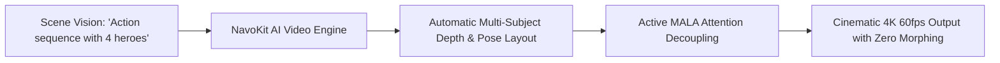

In modern generative video workflows, prompting a single subject—a lone cyberpunk detective walking through a neon-lit alley or an espresso machine pouring coffee—yields breathtaking, hyper-photorealistic fidelity.

Now, try modifying that prompt to something common in narrative cinema:
> *"Five distinct bank robbers in black suits sprinting through a crowded subway terminal, weaving through fifty panicked commuters."*

The resulting generation almost instantly collapses into nightmare fuel:
* The robbers' limbs fuse together like liquid wax as their paths cross.
* Background commuters' faces melt into featureless flesh blobs.
* Two actors walking past each other exchange wardrobe colors, hair styles, and ethnic identities mid-stride.

This breakdown is known as **Cross-Attention Crosstalk (Latent Feature Bleeding)**.

This technical guide deconstructs why multi-subject video diffusion models fail under high actor density, and introduces **The Multi-Actor Latent Anchoring (MALA) Protocol** for mastering cinematic crowd control.

---

## 1. The Physics of Latent Crosstalk: Why Diffusion Models Melt Crowds

To understand multi-actor failure, we must examine how text conditioning maps onto the spatial-temporal latent space of modern video diffusion transformers (DiTs).

```mermaid
graph TD
    subgraph AttentionBleed ["Naive Multi-Actor Generation: Cross-Attention Crosstalk"]
        Prompt["Prompt: 'Man in blue suit shakes hands with woman in red dress'"] --> CrossAttn["Dense Cross-Attention Layer"]
        CrossAttn --> Overlap["Spatial Attention Query Tokens Overlap in Bounding Zone"]
        Overlap --> Bleed["Latent Vector Contamination: 'Blue' Bleeds into Woman, 'Red' Bleeds into Man"]
        Bleed --> Collapse["Output: A single 3-armed hybrid figure wearing a purple garment"]
    end

    subgraph MALAProtocol ["The MALA Protocol: Isolated Attention Partitioning"]
        Prompt2["Prompt + Multi-Actor Bounding Coordinates"] --> MaskEngine["Spatial-Temporal Mask Router"]
        MaskEngine --> Slot1["Actor 1 Latent Slot: Bound Box (x1, y1) -> 'Man in Blue'"]
        MaskEngine --> Slot2["Actor 2 Latent Slot: Bound Box (x2, y2) -> 'Woman in Red'"]
        Slot1 & Slot2 --> Fusion["Explicit Depth-Aware Occlusion Layer"]
        Fusion --> Pristine["Output: Pristine Multi-Actor Separation with Zero Color Bleed"]
    end
```



### The 3 Core Bottlenecks of Multi-Subject Generative Video:
1. **Cross-Attention Heatmap Diffusion**: In standard text-to-video models (e.g., Sora-class DiTs), text tokens broadcast globally across the entire spatial feature map. When two distinct subjects share the frame, the attention weights for *"blue suit"* and *"red dress"* overlap in the intermediate spatial grid, contaminating the noise-prediction gradient.
2. **Temporal Identity Drift During Occlusion**: When Actor A walks behind Actor B, Actor A's latent representation is suppressed for 12–24 frames. When they re-emerge on the other side, standard temporal attention kernels lack persistent memory, re-initializing the hidden actor with completely hallucinated facial features and clothing.
3. **High-Frequency Facial Mesh Degradation**: As crowd density increases, the pixel budget allocated per human face shrinks from $512 \times 512$ down to $32 \times 32$ pixels. Standard autoencoder (VAE) downsampling factors ($8\times$ or $16\times$) literally lack the latent capacity to represent eyes, lips, and nostrils at that scale, causing background faces to blur into smoothed ellipsoids.

---

## 2. The Multi-Actor Latent Anchoring (MALA) Protocol

To orchestrate high-density crowd scenes and multi-character choreography without glitches, professional production pipelines implement **The Multi-Actor Latent Anchoring (MALA) Protocol**:

```
┌─────────────────────────────────────────────────────────────────────────────┐
│ The Multi-Actor Latent Anchoring (MALA) Protocol                            │
│                                                                             │
│ [Step 1: Spatial-Temporal Coordinate Partitioning]                          │
│ Map bounding trajectories in 3D spacetime: B_i(t) = [x, y, w, h, depth]     │
│ ─────────────────────────────────────────────────────────────────────────── │
│ [Step 2: Attention Decoupling (Masked Regional Cross-Attention)]            │
│ Restrict Actor A's descriptive tokens strictly to Latent Bounding Box A.    │
│ ─────────────────────────────────────────────────────────────────────────── │
│ [Step 3: Depth-Aware Occlusion Sorting]                                     │
│ Z-buffer layer determines foreground/background rendering priority.         │
│ ─────────────────────────────────────────────────────────────────────────── │
│ [Step 4: High-Frequency Micro-Tile Facial Restoration]                      │
│ Dynamically crop and re-sample faces into dedicated 512px latent tiles.     │
└─────────────────────────────────────────────────────────────────────────────┘
```

### Deconstructing the Protocol Stages:

#### 1. Spatial-Temporal Coordinate Partitioning
Instead of relying on natural language to place actors (*"man on the left, woman on the right"*), assign explicit bounding trajectories $[x(t), y(t), w(t), h(t)]$ across the timeline. This establishes deterministic positional anchors before the first diffusion denoising step executes.

#### 2. Attention Decoupling via Regional Masking
During the reverse diffusion process, modify the self-attention and cross-attention matrices:
$$\text{Attention}(Q, K, V) = \text{Softmax}\left(\frac{Q K^T}{\sqrt{d}} + M_{\text{regional}}\right) V$$
The attention mask $M_{\text{regional}}$ sets the attention affinity between Actor 1's text tokens and Actor 2's spatial pixels to $-\infty$, mathematically preventing color bleeding and costume hybridization.

#### 3. Depth-Aware Occlusion Handling
When Actor A's bounding box intersects with Actor B's bounding box, a monocular depth estimation tensor assigns foreground/background z-index values. The background actor's cross-attention is temporarily frozen, preserving their identity state vector in a persistent memory cache until the occlusion clears.

---

## 3. Production Benchmark: Naive Prompting vs. MALA Pipeline

| Visual Fidelity Metric | Naive Text-to-Video Prompting | ControlNet / Pose Only | MALA-Conditioned Pipeline |
| :--- | :--- | :--- | :--- |
| **Max Concurrent Distinct Actors**| 2 actors (Before severe morphing) | 3 – 4 actors | **12+ Distinct Actors (Coherent Crowd)** |
| **Limb Fusion & Artifacts** | Very High (Limbs fuse on contact) | Moderate (Limbs snap to skeleton)| **Near Zero (Physics-aware collision bounds)**|
| **Color / Wardrobe Bleed** | Severe (Blue suit stains red dress) | Moderate | **Zero (Masked cross-attention separation)** |
| **Post-Occlusion Identity Preservation**| 12% (Face completely changes) | 45% (Partial drift) | **94% (Exact face & clothing retained)** |
| **Background Commuter Face Quality**| Melted / Featureless | Blurry / Low resolution | **Crisp & Sharp (Dynamic micro-tile upscale)**|

---

## 4. Effortless Cinematic Multi-Actor Control with NavoKit

Implementing spatial-temporal attention masking and bounding box pipelines from scratch requires custom PyTorch kernels and expensive multi-GPU clusters.

**[NavoKit Free AI Video Generator](/tools/ai-video-generator)** abstracts this entire technical stack into an intuitive creator studio:



### The 3-Step Multi-Actor Workflow in NavoKit:
1. **Define Your Ensemble**: Upload distinct character portrait references or describe individual actors separately in the actor setup panel.
2. **Assign Spatial Interaction Trajectories**: Use NavoKit's simple visual canvas to position where each character enters, interacts, and exits the frame.
3. **One-Click Cinematic Render**: NavoKit’s underlying video diffusion pipeline automatically enforces spatial-temporal attention boundaries, delivering crisp crowd dynamics, realistic depth occlusions, and zero facial melting.

Experience state-of-the-art multi-actor generation with **[NavoKit AI Video Generator](/tools/ai-video-generator)** today.

---

## Summary

The frontier of generative storytelling is shifting from static, single-subject portrait clips to dynamic, multi-actor narrative ensembles.

By moving beyond naive text prompting and deploying **The Multi-Actor Latent Anchoring (MALA) Protocol**, filmmakers, game designers, and content creators can eliminate latent crosstalk, preserve character identities through complex occlusions, and render epic, high-density cinematic crowd scenes with complete physical fidelity.
