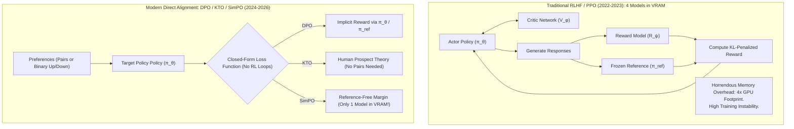
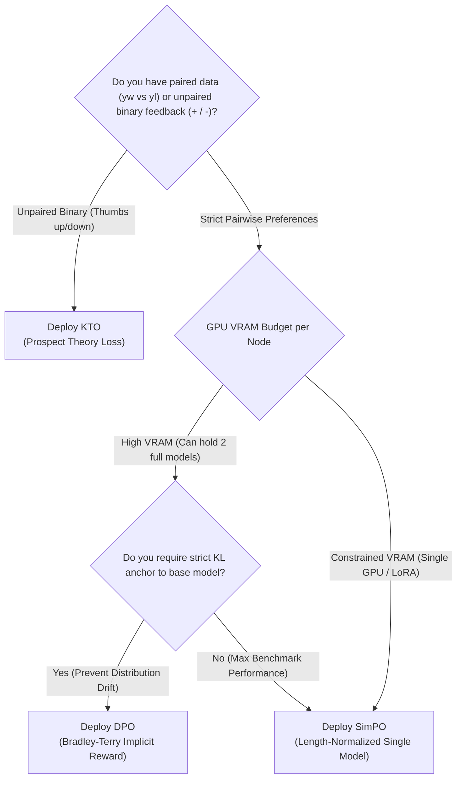

In the foundational days of large language model alignment (2022–2023), Proximal Policy Optimization (PPO)—the reinforcement learning technique behind the original ChatGPT—was the undisputed industry titan.

It was also an engineering nightmare.

To align a single base LLM using PPO, an infrastructure team had to juggle **four massive deep learning models concurrently in GPU memory**:
1. The **Actor Model** (the policy being updated $\pi_\theta$).
2. The **Critic Model** (the value network estimating future rewards).
3. The **Reward Model** (trained separately on human pairwise preferences).
4. The **Reference Model** (the frozen base policy $\pi_{\text{ref}}$ preventing policy collapse via KL divergence penalty).

Training runs were notoriously unstable, hypersensitive to learning rates, and prone to reward hacking. A single gradient spike could poison an entire 8-node H100 cluster run.

Between 2024 and 2026, the machine learning industry underwent a seismic simplification. Direct, closed-form loss objectives systematically eliminated the need for separate reward models and reinforcement learning loops.

This technical breakdown explores the mathematical lineage of modern alignment algorithms—**DPO**, **KTO**, and **SimPO**—and introduces **The Preference Loss Topology (PLT) Matrix**.

---

## 1. The Architectural Evolution: From 4 Models to 1

How did we transition from fragile multi-model RL pipelines to elegant single-pass loss functions?

---

## 2. Mathematical Dissection: DPO, KTO, and SimPO

### A. Direct Preference Optimization (DPO)
Introduced by Rafailov et al. (Stanford), DPO recognized a profound mathematical duality: under the Bradley-Terry preference model, the ground-truth reward function $r(x,y)$ can be expressed analytically through the optimal policy $\pi^*$ and the reference policy $\pi_{\text{ref}}$:

$$r(x, y) = \beta \log \frac{\pi_\theta(y | x)}{\pi_{\text{ref}}(y | x)}$$

By substituting this identity directly into the pairwise Bradley-Terry likelihood, DPO optimizes the policy directly over paired completions $(x, y_w, y_l)$ without training an explicit reward model:

$$\mathcal{L}_{\text{DPO}}(\pi_\theta; \pi_{\text{ref}}) = -\mathbb{E}_{(x, y_w, y_l)} \left[ \log \sigma \left( \beta \log \frac{\pi_\theta(y_w | x)}{\pi_{\text{ref}}(y_w | x)} - \beta \log \frac{\pi_\theta(y_l | x)}{\pi_{\text{ref}}(y_l | x)} \right) \right]$$

* **Advantage**: Bypasses PPO's actor-critic loops entirely; mathematically rigorous and highly stable.
* **Limitation**: Still requires keeping the frozen reference model $\pi_{\text{ref}}$ in GPU memory to compute the implicit KL penalty, consuming double the base model's VRAM.

---

### B. Kahneman-Tversky Optimization (KTO)
Ethayarajh et al. challenged the fundamental assumption that alignment requires pairwise preference datasets $(y_w \succ y_l)$. In real-world enterprise deployments, users rarely generate two parallel responses and pick the better one; they simply give a single answer a "thumbs up" ($y \in \mathcal{Y}^+$) or a "thumbs down" ($y \in \mathcal{Y}^-$).

Borrowing from Behavioral Economics (Kahneman & Tversky's Prospect Theory), KTO defines loss over unpaired, binary-labeled feedback:

$$\mathcal{L}_{\text{KTO}}(\pi_\theta; \pi_{\text{ref}}) = \mathbb{E}_{x, y} \left[ w(y) \left( 1 - v_{\text{KTO}}\left( \beta \log \frac{\pi_\theta(y | x)}{\pi_{\text{ref}}(y | x)} - z_{\text{ref}} \right) \right) \right]$$

Where the value function $v(z)$ is S-shaped—concave for positive gains and convex/steeper for losses—reflecting human loss aversion ($w(y^-) > w(y^+)$).

* **Advantage**: Unlocks massive, messy real-world logs (upvotes/downvotes, customer support ratings) without needing expensive pairwise labeling.
* **Limitation**: Sensitivity to the reference anchor point $z_{\text{ref}}$; hyperparameter tuning can be finicky across heterogeneous domains.

---

### C. Simple Preference Optimization (SimPO)
Published in mid-2024 by Meng et al., SimPO took the simplification philosophy to its logical conclusion:  
**Why do we even need a reference model $\pi_{\text{ref}}$ at all?**

SimPO eliminates $\pi_{\text{ref}}$ completely by using the sequence-length-normalized average log-likelihood as the implicit reward metric, augmented with a fixed target reward margin $\gamma$:

$$\mathcal{L}_{\text{SimPO}}(\pi_\theta) = -\mathbb{E}_{(x, y_w, y_l)} \left[ \log \sigma \left( \frac{\beta}{|y_w|} \log \pi_\theta(y_w | x) - \frac{\beta}{|y_l|} \log \pi_\theta(y_l | x) - \gamma \right) \right]$$

* **Length Normalization**: Dividing by length $|y|$ prevents the model from exploiting length bias (generating overly verbose answers to game the loss).
* **Target Margin $\gamma$**: Enforces that the winning response must beat the losing response by at least margin $\gamma$, preventing gradient saturation.
* **Pure Single-Model Footprint**: Because no reference model is needed, memory overhead drops by nearly 50% compared to DPO.

---

## 3. The Preference Loss Topology (PLT) Matrix

To determine which alignment objective fits your training budget and dataset constraints, evaluate the pipeline against **The Preference Loss Topology (PLT) Matrix**:

---

## 4. Comprehensive Engineering Comparison

| Architecture Metric | PPO (Classic RLHF) | DPO (Direct Preference) | KTO (Prospect Theory) | SimPO (Simple Preference) |
| :--- | :--- | :--- | :--- | :--- |
| **Active Models in VRAM** | 4 (Actor, Critic, RM, Ref) | 2 (Target Policy + Ref) | 2 (Target Policy + Ref) | **1 (Target Policy Only!)** |
| **Data Format Required** | Prompts + Separate RM | Paired preferences $(y_w \succ y_l)$ | Unpaired binary $(y^+ \text{ or } y^-)$ | Paired preferences $(y_w \succ y_l)$ |
| **VRAM Consumption (70B Model)**| $\approx 320\text{ GB}$ (8x H100) | $\approx 160\text{ GB}$ (4x H100) | $\approx 160\text{ GB}$ (4x H100) | **$\approx 85\text{ GB}$ (2x H100 or LoRA)** |
| **Training Stability** | Extremely fragile (PPO clipping) | High (Standard supervised cross-entropy) | High | **Very High (Clean gradient bounds)** |
| **Length Bias Vulnerability** | High (Exploits RM length)| Moderate (Favors longer answers) | Low (Prospect anchor) | **Zero (Length-normalized log-prob)** |
| **Peak Benchmark Performance** | Historic baseline | Strong standard | Strong on binary data | **State-of-the-Art (AlpacaEval 2 / Arena)**|

---

## Summary

The history of machine learning optimization is a recurring lesson in subtraction: replacing complex, multi-stage heuristics with direct, closed-form objective functions.

The progression from **PPO $\rightarrow$ DPO $\rightarrow$ KTO $\rightarrow$ SimPO** has transformed LLM post-training alignment from an occult art accessible only to multi-billion-dollar labs into a streamlined, single-pass training run that any engineering organization can execute on modest hardware.

For modern teams with paired data, **SimPO** represents the peak of efficiency and length-controlled quality. For organizations sitting on mountain ranges of raw user feedback logs, **KTO** unlocks direct behavioral alignment without the expense of artificial pair generation.
