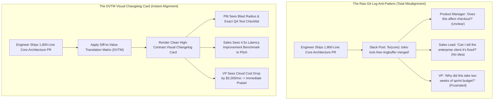

In every software organization, there exists a massive, chronic communication chasm between engineering teams and non-technical stakeholders:

On Friday afternoon, a Senior Backend Engineer finishes a grueling, 40-hour architectural refactor. They squash 32 commits into a single Pull Request modifying 48 files and 1,800 lines of code.

In the release Slack channel, the engineer posts:
> *"Merged PR #412: `refactor(db): migrated connection pool to lock-free ringbuffer, updated tokio epoll bindings, resolved OOM crash in socket draining`."*

The reaction from product managers, account executives, and the VP of Operations?  
**Blank stares.**  
Non-technical leaders have no idea what just shipped, whether customers should be notified, or what business metrics were impacted.

Meanwhile, marketing writes a vague, toothless blog post (*"We made general performance improvements under the hood!"*), completely missing the incredible technical achievement.

Engineers speak in **syntax and diffs**. Stakeholders think in **risk, velocity, and revenue**.

To bridge this divide and build massive organizational trust, engineering leaders must adopt **The Diff-to-Value Translation Matrix (DVTM)**.

---

## 1. The PR Communication Breakdown: Code Diffs vs. Business Value

Why does sharing raw git logs alienate cross-functional teams?



### The 3 Core Communication Failures of Technical Teams:
1. **The Curse of Implementation Details**: Engineers describe *how* they built something (e.g., *"Replaced Mutex with AtomicU64"*). Stakeholders need to know *what problem it eliminates* (e.g., *"Eliminated the 2-second UI freeze during checkout"*).
2. **Invisible Blast Radius**: Non-technical team members cannot gauge risk from a PR title. When an engineer says *"small cleanup"*, the PM has no idea if the change touched payment processing or just an internal admin CSS file.
3. **Format Blindness**: Raw markdown diff blocks (````diff - old + new ````) wrapped in monospaced Slack text look like unreadable alien hieroglyphics on smartphone screens.

---

## 2. The Diff-to-Value Translation Matrix (DVTM)

To turn a complex code diff into an authoritative, high-impact visual changelog card, structure your release communications around **The Diff-to-Value Translation Matrix (DVTM)**:

```
┌─────────────────────────────────────────────────────────────────────────────┐
│ The Diff-to-Value Translation Matrix (DVTM)                                 │
│                                                                             │
│ [Section 1: The Commercial Headline (The Value Hook)]                       │
│ "P99 Checkout Latency Slashed from 1,850ms to 240ms"                        │
│ (Zero engineering jargon. Focus strictly on customer / business metric)     │
│ ─────────────────────────────────────────────────────────────────────────── │
│ [Section 2: The Curated Visual Diff Snapshot]                               │
│ Extract 4 to 8 lines of core conceptual code.                               │
│ High-contrast red (-) deprecated logic vs vibrant green (+) modern method.  │
│ ─────────────────────────────────────────────────────────────────────────── │
│ [Section 3: The Blast Radius & System Health Impact]                        │
│ - Systems Touched: Billing API, Postgres Connection Pool                    │
│ - Verified Uptime Risk: Zero Downtime (Hot-swapped)                         │
│ - Cloud Economic Impact: -$3,200/mo in idle memory allocation               │
│ ─────────────────────────────────────────────────────────────────────────── │
│ [Section 4: The Stakeholder Action Checklist]                               │
│ - QA: Smoke-test parallel checkout retries on iOS staging v2.4              │
│ - Support: Mark ticket #8921 (Slow order sync) as RESOLVED                  │
└─────────────────────────────────────────────────────────────────────────────┘
```

### Deconstructing the 4 Quadrants:

#### Section 1: The Commercial Headline
Translate the engineering refactor into a singular, unambiguous business milestone. Never lead with the package name; lead with the customer experience or financial outcome.

#### Section 2: The Curated Visual Diff
Stakeholders love seeing code *when it is curated and aesthetically framed*. Do not dump 1,800 lines. Pick the single critical snippet that tells the story—showing 30 lines of bloated boilerplate replaced by 3 lines of high-performance code.

#### Section 3: Blast Radius & Telemetry Verification
Reassure product and operations leaders with cold metrics. Quantify memory drops, P99 latency shifts, or infrastructure savings. Provide proof that the changes were verified in staging.

#### Section 4: Cross-Functional Call-to-Action (CTA)
End with explicit operational instructions for each department: what QA should test, what Customer Support can tell frustrated clients, and what Marketing can brag about in the public release notes.

---

## Making a Markdown card with NavoKit

Paste a concise release note and a small diff into [NavoKit Markdown to Image](/en/tools/markdown-to-image). Organize it with headings, lists, tables, or code blocks, inspect the live preview, and export a PNG. Conversion runs in the browser and the image includes a NavoKit mark.

The current interface uses a fixed white card style. It has no theme, syntax-highlighting, window-frame, transparent-background, or aspect-ratio selector, and does not offer PDF, vector, or batch export. The image height follows the content, so split long material before exporting.

For a carousel or presentation, prepare and export each card separately, then assemble it in your publishing or presentation tool. Keep the original text and code links available for readers who need to copy them.

## Summary

In modern tech organizations, technical brilliance that cannot be communicated is indistinguishable from technical incompetence.

Engineers who learn to package their deep architectural work into **The Diff-to-Value Translation Matrix (DVTM)** earn the trust of leadership, eliminate endless status meetings, and bridge the gap between complex software commits and real business growth.
