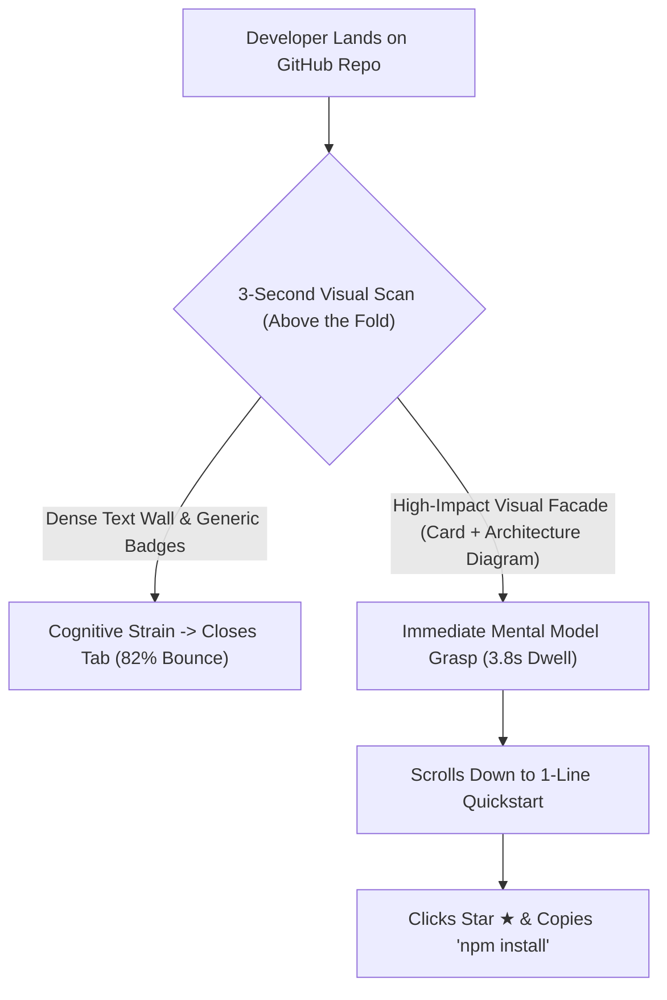

Every open-source maintainer has experienced this heartbreak:

You spend six months engineering an insanely fast, memory-efficient Rust library or Python framework. The code is modular, test coverage is 98%, and the benchmarks crush the competition.

You push to GitHub, post on Hacker News, and wait.

Result? 14 stars. 80% bounce rate within 4 seconds.

Why? Because in 2026, **developers do not evaluate your repo by cloning it and reading your source code**. They judge your project entirely on **the Visual Facade of your `README.md`**.

When a visitor lands on a wall of plain gray text and an intimidating 200-line installation section, they assume your project is abandoned or unmaintained. When they see a crisp, modern visual facade with high-contrast architecture diagrams and syntax-highlighted feature cards, their trust is established instantly.

This guide outlines **The 3-Second Repository Facade Architecture (RFA)** to skyrocket open-source adoption and star conversion.

---

## 1. The 3-Second Decision Window of a GitHub Visitor

Modern developers evaluating open-source tools on GitHub operate with ruthless brevity:



### The 3 Visual Proofs Developers Demand in Under 3 Seconds:
1. **The Instant Visual Metaphor**: A single, clean graphic showing what the tool actually does (e.g., an input $\rightarrow$ output comparison card).
2. **The "Single-Line Magic" Card**: An aesthetic, syntax-highlighted visual card showing how trivial the API is to invoke.
3. **Visual Architecture Legitimacy**: An elegant, high-contrast system topology diagram that proves the author understands systems engineering.

---

## 2. The 3-Second Repository Facade Architecture (RFA)

To maximize star conversion and community trust, structure your README hero section using **The 3-Second Repository Facade Architecture**:

```
┌──────────────────────────────────────────────────────────────┐
│  [Hero Header Banner: 1200x400 High-Contrast Obsidian Dark]   │
│  Project Logo + 1-Sentence Bold Mission Statement            │
├──────────────────────────────────────────────────────────────┤
│  [Dynamic Metrics Strip: Version | License | Zero-Dep | Rust]│
├──────────────────────────────────────────────────────────────┤
│  [Visual Proof Anchor: Markdown-to-Image Feature Card]       │
│  ┌────────────────────────────────────────────────────────┐  │
│  │  Before (Messy 40 Lines)  vs  After (Clean 3 Lines)    │  │
│  └────────────────────────────────────────────────────────┘  │
├──────────────────────────────────────────────────────────────┤
│  [1-Click Copy-Paste Quickstart Code Snippet]                │
└──────────────────────────────────────────────────────────────┘
```

| Section | Common Amateur Mistake | Top 1% Open Source Pattern |
| :--- | :--- | :--- |
| **Header** | Default H1 text `# my-cool-project` | Custom branded dark-mode visual header card |
| **Problem Statement**| 4 paragraphs of academic background | Visual diff card comparing the painful old way vs your fast way |
| **API Demonstration** | Low-contrast text code blocks | **High-DPI syntax-highlighted visual snippet cards** |
| **Architecture** | Convoluted raw text ASCII art | Polished Mermaid diagram or SVG flowchart |
| **Installation** | 15 prerequisite steps | `curl -fsSL https://... | sh` or single npm/cargo command |

---

## Making a Markdown card with NavoKit

Paste a README introduction or quick-start example into [NavoKit Markdown to Image](/en/tools/markdown-to-image). Organize it with headings, lists, tables, or code blocks, inspect the live preview, and export a PNG. Conversion runs in the browser and the image includes a NavoKit mark.

The current interface uses a fixed white card style. It has no theme, syntax-highlighting, window-frame, transparent-background, or aspect-ratio selector, and does not offer PDF, vector, or batch export. The image height follows the content, so split long material before exporting.

For a carousel or presentation, prepare and export each card separately, then assemble it in your publishing or presentation tool. Keep the original text and code links available for readers who need to copy them.

## Summary

In the hyper-competitive open-source landscape of 2026, great code that looks ugly dies in obscurity.

Give your repository the visual respect it deserves. Implement the Repository Facade Architecture, turn boring README code blocks into stunning visual cards, and watch your GitHub star count accelerate.
