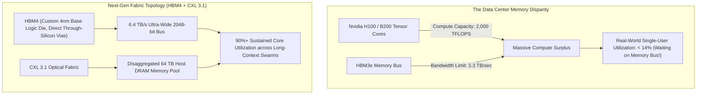

When the tech industry debates the future of artificial intelligence, headlines remain obsessed with raw compute: *Nvidia Blackwell vs. Rubin! 200,000 GPU clusters! 50 PFLOPS of FP4!*

Inside the engineering war rooms of hyperscale data centers, hardware architects know the bitter physical truth:

**Compute is not the bottleneck. The memory wall is.**

Modern GPU architectures can perform trillions of matrix floating-point operations per second. But those compute cores sit idle during single-batch LLM inference, starved of data while waiting for weights to travel across silicon interposers from High Bandwidth Memory (HBM).

By 2026, the industry is bumping against the thermodynamic and parasitic capacitance limits of copper interposers. The battle for the next generation of AI infrastructure will not be won with more tensor cores, but with **HBM4 3D-stacked logic dies** and **CXL 3.1 coherent memory fabric pooling**.

This technical teardown dissects the physics of datacenter memory architectures and introduces **The Memory-Compute Decoupling Topology**.

---

## 1. The Physics of the Memory Wall: Why FLOPS Sit Idle

In large language model inference, especially during the autoregressive token-by-token generation phase, the operational regime is strictly **Memory-Bandwidth Bound**:

$$\text{Arithmetic Intensity} = \frac{\text{FLOPs Executed}}{\text{Bytes Transferred from Memory}}$$



To generate a single token on a 70B parameter model, a GPU must fetch ~70 GB of weights. Even with modern HBM3e delivering 3.3 TB/s, reading those weights takes at least **21 milliseconds**, regardless of how many thousands of FLOPS the GPU has.

The GPU's mathematical engines spend 90% of their operational cycles essentially twiddling their thumbs.

---

## 2. HBM4: The Transition to 3D Active Base Dies

The leap from HBM3e to **HBM4** represents the most radical architectural disruption in semiconductor memory in a decade:

```
┌─────────────────────────────────────────────────────────────┐
│ 1. 16-High DRAM Die Stack (DRAM Layer 1..16)                │
│    Connected via millions of microscopic TSVs               │
├─────────────────────────────────────────────────────────────┤
│ 2. The Active 4nm Base Logic Die (The TSMC/SK Hynix Shift)  │
│    - Replaces passive silicon substrate with active logic   │
│    - Contains Near-Memory BIST, ECC, and Routing Logic      │
├─────────────────────────────────────────────────────────────┤
│ 3. 2048-bit Ultra-Wide Memory Bus (Doubled from 1024-bit)   │
│    - 6.4 TB/s per stack (Over 25 TB/s total GPU memory)     │
└─────────────────────────────────────────────────────────────┘
```

### The 3 Revolutionary Shifts in HBM4:
1. **Doubled Interconnect Width (2048-bit Interface)**: HBM has historically been locked to a 1024-bit interface. HBM4 doubles this to 2048 pins per stack, demanding unprecedented microscopic micro-bump density.
2. **Active Base Logic Dies**: Rather than using cheap passive silicon interposers, the bottom base die of the HBM4 stack is fabricated on cutting-edge **4nm / 3nm foundry logic nodes** (TSMC / Samsung), enabling compute-in-memory (PIM) primitives directly beneath the DRAM cells.
3. **Thermal Resistance Reductions**: Advanced hybrid bonding (direct copper-to-copper bonding without solder micro-bumps) slashes parasitic capacitance and thermal resistance, keeping 16-layer memory stacks below the dreaded 105°C thermal throttling ceiling.

---

## 3. The Tragedy of Stranded Memory vs. CXL 3.1 Pooling

While HBM4 solves extreme bandwidth for model weights, it does not solve **capacity**. Stacking HBM is hideously expensive—a single 192GB HBM3e memory configuration accounts for over 60% of the entire bill-of-materials cost of a GPU server.

Enter **Compute Express Link (CXL 3.1)**:

```mermaid
graph LR
    subgraph TraditionalCluster ["Static Stranded Memory (40% Waste)"]
        GPU1["GPU 1 (VRAM 100% Full)"]
        GPU2["GPU 2 (VRAM 20% Used)"]
        GPU1 -.->|"Cannot Borrow Memory!"| Fail["Cluster OOM Crash"]
    end

    subgraph CXLFabric ["CXL 3.1 Coherent Memory Pool"]
        GPUA["GPU Node A"] <===="PCIe Gen 6 / CXL Fabric"====> Pool["Disaggregated 32 TB Memory Appliance"]
        GPUB["GPU Node B"] <===="PCIe Gen 6 / CXL Fabric"====> Pool
        Pool --> Allocation["Dynamic Zero-Latency Allocation (Zero Stranded Memory)"]
    end
```

### The CXL 3.1 Revolution:
* In standard AI clusters, **over 40% of GPU memory sits "stranded"**—Node A runs out of memory for a 1M token context and crashes, while Node B sits idle with 80% free VRAM.
* CXL 3.1 enables **Disaggregated Shared Memory Pooling**: GPUs borrow memory across PCIe Gen 6 and optical switch fabrics with hardware-enforced cache coherency.
* KV caches for millions of tokens are offloaded from hyper-expensive HBM into pooled CXL DDR5 arrays, cutting cluster memory hardware costs by 70%.

---

## 4. Memory Architecture Comparison

| Memory Technology | Peak Bandwidth | Typical Capacity per Accelerator | Interconnect Mechanism | Primary AI Role |
| :--- | :--- | :--- | :--- | :--- |
| **DDR5 DRAM (Host)** | 300 GB/s – 600 GB/s | 1 TB – 4 TB | Motherboard DIMM Slots | Cold storage, system OS, raw dataset pre-processing |
| **HBM3e (Blackwell / MI300)**| 3.3 TB/s – 5.3 TB/s | 144 GB – 288 GB | 2.5D Silicon Interposer (CoWoS) | Model weights & active multi-tenant attention |
| **HBM4 (Next-Gen 2026)** | **6.4 TB/s – 10.0 TB/s**| **192 GB – 384 GB** | **3D Hybrid Cu-Cu Direct Bonding** | Ultra-dense frontier models, real-time reasoning |
| **CXL 3.1 Fabric Pool** | 1.0 TB/s – 2.0 TB/s | **16 TB – 128 TB (Shared Pool)**| **PCIe Gen 6 / Coherent Optical Fabric**| **Massive multi-million-token KV cache offload** |

---

## Summary

The frontier of AI is no longer a battle of algorithms; it is a battle of **condensed matter physics and semiconductor packaging**.

As model architectures scale, raw compute FLOPS will continue to deflate into a cheap commodity. The real economic moat of future AI datacenters belongs to the infrastructure architects who master the physical pipeline of memory—bridging 3D-stacked HBM4 on the chip with flexible, coherent CXL pools across the fabric.
