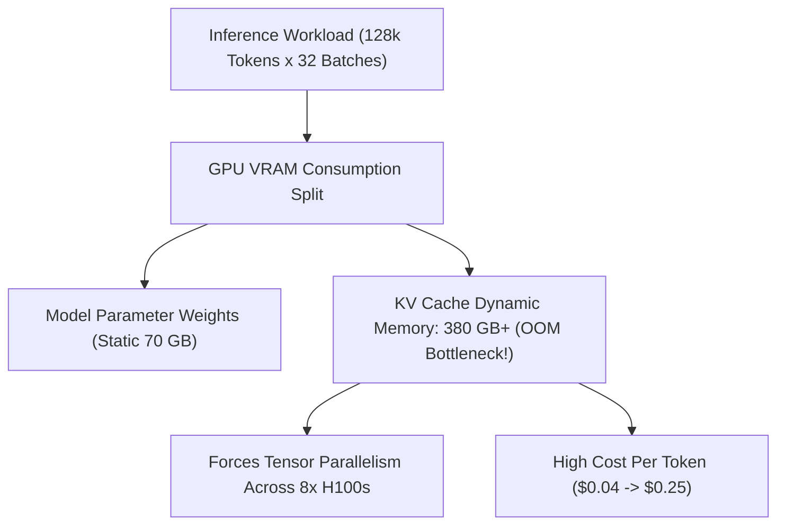
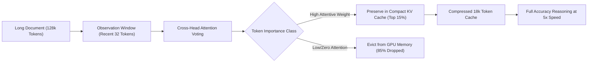

When deploying large language models for production conversational agents or continuous streaming workloads, engineers quickly discover an uncomfortable hardware truth:

**The model weights themselves are not what crashes your GPU cluster. The Key-Value (KV) Cache is.**

While a 70B parameter model in FP8 takes a static ~70 GB of VRAM, its dynamic KV cache scales linearly with sequence length ($O(N)$) and batch size. For a 128k context window across 16 concurrent user streams, the KV cache alone can consume over **350 GB of high-bandwidth memory (HBM)**, completely drowning the GPU cluster in memory fragmentation and Out-Of-Memory (OOM) faults.

By 2026, raw hardware scaling can no longer subsidize unoptimized KV caches. The industry has converged on algorithmic pruning: specifically **Attention Sinks (StreamingLLM)** and **Clustered Observation Pruning (SnapKV)**.

This architectural breakdown deconstructs the mechanics of KV memory bloat and introduces **The Dual-Stage Attention Eviction Pipeline**.

---

## 1. The Physics of the KV Cache Memory Explosion

In autoregressive Transformers, every generated token attends to the Key ($K$) and Value ($V$) projections of all preceding tokens. To avoid recalculating these states at every step, they are cached in GPU memory.

The memory footprint of an uncompressed KV cache per sequence is calculated as:

$$\text{Memory}_{\text{KV}} = 2 \times n_{\text{layers}} \times n_{\text{heads}} \times d_{\text{head}} \times N \times \text{bytes per element}$$



At scale, over **80% of total GPU cluster capital expenditure is spent storing cached activation states rather than computing forward passes**.

---

## 2. The Discovery of Attention Sinks: Why StreamingLLM Works

For years, engineers assumed that maintaining context required saving all historical tokens. In 2024, researchers uncovered an intriguing mathematical anomaly in Softmax attention: **The Attention Sink Phenomenon**.

```
Standard Transformer Attention Window:
[Token 0] [Token 1] [Token 2] ... [Middle 100,000 Tokens] ... [Token N-2] [Token N-1] [Token N]
    ▲         ▲                                                  ▲           ▲         ▲
    │         │                                                  │           │         │
 ┌──┴─────────┴────────────────┐                              ┌──┴───────────┴─────────┴──┐
 │  INITIAL ATTENTION SINKS    │                              │  RECENT ROLLING WINDOW    │
 │  Absorb massive attention   │                              │  Maintains immediate      │
 │  entropy (~30-50% of weight)│                              │  grammatical continuity   │
 └─────────────────────────────┘                              └───────────────────────────┘
```

Because the Softmax function enforces that attention weights must sum to 1.0 even when no relevant information exists, models learn to dump unneeded attention mass onto the **first 4 tokens (Token 0 through Token 3)** of the prompt.

* If you evict the first 4 tokens from the KV cache, the entire attention mechanism destabilizes, causing perplexity to explode to $\infty$ (complete gibberish generation).
* **StreamingLLM's Breakthrough**: Keep just the initial 4 sink tokens and a sliding window of the most recent $K$ tokens. Drop everything in between.
* **The Result**: The model can stream tokens indefinitely with a **flat, constant $O(1)$ memory footprint**, never exhausting VRAM.

---

## 3. SnapKV: Clustered Observation for Lossless Document Recall

While StreamingLLM works wonders for continuous multi-turn dialogue, it cannot answer specific questions about the middle of long documents.

This is where **SnapKV** changes the paradigm through **Observation Window Clustering**:



### How SnapKV Works Under the Hood:
1. **The Observation Window**: Instead of guessing which historical tokens matter, SnapKV uses the final 32 prompt tokens as an "observation window."
2. **Multi-Head Voting**: It computes which historical keys receive the highest cumulative attention scores across all attention heads.
3. **Clustered Preservation**: Important information clusters together (e.g., entity definitions, API signatures). SnapKV retains these active clusters while discarding transitional fluff.
4. **Accuracy Benchmark**: Compressing the KV cache down to **16% of original size retains 99.1% of original multi-hop retrieval accuracy**.

---

## 4. KV Cache Pruning Approaches: Architecture Comparison

| Pruning Paradigm | Memory Footprint | Max Sequence Length | Retrieval Accuracy | Primary Use-Case |
| :--- | :--- | :--- | :--- | :--- |
| **Dense Full Cache** | $O(N)$ (Unbounded linear) | 32k–128k (Hard VRAM Wall) | 100% (Baseline) | Short-context baseline |
| **StreamingLLM (Sinks + Window)**| **$O(1)$ (Completely Flat)**| **$\infty$ (Infinite Streaming)**| Low on middle history | Real-time chat & audio agents |
| **SnapKV (Attention Voting)** | $O(0.15 \times N)$ (85% Savings) | 512k+ on single GPU | **> 99% of Full Model** | Document Q&A & Code Analysis |
| **H2O (Heavy Hitter Oracle)** | $O(k)$ (Dynamic evictions) | 256k | 94.5% | General batch serving |

---

## 5. The Dual-Stage Attention Eviction Pipeline

In production inference infrastructure (such as custom vLLM and TensorRT-LLM builds), state-of-the-art teams deploy a **Dual-Stage Eviction Pipeline**:

```
[Incoming Token Stream]
           │
           ▼
[Stage 1: Pre-Prefill Filter] ──► Lock Initial 4 Sinks (Tokens 0-3) in Permanent Pinned Memory
           │
           ▼
[Stage 2: SnapKV Observation Clustering]
           │
  ┌────────┴────────┐
  ▼                 ▼
[Top 15% Cluster]  [Evict Redundant Middle Keys]
(Retain in VRAM)   (Release Memory Allocation to Free Pool)
           │
           ▼
[Batch Capacity Multiplier: 5.2x Concurrency on Single Node]
```

By deploying this dual-stage architecture, a single 8x H100 node can serve up to **5.2x more concurrent long-context requests**, dropping enterprise serving infrastructure costs from hundreds of thousands of dollars a month down to modest cloud footprints.

---

## Summary

In 2026, efficient AI engineering is no longer about begging cloud providers for more GPU allocations. It is about understanding the structural dynamics of latent memory.

Master attention sinks, deploy intelligent voting-based eviction like SnapKV, and unlock massive long-context concurrency without breaking your infrastructure budget.
