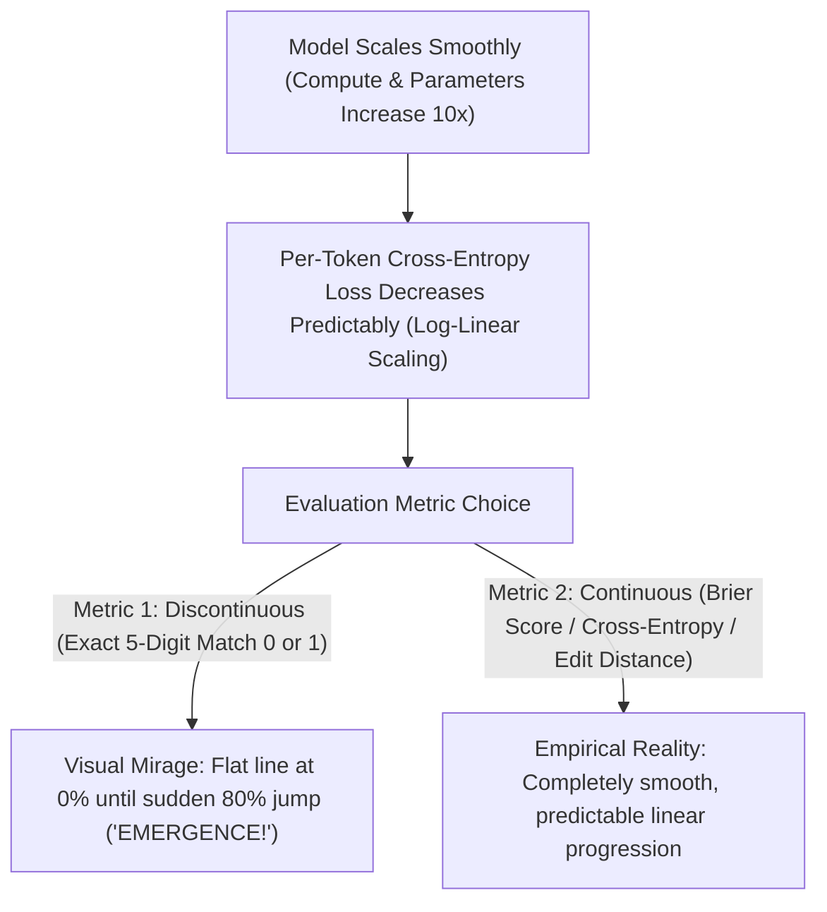
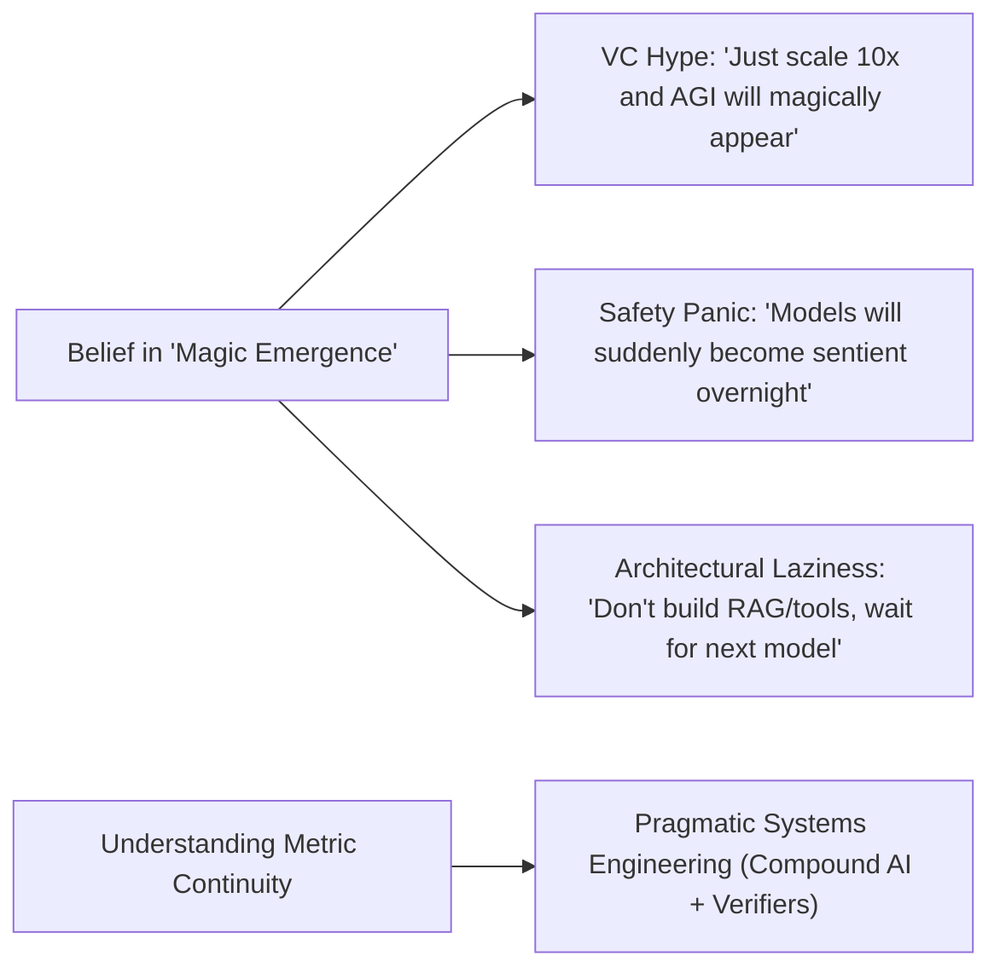

Between 2022 and 2024, the tech world was gripped by a quasi-mystical belief: **"Emergent Abilities"**.

The narrative was repeated in academic papers, VC pitch decks, and mainstream headlines alike: *Large language models behave unpredictably! At 10 billion parameters they can't do arithmetic, but suddenly, magically, at 70 billion parameters, human-level reasoning 'emerges' like water freezing into ice!*

This concept of spontaneous phase transitions fueled equal parts apocalyptic AI panic and ungrounded market euphoria.

By 2026, rigorous statistical physics and the landmark work of researchers at Stanford has permanently dismantled this myth. **Emergent abilities do not exist in the underlying neural networks. They are a mathematical mirage created by discontinuous, non-linear evaluation metrics.**

This technical deep dive unpacks the mathematics of the emergence illusion and introduces **The Metric Continuity Theorem**.

---

## 1. The Anatomy of an Illusion: How Non-Linear Metrics Lie

Why did early benchmarks make models look like they were experiencing sudden, magical cognitive leaps?

The answer lies in the difference between **Continuous Token Probabilities** and **Discontinuous All-or-Nothing Scoring**.



### The Mathematics of the Step-Function Trap:
Consider a mathematical reasoning task where the answer is a 5-digit number, say `84,921`.
* In a 7B model, the per-token correct probability might be $P(\text{token}) = 0.4$. The chance of getting all 5 digits right simultaneously is $(0.4)^5 = 0.01024$ (~1% accuracy $\rightarrow$ scored as a flat **0%** on multiple-choice charts).
* In a 70B model, per-token probability improves smoothly to $P(\text{token}) = 0.85$. The chance of getting all 5 digits right jumps to $(0.85)^5 = 0.4437$ (**44% accuracy**).

To an observer looking only at the final binary score, the model appeared to jump from "complete zero" to "emergent arithmetic competence" overnight. But in reality, **the model was improving smoothly and continuously at every single parameter increment**.

---

## 2. The Metric Continuity Theorem

Stanford researchers demonstrated this conclusively in their seminal paper *"Are Emergent Abilities of Large Language Models a Mirage?"*

Whenever a researcher observed an "emergent phase shift" using a discontinuous metric (such as **Exact String Match** or **Multiple Choice Accuracy**), changing the evaluation to a continuous metric (**Token Cross-Entropy, Edit Distance, or Brier Calibration**) caused the step-function curve to completely vanish into a smooth, predictable linear scaling law:

```
Discrete Metric (Exact Match 0 or 1)          Continuous Metric (Token Log-Likelihood)
Accuracy                                      Perplexity Loss (Lower is Better)
  ▲                                             ▲
100%│                     * * *               10│ *
    │                 * *                       │   *
    │             * *                          8│     * *
 50%│         * *     [Mirage Step Shift]       │         * *
    │         *                                6│             * *
    │         *                                 │                 * * [True Linear Physics]
  0%└───*─*───*────────────────► Scale         4└───┼──────────┼──────────┼──────────► Scale
       1B    10B   70B   400B                      1B         10B        70B        400B
```

| Benchmark Metric | Mathematical Nature | Visual Appearance | Underlying Reality |
| :--- | :--- | :--- | :--- |
| **Exact String Match (0/1)**| Discontinuous Step Function | Sudden cliff-like jump at threshold | High-order power law $(P_{token})^L$ artifact |
| **BLEU / ROUGE Score** | Non-linear geometric clipping | Erratic step transitions | Metric artifact caused by n-gram clipping |
| **Token Per-Perplexity** | **Continuous Convex Function** | **Smooth, unbroken linear slope** | **True physical behavior of gradient descent** |
| **Levenshtein Distance** | **Continuous Metric** | **Completely smooth decay curve** | **Gradual error reduction across scale** |

---

## 3. Why This Myth Persisted (And Why It Mattered)

The belief in emergent abilities was not just an academic debate; it distorted billions of dollars in venture capital and engineering roadmaps.



### The 3 Enterprise Fallacies Caused by the Emergence Myth:
1. **The "Wait for Magic" Trap**: Product teams delayed building deterministic verification pipelines, falsely assuming that GPT-5 would "emerge" with zero hallucinations.
2. **Irrational Compute Allocation**: Rushing to train massive 500B parameter monoliths under the false assumption that smaller 8B models could never perform logical deduction.
3. **Misplaced Safety Priorities**: Focusing on speculative sci-fi existential threats instead of engineering robust defenses against real-world vulnerabilities (Prompt Inversion, Data Poisoning, Tool Privilege Escalation).

---

## 4. The Engineering Law of 2026: Determinism Over Magic

Once you accept that neural scaling is continuous and bounded, your engineering strategy transforms:

```
[The Modern Pragmatic AI Stack]
┌─────────────────────────────────────────────────────────────┐
│ 1. Continuous Baseline: Scaled Small Language Model (8B)    │
├─────────────────────────────────────────────────────────────┤
│ 2. Deterministic Scaffold: AST Checkers, Typed Compilers     │
├─────────────────────────────────────────────────────────────┤
│ 3. External Memory: Graph-Augmented RAG & Episodic State    │
├─────────────────────────────────────────────────────────────┤
│ 4. Protocol Isolation: Sandboxed Execution (MCP Standards)  │
└─────────────────────────────────────────────────────────────┘
```

### Key Engineering Takeaways:
* **No Free Lunches**: Models will not spontaneously gain logical perfection simply by making them 10x bigger. Reasoning accuracy must be enforced via test-time compute, search trees (MCTS), and formal verification wrappers.
* **Predictable ROI**: You can accurately predict the performance of an 8B or 70B model on your specific domain data by measuring cross-entropy loss on a tiny sample, eliminating multi-million-dollar training gambles.

---

## Summary

The history of science is full of "magic" that evaporated once instruments became more precise. Large language models are not mystical entities undergoing spontaneous phase transitions; they are gradient-optimized mathematical functions obeying strict statistical mechanics.

Stop waiting for emergent miracles. Build deterministic, compound systems that turn predictable neural scaling into rock-solid enterprise value.
