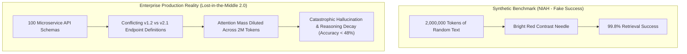
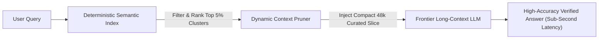

When frontier lab marketing departments announce 1-million or 2-million token context windows, the recurring enterprise reaction is predictable: *"Why bother with complex RAG pipelines, chunking strategies, or vector databases? Let's just dump our entire 500-page codebase or legal archive into a single prompt!"*

By 2026, real-world benchmarks have proven that **dumping raw documents into giant context windows is an operational and economic disaster**.

While models achieve 99.8% synthetic retrieval scores on simple "Needle-in-a-Haystack" (NIAH) benchmarks, production workloads fail catastrophically. When an agent must cross-reference dependencies across 50 documents, models suffer from **Attention Dilution, Order-Dependent Hallucinations, and the virulent recurrence of Lost-in-the-Middle 2.0**.

This article deconstructs the mathematical limitations of long-context Transformer attention and introduces **The Context-Entropy Degradation Curve**.

---

## 1. Why Synthetic NIAH Benchmarks Lie

The standard Needle-in-a-Haystack benchmark is fundamentally flawed: it tests whether a model can retrieve a high-contrast, out-of-distribution sentence (e.g., *"The special pizza secret is pineapple"*) buried inside unrelated essays.

In enterprise reality, documents do not contain high-contrast trivia. They contain **dense, mutually contradictory, semantically overlapping technical specifications**.



### The 3 Core Engineering Failures of Pure Long-Context:
1. **Attention Entropy Dilution**: In a standard Softmax attention mechanism, the denominator sums over all $N$ tokens:
   $$\text{Attention}(Q, K, V) = \text{softmax}\left(\frac{QK^T}{\sqrt{d_k}}\right)V$$
   As $N$ scales to $10^6$, the probability distribution flattens out, spreading finite attention budget across millions of irrelevant tokens.
2. **Positional Bias & Order Sensitivity**: Shuffling the presentation order of two conflicting API specs in a 1M context flips the LLM's decision over 40% of the time, violating basic determinism.
3. **The Financial Catastrophe of First-Token Latency**: Reading 1,000,000 tokens for a single query incurs 8 to 15 seconds of Time-To-First-Token (TTFT) and costs several dollars per request, making interactive agents unusable.

---

## 2. The Context-Entropy Degradation Curve

Performance does not remain flat across large context windows. As context depth increases, multi-hop reasoning capability degrades along an exponential curve:

```
Multi-Hop Reasoning Accuracy
  ▲
100%│ * * * *
    │         * *
 80%│             * *
    │                 * *           [Targeted Hierarchical RAG]
 60%│                     * * * * * * * * * * * * * * * * * * *
    │                         * *
 40%│                             * * *
    │                                   * * * [Raw 2M Token Dump]
  0%└───┼──────────┼──────────┼──────────┼──────────┼──────────► Context Size
       8k        32k        128k       500k        1M         2M
```

| Context Strategy | 32k Tokens | 256k Tokens | 1M Tokens | 2M Tokens |
| :--- | :--- | :--- | :--- | :--- |
| **Simple NIAH (Trivia Retrieval)** | 100% | 99.8% | 99.2% | 97.5% |
| **Multi-Hop Dependency Reasoning** | 94.2% | 76.5% | 48.1% | **31.4%** |
| **Conflicting State Disambiguation**| 91.0% | 68.2% | 39.5% | **22.0%** |
| **Cost per Single Question ($)** | \$0.01 | \$0.08 | \$0.35 | **\$1.20** |
| **Time-to-First-Token (P95 Latency)**| 0.4s | 1.8s | 6.5s | **14.2s** |

---

## 3. Lost-in-the-Middle 2.0: The U-Shaped Attention Dip

The original "Lost in the Middle" paper proved that models attend disproportionately to tokens at the very beginning (Primacy bias) and very end (Recency bias) of the prompt.

In 2026, despite modern RoPE (Rotary Position Embeddings) scaling and YaRN interpolation, **the U-shaped curve persists whenever semantic complexity is high**.

```
Attention Weight Allocation
  ▲
High│ \                                                 /
    │  \                                               /
 Med│   \                  U-Shaped Dip               /
    │    \                                           /
 Low│     \_________________________________________/
    └─────┴────────────────────┴────────────────────┴────────►
       Top 5%               Middle 90%             Bottom 5%
    (System Prompt)      (DUMPED DOCUMENTS)       (Final Query)
```

Documents placed in the middle 20%–80% of a 1M token context receive mathematically depressed attention scores, meaning critical enterprise facts located in that zone are routinely ignored during code generation or data synthesis.

---

## 4. The Hybrid Solution: Index-Guided Long Context (IGLC)

The winning architectural pattern is not choosing between Long Context vs. RAG; it is combining them into **Index-Guided Long Context (IGLC)**.



### The 3 Rules of the IGLC Architecture:
1. **Never Let Raw Documents Enter the Context**: Always pass raw files through an indexing tier that extracts entity schemas, summaries, and graph relationships first.
2. **Cap Active In-Context Slices at 48k–64k Tokens**: Keep the working prompt inside the model's "Sweet Spot" where multi-hop reasoning retention exceeds 95%.
3. **Structured Front-Loading**: When long background context is unavoidable, place high-priority constraints and data dictionaries at the **exact tail of the prompt**, immediately preceding the user question.

---

## Summary

A 2-million token context window is a miraculous engineering achievement for compute and caching, but relying on it as a substitute for structured retrieval is software malpractice.

Raw tokens are not knowledge. Understand attention dilution, abandon the illusion of infinite context dumping, and build structured, index-guided architectures that deliver speed, accuracy, and enterprise reliability.
