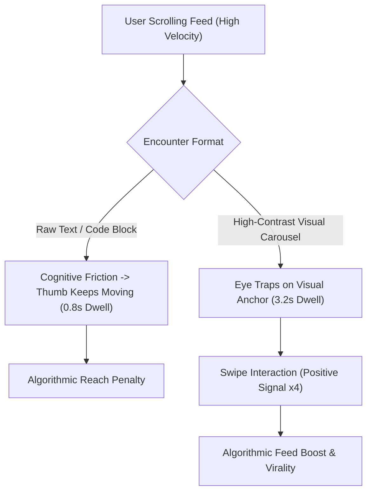

If you are a developer, technical marketer, or startup founder trying to share code snippets or architecture insights on social media, you have likely noticed a painful reality:

**Posting walls of text or raw code blocks produces virtually zero engagement.**

On both LinkedIn and X (formerly Twitter), feed recommendation algorithms are ruthlessly optimized for two core signals: **Dwell Time** (how many seconds a user pauses on your post) and **Micro-Engagements** (swiping through carousel slides, expanding images, bookmarking).

When a user scrolls past a 40-line text dump, their thumb keeps moving in under 0.8 seconds. When they encounter a crisp, high-contrast, syntax-highlighted visual card, their cognitive eye-tracking pattern shifts immediately.

This guide breaks down the cognitive science of developer feeds and provides **The 4-Slide Micro-Narrative Loop** to turn raw Markdown into viral social carousels.

---

## 1. The Algorithm of Visual Attention in 2026

Modern social algorithms no longer measure success purely on vanity likes; they measure **Information Density vs. Scroll Velocity**.



### The 3 Visual Triggers That Stop the Scroll:
1. **The Syntax Highlighting Reflex**: Developers and engineers have been conditioned over decades to parse colors (keywords in purple, strings in green, types in blue) 5x faster than monochrome text.
2. **The Swipe Completion Multiplier**: On LinkedIn, PDF/image carousels trigger a distinct ranking bonus every time a user swipes from Slide 1 to Slide 2.
3. **Save-Rate (Bookmark) Dominance**: A clean visual card looks like a collectible reference cheat-sheet, driving 300% higher bookmark rates than plain text threads.

---

## 2. The 4-Slide Micro-Narrative Loop

To achieve maximum retention without overwhelming your audience, structure every technical carousel using **The 4-Slide Micro-Narrative Loop**.

```
┌─────────────────┐   ┌─────────────────┐   ┌─────────────────┐   ┌─────────────────┐
│ Slide 1: HOOK   │   │ Slide 2: THE BUG│   │ Slide 3: FIX    │   │ Slide 4: SUMMARY│
│                 │   │                 │   │                 │   │                 │
│ Bold statement  ├──►│ The naive/wrong ├──►│ Elegant pattern ├──►│ Takeaway rule   │
│ + preview badge │   │ code pattern    │   │ + highlighted diff│ │ + CTA           │
└─────────────────┘   └─────────────────┘   └─────────────────┘   └─────────────────┘
```

| Slide Number | Cognitive Role | Design Rule | Ideal Content Format |
| :--- | :--- | :--- | :--- |
| **Slide 1** | **The Hook Anchor** | Giant title, zero clutter, high contrast | Big problem statement (e.g., *"Why your `useMemo` is leaking memory"*) |
| **Slide 2** | **The Common Trap** | Red highlight, anti-pattern code | 6–8 lines of flawed code with a concise callout bubble |
| **Slide 3** | **The Elegant Fix** | Green highlight, syntax diff | The optimized architecture / refactored code |
| **Slide 4** | **The Mental Model & CTA** | Structured checklist or summary table | 3-bullet golden rule + save/share prompt |

---

## Making a Markdown card with NavoKit

Paste one card at a time from a longer outline into [NavoKit Markdown to Image](/en/tools/markdown-to-image). Organize it with headings, lists, tables, or code blocks, inspect the live preview, and export a PNG. Conversion runs in the browser and the image includes a NavoKit mark.

The current interface uses a fixed white card style. It has no theme, syntax-highlighting, window-frame, transparent-background, or aspect-ratio selector, and does not offer PDF, vector, or batch export. The image height follows the content, so split long material before exporting.

For a carousel or presentation, prepare and export each card separately, then assemble it in your publishing or presentation tool. Keep the original text and code links available for readers who need to copy them.

## Summary

In the attention economy of 2026, the clarity of your presentation dictates the reach of your ideas.

Stop losing organic reach to bland text formatting. Convert your Markdown documentation, code snippets, and mental models into high-converting visual carousels and dominate developer feeds.
