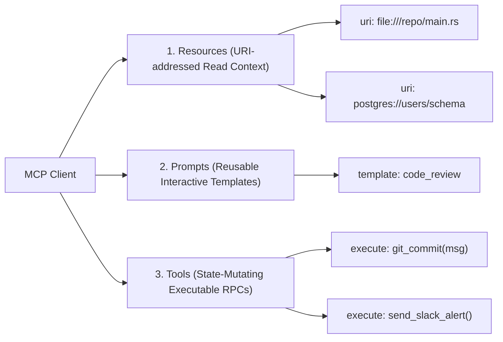

Between 2023 and early 2025, every engineering team building LLM agents repeated the exact same mistake: writing brittle, custom JSON glue code for every external tool, API, and database.

If you had five internal microservices and wanted to connect them to three different model providers (Anthropic, OpenAI, local OSS models), you ended up building and maintaining $5 \times 3 = 15$ bespoke integration adapters. Each adapter had its own error handling, schema serialization quirks, rate limit wrappers, and authorization lifecycles.

This $M \times N$ integration sprawl is the silent killer of enterprise agent velocity.

The release and rapid open-source adoption of the **Model Context Protocol (MCP)** has permanently solved this fragmentation. Analogous to what the Language Server Protocol (LSP) did for IDEs and programming languages, MCP decouples the LLM application host from the underlying data and tool providers.

This technical breakdown dissects the transport layers, capability negotiation, and security architecture of MCP, introducing **The 3-Tier MCP Decoupled Topology**.

---

## 1. The $M \times N$ Integration Problem vs. MCP Universal Protocol

Before MCP, tools were tightly coupled to model-specific function calling schemas. A schema defined for OpenAI's `tools` parameter would fail silently or behave unpredictably when mapped into Anthropic's `tool_choice` or LangChain abstractions.

```mermaid
graph TD
    subgraph Legacy ["Legacy Bespoke Integrations (M x N Spaghetti)"]
        A1[Agent A] --> T1[Postgres DB]
        A1 --> T2[GitHub API]
        A2[Agent B] --> T1
        A2 --> T3[Slack]
        A3[Agent C] --> T2
        A3 --> T3
    end

    subgraph MCPTopology ["MCP Universal Topology (M + N Linear Standard)"]
        Host1[Claude Desktop / Custom Host] --> Client[MCP Client]
        Host2[Cursor / IDE Agent] --> Client
        Client <===="JSON-RPC 2.0 (stdio / SSE)"====> S1[MCP Server: Postgres]
        Client <===="JSON-RPC 2.0 (stdio / SSE)"====> S2[MCP Server: GitHub]
        Client <===="JSON-RPC 2.0 (stdio / SSE)"====> S3[MCP Server: Slack]
    end
```

### Why MCP Solves the Architectural Bottleneck:
1. **Universal Protocol Standard**: Replaces custom REST contracts with standard **JSON-RPC 2.0** over `stdio` (local subprocesses) or Server-Sent Events (`SSE` for remote networks).
2. **Dynamic Capability Negotiation**: When a client initializes a connection with an MCP server, both parties negotiate supported primitives: **Resources** (read-only data), **Prompts** (pre-engineered workflows), and **Tools** (executable functions).
3. **Write-Once, Run-Everywhere**: An engineering team writes one MCP server for their enterprise Elasticsearch cluster. That server immediately works with Claude Desktop, Cursor, bespoke internal LangGraph swarms, and autonomous CLI agents.

---

## 2. The 3-Tier MCP Decoupled Topology

The MCP specification defines three distinct operational tiers:

```
┌─────────────────────────────────────────────────────────────────┐
│ 1. MCP Host (The AI Application)                                │
│    - Coordinates LLM context, UI rendering, user approvals     │
│    - Houses the LLM reasoning loop                              │
└───────────────────────────────┬─────────────────────────────────┘
                                │ Internal API
┌───────────────────────────────▼─────────────────────────────────┐
│ 2. MCP Client                                                   │
│    - Maintains 1:1 stateful connections to multiple servers     │
│    - Dispatches JSON-RPC requests, parses responses             │
└───────────────────────────────┬─────────────────────────────────┘
                                │ stdio / SSE (JSON-RPC 2.0)
         ┌──────────────────────┼──────────────────────┐
         ▼                      ▼                      ▼
┌──────────────────┐   ┌──────────────────┐   ┌──────────────────┐
│ 3a. Local Server │   │ 3b. Remote Server│   │ 3c. Cloud Server │
│ (Local Git / FS) │   │ (Internal DB)    │   │ (Third-party SaaS│
└──────────────────┘   └──────────────────┘   └──────────────────┘
```

| Component | Responsibility | Failure Domain |
| :--- | :--- | :--- |
| **MCP Host** | Drives the high-level user loop, manages LLM keys, prompts the user for tool execution approval. | UI crash or token budget exhaustion. |
| **MCP Client** | Handles connection pooling, protocol handshake, capability versioning, and ping heartbeats. | Network disconnection, protocol version mismatch. |
| **MCP Server** | Exposes concrete domain primitives (e.g., querying SQLite, sending a webhook, fetching Jira tickets). | Upstream API 500 error or database deadlock. |

---

## 3. The 3 Core Primitives: Resources, Prompts, and Tools

Unlike traditional function calling which treats everything as an arbitrary JSON payload, MCP cleanly categorizes context into three distinct architectural primitives:



### A. Resources (Passive Context Injection)
* Addressed via standard URIs: `file:///workspace/src/lib.rs`, `postgres://cluster/metrics`.
* Completely read-only and deterministic. The LLM can subscribe to resource updates, allowing servers to stream real-time logs or file changes directly into the agent's context without re-querying.

### B. Prompts (User-Facing Workflow Templates)
* Pre-packaged interactive recipes exposed by the server to guide user intent (e.g., `/debug-pipeline`, `/optimize-sql`).
* Allows domain-expert backend engineers to package prompt guidelines directly alongside their tools.

### C. Tools (Active Side-Effect Executions)
* Functions that modify state or execute code.
* MCP explicitly enforces **Human-in-the-Loop (HITL)** semantics: the host can intercept tool call invocations and require interactive user confirmation before sending execution grants.

---

## 4. MCP vs. Traditional Function Calling

| Architectural Dimension | Traditional Function Calling (e.g. OpenAI Tools) | Model Context Protocol (MCP) |
| :--- | :--- | :--- |
| **Coupling** | Tightly coupled to specific model provider SDK | Model-agnostic; decoupled via standard JSON-RPC 2.0 |
| **Transport** | Embedded directly within single HTTP inference request | Clean decoupled transport (`stdio`, HTTP/SSE, WebSockets) |
| **Statefulness** | Stateless; full schema re-transmitted on every turn | Stateful handshake; cached capabilities and subscriptions |
| **Security Boundary** | Implicit in client application code | Explicit capability negotiation and per-tool authorization |
| **Extensibility** | Rebuilding backend adapters for every new agent framework | Drop-in standard; any MCP client connects instantly |

---

## 5. Security Engineering: Sandboxing MCP in Production

Exposing executable tools to an autonomous agent creates real attack surfaces, particularly regarding **Remote Code Execution (RCE)** and **Privilege Escalation**.

```
[MCP Client] ───(JSON-RPC: tools/call)───► [Kernel Sandbox Gateway]
                                                    │
                   ┌────────────────────────────────┴────────────────────────────────┐
                   ▼                                                                 ▼
      [Inspection: Stdio Pipe]                                          [Inspection: SSE Network]
      - Enforce strict UID / GID                                       - Mutual TLS (mTLS) Auth
      - Mount read-only file systems                                    - Per-IP rate limiting
      - Intercept unapproved syscalls                                   - Zero-Trust Bearer tokens
```

### Production Security Directives:
1. **Enforce `stdio` Process Isolation**: When running local MCP servers, spawn them inside isolated containerized namespaces (e.g., Docker or Apple Sandbox Profile) with read-only root filesystems.
2. **Explicit User Approval Gates**: Never automatically grant write permissions to tools with destructive potential (`rm -rf`, `DROP TABLE`, `git push --force`). Use MCP's native approval notifications.
3. **Strict Schema Type Validation**: Sanitize all parameters using Zod or Pydantic before passing them to internal shell executions to prevent argument injection attacks.

---

## Summary

The industry has moved past the era of ad-hoc prompt-embedded tool definitions. Just as REST standardized the web and LSP standardized developer tooling, **MCP has established the definitive protocol standard for autonomous AI agents**.

Building an AI agent stack without MCP in 2026 is the modern equivalent of writing custom database drivers for every web page you deploy. Standardize on MCP, decouple your tools, and eliminate integration debt permanently.
