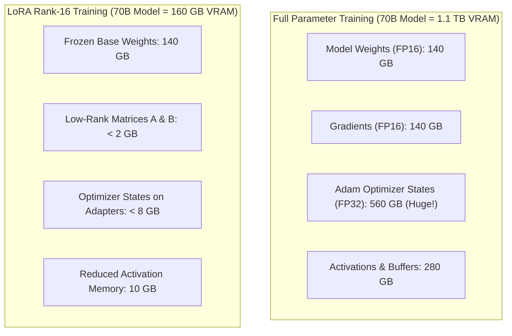
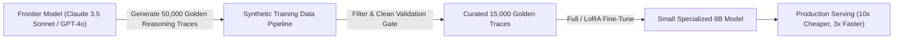

In the early hype cycle of generative AI, every enterprise engineering team wanted to "train their own foundation model."

By 2026, CFOs and VP of Engineering have learned the harsh economic reality: **pre-training from scratch is a capital furnace, and indiscriminate full-parameter fine-tuning is usually financial malpractice**.

Adapting open-weight models (such as Llama-3.3, Mistral, and Qwen) to custom domain data requires making critical mathematical trade-offs between **Memory Footprint, Adapter Swapping Latency, Catastrophic Forgetting, and Long-Term Serving Unit Economics**.

Should you train a low-rank adapter (LoRA)? Squeeze weights into 4-bit precision (QLoRA)? Execute a full-rank gradient update? Or distill a frontier teacher model into an 8B edge worker?

This guide breaks down the true total cost of ownership (TCO) across model adaptation strategies and introduces **The Adaptation Efficiency Frontier (AEF)**.

---

## 1. The Mathematical Physics: Where the Compute Dollars Go

To understand why full-parameter fine-tuning costs $15\times$ more than LoRA, look at the memory allocation during a standard backpropagation pass.



### The Adam Optimizer Tax:
* For every single parameter $\theta$, the AdamW optimizer stores two 32-bit floating-point state tensors: the first moment (momentum) and the second moment (variance).
* That means a 70B parameter model requires **$70 \times 10^9 \times 8 \text{ bytes} = 560\text{ GB}$ of pure optimizer overhead**, completely independent of batch size or context length!
* **The LoRA Alternative**: By freezing the base matrix $W_0 \in \mathbb{R}^{d \times k}$ and learning only two low-rank matrices $A \in \mathbb{R}^{r \times k}$ and $B \in \mathbb{R}^{d \times r}$ (where $r \ll d$, e.g., $r=16$), the optimizer state drops from 560 GB to under 8 GB.

---

## 2. The Adaptation Efficiency Frontier (AEF)

Every enterprise adaptation project sits somewhere along **The Adaptation Efficiency Frontier**:

```
Domain Knowledge Ingestion Depth
  ▲
High│                                           [Full-Parameter Fine-Tuning]
    │                                     * * * *
    │                              * * *
 Med│                       * * * [LoRA / DoRA Rank-64]
    │                * * *
 Low│         * * * [QLoRA 4-bit]
    │  * * * [Prompt In-Context RAG]
  0%└───┼──────────┼──────────┼──────────┼──────────┼──────────►
       $100      $1,000     $10,000    $50,000   $250,000+   Training Cost (TCO)
```

| Strategy | Hardware Required for 70B | Training Cost (Typical Run) | Multi-Tenant Serving Overhead | Knowledge Retention |
| :--- | :--- | :--- | :--- | :--- |
| **In-Context Prompting** | None (API only) | \$0 upfront | High ongoing token costs | Zero internal weight updates |
| **QLoRA (4-bit NF4)** | 2x A100 (80GB) | \$80 – \$300 | Dynamic LoRA adapter hot-swapping | High format alignment, moderate new knowledge |
| **LoRA (FP16 / BF16)** | 4x A100 (80GB) | \$400 – \$1,500 | Multi-LoRA batching (vLLM / SGLang) | Strong task alignment, low forgetting |
| **Full Fine-Tuning** | 16x H100 (80GB) | \$12,000 – \$45,000 | Requires dedicated cluster per fine-tune | **Maximal deep domain synthesis** |
| **Teacher Distillation**| Frontier API + 4x A100 | \$2,500 – \$8,000 | Extremely cheap (running small 8B worker) | High task efficiency, lower generality |

---

## 3. When Full-Parameter Fine-Tuning is Mandatory (And When It's Waste)

### Use Full Fine-Tuning ONLY When:
1. **Introducing a New Natural Language or Code Syntax**: LoRA cannot easily synthesize new phonetic or morphological tokens because the underlying embedding matrices are frozen. If you are training a model on COBOL, Erlang, or medical Latin, full backprop is required.
2. **Overhauling Reasoning Paradigms**: When altering the model's fundamental chain-of-thought verification style.

### Use LoRA / QLoRA For Everything Else:
* **Style & Tone Alignment**: Enforcing corporate brand guidelines or specific JSON schemas.
* **Multi-Tenant SaaS Serving**: You can serve 500 different enterprise customers from a **single shared base 70B model** in VRAM, swapping lightweight 50MB LoRA adapter weights in memory on a per-request basis with zero cold-start latency.

---

## 4. The Distillation Paradigm: Slashing Inference COGS by 85%

The most profitable architectural maneuver in 2026 is **Teacher-to-Student Distillation**:



Instead of deploying a \$20/million-token frontier model to execute repetitive internal extraction, you use the frontier model as a "synthetic teacher" to generate 20,000 curated, step-by-step reasoning outputs.

Then, you fine-tune an 8B open-weight model on those exact traces. The 8B student achieves **98% of the teacher's task-specific accuracy while operating at 1/15th the inference cost**.

---

## Summary

Training foundation models is a sport for hyperscalers; deploying cost-effective, task-specialized intelligence is the real business of software engineering.

Stop burning capital on unnecessary full-parameter runs. Use LoRA for dynamic multi-tenant alignment, employ teacher distillation to shrink inference COGS, and build sustainable unit economics into your AI products.
