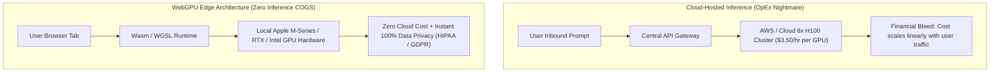
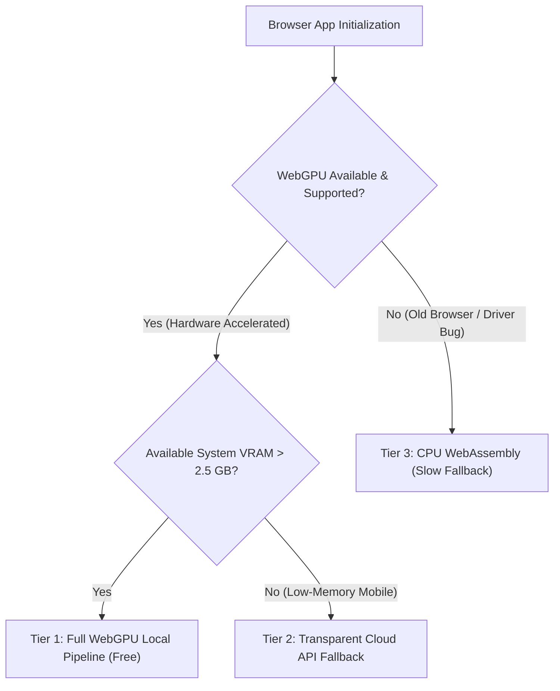

For years, the holy grail of software unit economics has been alluringly simple: **zero cloud inference cost**.

If you could run small language models (SLMs, e.g., 1B–3B parameters), image segmenters, or Whisper audio transcribers directly inside your user's browser using client GPU silicon via **WebGPU**, your monthly cloud GPU bill would instantly collapse to \$0.

By 2026, the technology has officially matured from tech demos into enterprise production. Millions of users run client-side neural networks daily.

However, moving inference from cloud H100 clusters onto fragmented end-user hardware (MacBooks, cheap Windows laptops, budget smartphones) exposes engineers to a brutal gauntlet of **Shader Compilation Latency, Browser VRAM Quotas, Thermal Throttling, and Cache Invalidation Traps**.

This architectural analysis dissects the reality of production WebGPU deployments and introduces **The Client-Side Inference Viability Matrix**.

---

## 1. The Architectural Shift: Cloud API vs. In-Browser WebGPU

Why are product teams enduring the pain of client-side machine learning?



### The 3 Business Imperatives for In-Browser Inference:
1. **Infinite Margin Scaling**: Whether you have 100 users or 10,000,000 users, your inference compute cost is literally \$0.00.
2. **Absolute Data Privacy by Design**: Sensitive audio transcripts, medical text, or proprietary financial documents never leave `localhost`, eliminating enterprise compliance hurdles.
3. **Offline Zero-Latency Execution**: Users can run smart document structuring on an airplane with zero Wi-Fi connectivity.

---

## 2. The 4 Engineering Pitfalls of Production WebGPU

Shipping WebGPU models to real-world consumers reveals four major hardware bottlenecks that never appear in localhost benchmarks:

```
┌─────────────────────────────────────────────────────────────────┐
│ Pitfall 1: The Initial Download Cliff (Cold-Start Churn)        │
│   - A 3B quantized model is ~1.8 GB. 40% of users bounce on 4G. │
├─────────────────────────────────────────────────────────────────┤
│ Pitfall 2: Shader Compilation Jitter (The First-Token Stutter)  │
│   - Browser must compile WGSL shaders into native GPU bytecode. │
├─────────────────────────────────────────────────────────────────┤
│ Pitfall 3: OS Memory Pressure & Tab Eviction                    │
│   - Mobile browsers aggressively kill background tabs > 1.5 GB. │
├─────────────────────────────────────────────────────────────────┤
│ Pitfall 4: Thermal Throttling on Ultrabooks                     │
│   - 10 minutes of continuous generation cuts clock speed by 60%.│
└─────────────────────────────────────────────────────────────────┘
```

| Dimension | Cloud H100 Inference | WebGPU In-Browser Inference |
| :--- | :--- | :--- |
| **Inference Cost (COGS)** | \$0.02 – \$0.15 per 1,000 tokens | **\$0.000 (Pure zero compute cost)** |
| **Cold-Start Time** | 200ms (Warm API container) | **12s – 45s (Model asset download & compile)** |
| **P95 Latency Consistency** | High (Regulated datacenter thermals)| Variable (Depends on battery level & OS load) |
| **Max Model Scale** | 70B – 405B Frontier Models | **1B – 3.8B Small Language Models (SLMs)** |
| **Regulatory Compliance** | Complex DPA agreements required | **Zero audit surface (Data never leaves device)** |

---

## 3. The Client-Side Inference Viability Matrix

Not every model should run in the browser. Before architecting for WebGPU, assess your workload against **The Client-Side Inference Viability Matrix**:

```
Model Size (Parameters & Weight Footprint)
  ▲
14B│                                           [Server Cloud Only Zone]
   │                                           (70B LLMs, Multi-modal Diffusion)
 7B│
   │                              [Borderline Hybrid]
 3B│                       * * *  (Requires IndexedDB Chunking)
   │                * * *
 1B│         * * * [The Sweet Spot: WebGPU Production Grade]
   │  * * *        (Audio Whisper, Embeddings, 1.5B Code Assistants)
 0 └───┼──────────┼──────────┼──────────┼──────────┼──────────►
      1s         5s         15s        30s        60s+       Acceptable Initialization Window
```

### Production Sweet-Spot Models:
* **Vector Embeddings (Nomic / MiniLM)**: 30MB–80MB download. Compiles in under 400ms. Enables instant local semantic search across thousands of local notes.
* **Audio Transcription (Whisper-Base)**: 120MB download. Transcribes real-time microphone streams at $8\times$ realtime speed with zero cloud upload.
* **Specialized Tokenizer & Grammar Checkers (1B–2B)**: Instant structured JSON formatting and local privacy filters.

---

## 4. The Resilient WebGPU Production Architecture

To build a fault-tolerant browser application, adopt a **Tiered Graceful Degradation Architecture**:



### 3 Golden Rules for WebGPU Production Engineering:
1. **Persistent Cache Partitioning (IndexedDB + CacheStorage)**: Never redownload model weights. Chunk weight tensors into 50MB blobs and store them in persistent IndexedDB with explicit ETag version checks.
2. **Dedicated WebWorker Isolation**: Never run WebGPU inference on the main UI thread. A heavy matrix multiplication block will freeze user scroll and button clicks, causing browser crash warnings.
3. **Graceful Cloud Teleportation**: If client-side memory spikes above 85% of browser tab limits, transparently forward the active prompt payload to a cloud API endpoint without disrupting the user experience.

---

## Summary

WebGPU is neither a silver bullet nor a toy. It is an extraordinary architectural lever that fundamentally rewrites the gross margins of AI-native SaaS companies.

Respect the physical constraints of end-user hardware, build robust fallbacks, and leverage client-side execution where privacy and cost margins matter most.
