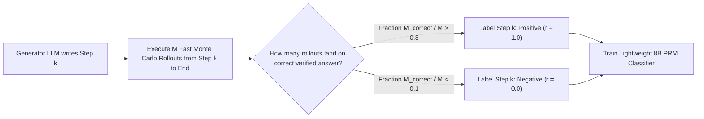

When training artificial intelligence systems to perform complex multistep deductions—such as proving an algebraic theorem, refactoring a concurrent codebase, or conducting an enterprise tax audit—the classical machine learning paradigm relied on **Outcome Supervision**.

You gave the model a complex problem, waited for it to generate a 40-step Chain-of-Thought (CoT), and compared its final output against the answer key. If the final number matched, you rewarded the model ($R = +1$). If it was wrong, you penalized it ($R = -1$).

By 2026, researchers and reasoning engineers have proven that **pure Outcome-Supervised Reward Models (ORMs) are mathematically predisposed to reward hallucination and flawed logic**.

A model can execute 38 steps of complete mathematical gibberish, introduce two offsetting arithmetic errors, accidentally land on the correct final number, and receive a massive positive reinforcement signal.

To build models that truly "think" without deceptive alignment, the frontier has migrated to **Process Supervision (Process Reward Models, or PRMs)**.

This architectural teardown examines the mathematical mechanics of per-step evaluation and introduces **The Error Cascade Probability Theorem**.

---

## 1. The Error Cascade Problem: Why ORMs Fail at Deep Logic

Why does rewarding the final answer fail when reasoning chains grow beyond 5 steps?


### The Error Cascade Probability Formula:
Consider an $N$-step derivation where each step has an independent correctness probability $p$. The probability that an entire chain contains zero reasoning flaws is:

$$P(\text{Valid Chain}) = p^N$$

If a model has a 95% step accuracy ($p = 0.95$), in a short 3-step prompt the validity is $(0.95)^3 = 85.7\%$.
But in a complex 30-step architectural refactor, validity collapses to:

$$(0.95)^{30} \approx 21.4\%$$

Under Outcome Supervision, the model cannot distinguish *which* of the 30 steps broke the reasoning. The gradient signal is diffused uniformly across all tokens, causing **Credit Assignment Paralysis**.

---

## 2. Process Reward Models (PRMs): Mathematics of Per-Step Credit

A Process Reward Model evaluates a trajectory step by step:

$$\text{Trajectory: } \tau = (s_1, s_2, \dots, s_N)$$

For every discrete reasoning step $s_i$, the PRM assigns a scalar validation score $r_i \in [0, 1]$, representing the probability that the partial reasoning trajectory $\tau_{\le i}$ can be completed into a mathematically sound, truthful conclusion:

$$r_i = P(\text{Sound Solution Exists} \mid s_1, s_2, \dots, s_i)$$

```
┌─────────────────────────────────────────────────────────────┐
│ Reasoning Step 1: "Let G be a finite cyclic group..."       │
│ PRM Verification Head: [Score: 0.99] -> ACCEPT              │
├─────────────────────────────────────────────────────────────┤
│ Reasoning Step 2: "By Lagrange's Theorem, |H| divides |G|..."│
│ PRM Verification Head: [Score: 0.98] -> ACCEPT              │
├─────────────────────────────────────────────────────────────┤
│ Reasoning Step 3: "Assume |H| is prime, therefore G is R^2" │
│ PRM Verification Head: [Score: 0.02] -> REJECT & BACKTRACK   │
└─────────────────────────────────────────────────────────────┘
```

By providing dense, step-level reinforcement signals, PRMs solve the credit assignment problem completely. The model receives immediate, localized feedback on the exact token boundary where the fallacy occurred.

---

## 3. ORM vs. PRM: Architectural Comparison

| Dimension | Outcome Reward Model (ORM) | Process Reward Model (PRM) |
| :--- | :--- | :--- |
| **Annotation Granularity** | 1 binary label per trajectory | Label per individual newline / step tag |
| **Credit Assignment** | Diffuse & noisy across entire context | **Hyper-localized to exact faulty deduction** |
| **Search Compatibility** | Limited to Best-of-N reranking | **Enables Monte Carlo Tree Search (MCTS) pruning** |
| **Vulnerability to Flukes** | High (Rewards accidental correct answers) | **Zero (Rejects invalid logic even if answer matches)** |
| **Annotation Cost** | Cheap (Only checks final output) | High (Requires per-step active synthetic verifiers) |
| **Reasoning Accuracy Gain**| $+15\% – 25\%$ on Math/Code | **$+65\% – 110\%$ on Olympiad-grade reasoning** |

---

## 4. The Synthetic Process Supervision Flywheel

Historically, the bottleneck of PRMs was data: human mathematicians cannot manually label millions of intermediate derivation steps.

In 2026, the breakthrough that unlocked widespread PRM deployment is **The Synthetic Rollout Verification Flywheel**:



Instead of asking a human, an automated pipeline freezes the model at step $k$, spins off 32 ultra-fast random draft rollouts to the end, and checks how many rollouts reach the ground-truth solution.

If 30 out of 32 rollouts succeed, step $k$ was objectively promising. If 0 out of 32 succeed, step $k$ introduced a fatal, irrecoverable flaw.

This automated Monte Carlo estimation generates millions of densely annotated process training examples without a single minute of human labeling.

---

## Summary

Training models on final outcomes teaches them to be clever charlatans; training models on intermediate steps teaches them to be rigorous thinkers.

Process Supervision is the mathematical backbone of modern frontier reasoning systems. By shifting from outcome guessing to per-step verification, engineering teams can turn fragile, hallucination-prone models into deterministic deductive engines.
