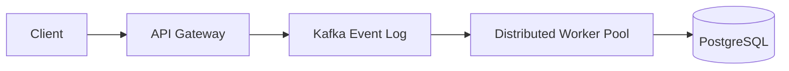

If you write technical documentation, RFCs, or GitHub READMEs, you already know the extraordinary power of **Mermaid.js**. With a dozen lines of declarative text, you can describe a multi-tier microservice cluster, an event-driven Kafka pipeline, or a complex distributed consensus protocol:



Inside GitHub, Notion, or GitLab, this markdown block renders natively into a clean interactive vector diagram.

**Now, attempt to share that exact architectural insight on LinkedIn, X (Twitter), Threads, or Substack.**

The result is an engagement disaster:
* Social feeds do not parse Mermaid syntax. Your elegant diagram appears as a wall of raw, confusing markdown code.
* If you take a quick screenshot using your operating system's clipping tool, the resulting raster PNG has blurry anti-aliased text, ugly jagged lines on Retina screens, and awkward horizontal margins that get cropped by mobile social feeds.
* Engineers scrolling through their timeline glance past your unreadable screenshot in 0.5 seconds.

To make complex distributed systems go viral among CTOs, Staff Engineers, and tech founders, you must adopt **The 3-Tier Visual Architecture Decomposition (VAD)**.

---

## 1. The Social Feed Physics: Raw Code vs. 4K Visual Architecture Cards

Why does visual presentation matter so intensely when communicating hardcore backend architectures?

```mermaid
graph TD
    subgraph RawCaptureFail ["The Screenshot Anti-Pattern (88% Engagement Drop)"]
        M1["Engineer Writes 25-Line Mermaid Architecture"] --> S1["Desktop Snipping Tool Capture"]
        S1 --> S2["Low DPI Raster Image with Washed-Out Gray Background"]
        S2 --> S3["Tiny Font Unreadable on Mobile Phone Screen"]
        S3 --> S4["Feed Algorithm Penalizes Low Dwell Time (< 1.2s) -> Post Disappears"]
    end

    subgraph VADRenderSuccess ["The VAD 4K Vector Architecture Card (5.8x Bookmark Rate)"]
        M2["Engineer Writes 25-Line Mermaid Architecture"] --> V1["The 3-Tier VAD Formatting Applied"]
        V1 --> V2["High-Contrast Dark Theme + Frosted Window Frame"]
        V2 --> V3["4K Vector Render at Mobile-Optimized 4:5 Aspect Ratio"]
        V3 --> V4["Instant Visual Anchor on Mobile Feed -> 8.5s Dwell Time + Viral Reposts"]
    end
```



### The 3 Core Friction Points of Technical Social Diagrams:
1. **The Mobile Viewport Constraint**: Over 80% of technical social media impressions occur on mobile devices. A horizontal 1920x1080 diagram squished into a 390px smartphone feed shrinks text below 6pt, rendering component labels completely illegible.
2. **Contrast & Syntax Cognitive Fatigue**: Standard browser white-background diagrams cause glare and look like generic corporate slide decks. Dark-mode aesthetics (Tokyo Night, Monokai, Cyberpunk) signal authentic developer craftsmanship and immediately capture attention.
3. **Information Density Balance**: If a diagram contains 60 interconnected nodes, it is unreadable on a feed. If it has only 3 boxes, it looks trivial. Effective visual communication requires disciplined semantic layering.

---

## 2. The 3-Tier Visual Architecture Decomposition (VAD)

To convert an intricate system architecture into a high-engagement social diagram, apply **The 3-Tier Visual Architecture Decomposition (VAD)**:

```
┌─────────────────────────────────────────────────────────────────────────────┐
│ The 3-Tier Visual Architecture Decomposition (VAD)                          │
│                                                                             │
│ [Tier 1: Macro Topology - The Core Highway]                                 │
│ Max 5 to 7 primary nodes. Unidirectional left-to-right or top-to-bottom.    │
│ Establish service boundaries and persistent data stores clearly.            │
│ ─────────────────────────────────────────────────────────────────────────── │
│ [Tier 2: Micro Interactions - Protocol & Latency Annotations]               │
│ Explicitly label arrow edges with protocols: [gRPC / Protobuf / 12ms p99].  │
│ Highlight bottlenecks and asynchronous decoupling points with warning hues. │
│ ─────────────────────────────────────────────────────────────────────────── │
│ [Tier 3: Aesthetic Polishing - The 4K Card Wrapper]                         │
│ Wrap diagram in macOS frosted glass chrome with traffic light controls.     │
│ Enforce high-DPI font scaling and 4:5 or 16:9 social viewport ratios.       │
└─────────────────────────────────────────────────────────────────────────────┘
```

### Deconstructing the 3 Tiers:

#### Tier 1: Macro Topology (Clean Structural Scaffolding)
Avoid web-like spaghetti graphs. Group microservices into logical subgraphs (e.g., `Ingestion Layer`, `Compute Core`, `Storage Fabric`). Limit the primary visual path to a clean, left-to-right (`graph LR`) or top-to-bottom (`graph TD`) pipeline.

#### Tier 2: Micro-Interaction Annotations
What separates an amateur flowchart from a master-level technical diagram is **edge semantics**. Instead of a generic arrow from Node A to Node B, annotate the transport layer and latency budget:
* `Service A -->|"gRPC (Stream) < 5ms"| Service B`
* `Queue -->|"Batch 500 msgs (Dead-Letter on Fail)"| Consumer`  
This transforms an abstract diagram into an authoritative engineering reference.

#### Tier 3: Aesthetic Frame & Vector Crispness
Embed the diagram inside a styled macOS window frame with subtle drop shadows and glowing border accents. Render the output at a minimum of $3\times$ pixel density (High-DPI) so that zooming in on a Retina display reveals razor-sharp vector typography.

---

## Making a Markdown card with NavoKit

Paste the written explanation accompanying a diagram into [NavoKit Markdown to Image](/en/tools/markdown-to-image). Organize it with headings, lists, tables, or code blocks, inspect the live preview, and export a PNG. Conversion runs in the browser and the image includes a NavoKit mark.

The current interface uses a fixed white card style. It has no theme, syntax-highlighting, window-frame, transparent-background, or aspect-ratio selector, and does not offer PDF, vector, or batch export. The image height follows the content, so split long material before exporting.

Mermaid code is displayed as a code block; this tool does not render it into a diagram. Render the diagram separately when you need an actual flowchart. Keep the original text and code links available for readers who need to copy them.

## Summary

In modern tech leadership, the best architecture does not win if no one understands it. When sharing complex engineering decisions with the wider developer community, your diagrams must balance rigorous technical truth with compelling visual hierarchy.

By applying **The 3-Tier Visual Architecture Decomposition (VAD)** and leveraging automated rendering tools, you can turn dry Mermaid syntax into stunning, bookmark-worthy visual cards that establish your technical authority across every social feed.
