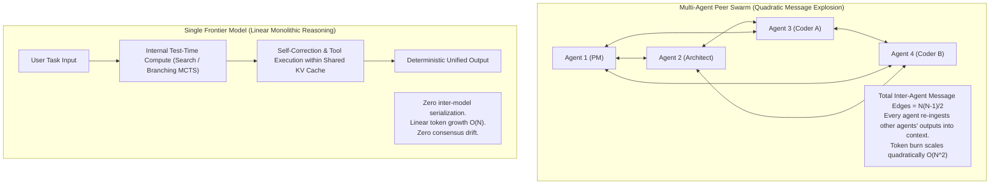
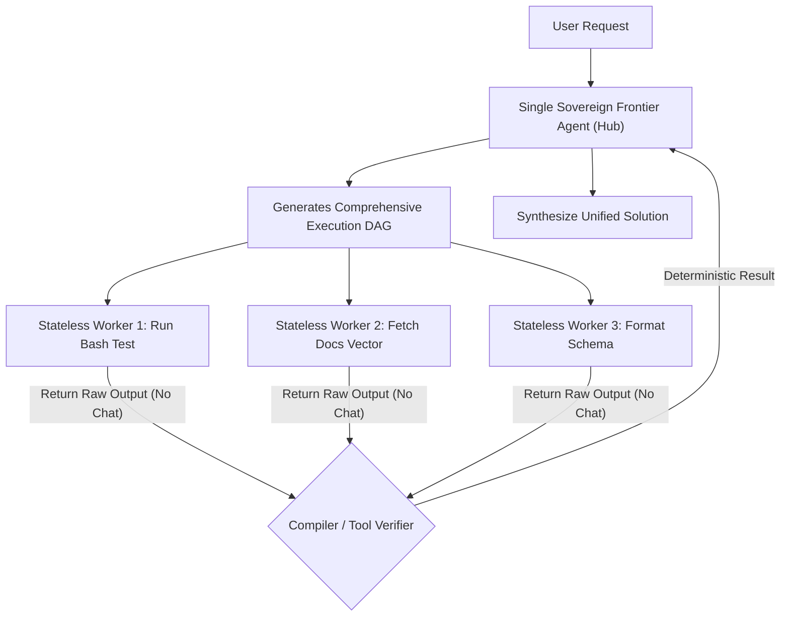

Between 2024 and early 2026, the artificial intelligence industry experienced a massive architectural gold rush: **Multi-Agent Swarms**.

Frameworks like AutoGen, CrewAI, and LangGraph made it tantalizingly easy to construct elaborate virtual org charts: a "Product Manager Agent" writing specs, passing them to an "Architect Agent", who delegated to three "Coder Agents", whose outputs were reviewed by a "QA Tester Agent", while a "Scrum Master Agent" monitored progress.

On paper, this division of labor mirrored human corporate structures.

In production engineering, however, thousands of teams hit a brutal brick wall:
* An innocent coding request ballooned into **450,000 billed tokens** before writing a single line of working code.
* Inter-agent chat loops degenerated into sycophantic politeness cascades (*"Thank you for the suggestion!", "Great thought, here is my update!", "Looks wonderful, passing to QA!"*).
* End-to-end task completion rates plummeted compared to asking a single frontier model to execute the task directly with deep chain-of-thought (CoT).

This engineering post dissects the mathematical limits of agent swarms, contrasting them against the resurgence of **Single Giant Frontier Agents**, and introduces **The Swarm Convergence Penalty (SCP) Matrix**.

---

## 1. The Physics of Inter-Agent Communication: The $O(N^2)$ Trap

Why do multi-agent systems suffer such rapid efficiency collapse as the number of agents increases?

The answer lies in **distributed message passing and context synchronization**:



### The 3 Core Pathologies of Agent Swarms:

1. **Quadratic Message Passing Inflation ($O(N^2)$)**  
   In a mesh topology of $N$ communicating agents, the potential communication channels scale as $\frac{N(N-1)}{2}$. When each agent must maintain awareness of collective team state, every message broadcast must be appended to the context window of every peer agent. Five agents discussing an edge case generate 10x more token churn than a single model debating itself.
2. **Hallucination Cascades & Error Amplification**  
   If Agent 1 (the Researcher) hallucinates a non-existent API parameter, Agent 2 (the Architect) treats that hallucination as an authoritative ground truth, designing an entire module around it. Agent 3 (the Coder) writes code against the fictitious design. By the time Agent 4 (the Tester) catches the error, the swarm has burned \$15 in compute down an irrecoverable dead end.
3. **Consensus Drift & Sycophancy Sinkholes**  
   Language models are heavily aligned to be cooperative. When two LLMs are put in a feedback loop without a deterministic external verifier (like a compiler or linter), they tend to converge on polite consensus rather than rigorous correctness, approving flawed code simply because the peer praised it.

---

## 2. The Swarm Convergence Penalty (SCP) Matrix

To evaluate whether a problem warrants a multi-agent swarm or a single deep-reasoning agent, engineering architects should evaluate their pipeline against **The Swarm Convergence Penalty (SCP) Matrix**:

$$\text{SCP} = \frac{\text{Serialization Latency} \times (\text{Token Fan-Out})^2}{\text{Ground-Truth Verifiability Score}}$$

```
┌─────────────────────────────────────────────────────────────────────────────┐
│ The Swarm Convergence Penalty (SCP) Matrix                                  │
│                                                                             │
│ High SCP (> 8.0) ──► IMMEDIATE COLLAPSE ZONE                                │
│                     - Interdependent creative writing                       │
│                     - Dynamic architectural refactoring                     │
│                     - Ambiguous prompt requirements                         │
│                     ► VERDICT: Deploy Single Giant Frontier Agent           │
│                                                                             │
│ Low SCP (< 2.0)  ──► EFFECTIVE SWARM REGIME                                 │
│                     - Embarrassingly parallel web scraping                  │
│                     - Independent modular micro-benchmarking                │
│                     - Formal compiler / linter verification in each node    │
│                     ► VERDICT: Deploy Asynchronous Specialized Swarm        │
└─────────────────────────────────────────────────────────────────────────────┘
```

### Deconstructing the 4 Key Variables:
* **Serialization Latency**: The wall-clock time required for Agent A to finish decoding, serialize its response into JSON/Markdown, transmit it over HTTP/WebSockets, and for Agent B to prefill that payload.
* **Token Fan-Out**: The ratio of internal communication tokens generated relative to the tokens returned to the end user. (In dysfunctional swarms, this ratio routinely exceeds $50:1$).
* **Ground-Truth Verifiability**: Can the output of an agent be verified by deterministic software (a bash command, a unit test, a regex validator)? If yes, error cascades are halted immediately. If no (subjective human evaluation), error cascades are guaranteed.

---

## 3. Architecture Shootout: Multi-Agent Swarm vs. Single Frontier Model

| Evaluation Dimension | 5-Agent Specialized Swarm (e.g. CrewAI / AutoGen) | Single Frontier Model (e.g. o1 / o3 / Claude 3.5 Sonnet) |
| :--- | :--- | :--- | :--- |
| **Token Consumption for 500-Line Codebase**| 250,000 – 600,000 tokens | 25,000 – 60,000 tokens |
| **End-to-End Execution Latency** | 120s – 350s (Serial inter-agent calls) | **25s – 65s (Single session stream)** |
| **Architectural Coherence** | Low (Interface mismatch between agents) | **High (Monolithic unified memory)** |
| **Failure Recovery** | Complex (Requires global state rollback) | **Direct (Model backtracks within its own CoT)** |
| **Infrastructure Complexity** | High (Orchestrators, message brokers, queues) | **Minimal (Single stateless API request)** |
| **Ideal Production Use Case** | Embarrassingly parallel, isolated map-reduce tasks | **Deep reasoning, complex logic, code generation** |

---

## 4. The 2026 Architectural Compromise: The "Hub-and-Spoke" Tool Pattern

If pure peer-to-peer swarms are prone to collapse, what is the modern enterprise standard?

Leading production teams have abandoned democratic, peer-to-peer agent meshes in favor of the **Hierarchical Hub-and-Spoke Verifier Pattern**:



### The 3 Production Rules of the Hub-and-Spoke Pattern:
1. **Workers Do Not Talk to Workers**: Worker agents never message each other directly. They operate as isolated, stateless tool executors that return raw data directly to the Central Sovereign Agent.
2. **Deterministic Air-Gaps**: Every worker output must pass through a non-LLM validation gate (a TypeScript compiler check, a JSON schema validator, or an HTTP status code check) before entering the controller's context.
3. **One Brain, Many Hands**: Keep reasoning centralized within a single frontier model equipped with extended test-time compute, delegating only mechanical, parallelizable subroutines to smaller satellite models.

---

## Summary

The fantasy of self-organizing agent swarms writing entire enterprise applications without human supervision has collided with the physical realities of context window quadratic costs and consensus decay.

For complex, tightly coupled engineering problems, a single giant model leveraging deep test-time compute and disciplined tool execution consistently outperforms an undisciplined swarm of chatting micro-agents. 

Use swarms only where tasks are strictly decoupled and mathematically verifiable; for everything else, trust a single, unified cognitive architecture.
