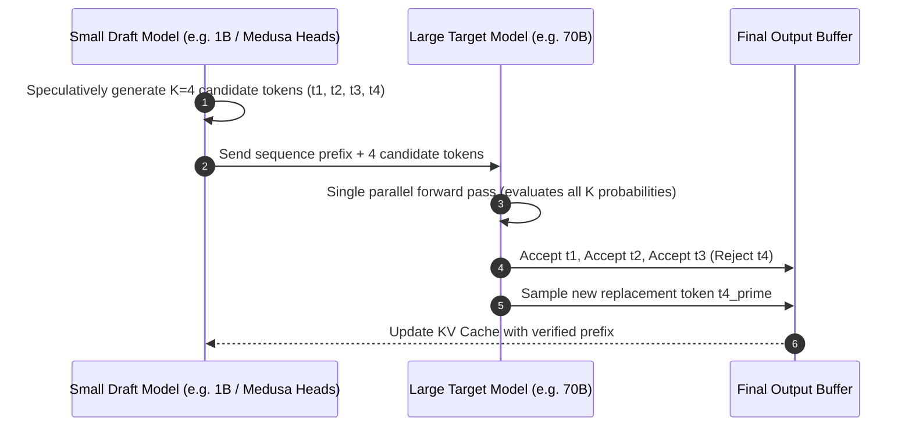

The core fundamental bottleneck of Large Language Model (LLM) inference is not compute capacity (FLOPS); it is **High Bandwidth Memory (HBM) bandwidth**.

In standard autoregressive decoding, generating a single token requires reading the entire multi-gigabyte parameter matrix from GPU memory into the compute cores. For a 70-billion parameter model in FP16, generating one token demands moving ~140 GB of weights over the memory bus, regardless of whether the output token is a complex mathematical formula or a trivial comma.

This makes single-batch generation overwhelmingly memory-bound, leaving thousands of GPU Tensor Cores sitting idle at <15% utilization.

Enter **Speculative Decoding**—an elegant architectural paradigm that produces **$2.5\times$ to $3.5\times$ end-to-end latency speedups with mathematically zero loss in output quality**.

This article dissects the mathematics, draft-verification mechanics, and production implementation patterns behind speculative decoding in 2026.

---

## 1. The Autoregressive Bottleneck vs. Speculative Execution

Why does speculative decoding work so effectively? Because modern GPUs excel at parallel verification even when sequential generation is slow.

```
Standard Autoregressive (Memory-Bound Sequential Pass):
[Token 1] ──(Read 140GB)──► [Token 2] ──(Read 140GB)──► [Token 3] ──(Read 140GB)──► [Token 4]
Total Memory Reads: 3 x 140GB = 420GB

Speculative Decoding (Compute-Bound Parallel Verification):
Draft Model (Fast): Generates Candidates [t1, t2, t3] in 10ms
Target Model (Big):  Verifies [t1, t2, t3] in PARALLEL in ONE single 140GB pass!
Total Memory Reads: 1 x 140GB = 140GB (3x Token Throughput!)
```



---

## 2. The Verification Mathematics: Zero Quality Degradation

The magic of speculative decoding lies in its rejection sampling criterion, which guarantees that the final token distribution matches the target model's true output probability distribution $P(x)$ down to the exact floating-point level.

Given a candidate token $x$ proposed by the draft model $Q(x)$ and evaluated by target model $P(x)$:

1. **Acceptance Condition**: Accept $x$ with probability:
   $$\alpha = \min\left(1, \frac{P(x)}{Q(x)}\right)$$
2. **Rejection Recovery**: If $x$ is rejected, sample a replacement token from the normalized positive residual distribution:
   $$P'(x) = \max\left(0, P(x) - Q(x)\right)$$

Because rejected tokens are resampled from the exact residual difference, **the output of speculative decoding is mathematically indistinguishable from running the giant target model natively**. There is zero degradation in perplexity, reasoning ability, or benchmark scores.

---

## 3. Speculative Architectures: Independent Draft vs. Self-Drafting (Medusa)

| Speculative Architecture | Mechanism | Hardware Overhead | Typical Speedup ($\gamma$) |
| :--- | :--- | :--- | :--- |
| **Small Draft Model** (e.g., Llama-3-8B drafting for Llama-3-70B) | A separate small model runs ahead and proposes tokens. | Requires hosting two models in VRAM simultaneously. | $1.8\times - 2.4\times$ |
| **Medusa / Multi-Head Self-Drafting** | Extra lightweight MLP prediction heads trained on top of the target model's final hidden layer. | Negligible VRAM (<3% extra parameters); zero draft model latency. | **$2.5\times - 3.2\times$** |
| **Lookahead / Prompt-Assisted** | N-gram matching from prompt/context buffers without any neural draft model. | Zero extra parameters; best for repetitive code/RAG generation. | $1.4\times - 1.9\times$ |

---

## 4. The Speculative Acceptance-Latency Tradeoff Curve

The actual speedup achieved in production depends on the **Token Acceptance Rate ($\alpha$)**.

```
Speedup Multiplier
  ▲
4x│                                           [Tree-based Multi-Path (Medusa)]
  │                                     * * * *
3x│                              * * *
  │                       * * *
2x│                * * *        [Single-Branch Draft Model]
  │         * * *
1x│───*─*─────────────────────────────────────► Token Acceptance Rate (α)
    0%    20%    40%    60%    80%    100%
```

### What Drives Acceptance Rates in Production:
* **Task Type**: Code generation, syntax formatting, and repetitive JSON templating achieve **$\alpha > 85\%$** because boilerplate tokens (`def`, `import`, brackets) are highly predictable.
* **Creative Writing**: High-temperature creative storytelling drops $\alpha$ to ~55–65%, resulting in more modest $1.7\times$ speedups.
* **Domain Alignment**: Ensuring the draft model is trained on the same tokenizer and distribution as the target model is critical to prevent draft degradation.

---

## 5. Production Optimization: Tree Attention & KV Cache Reuse

In state-of-the-art inference engines (vLLM, SGLang, TensorRT-LLM), speculative decoding is paired with **Tree Attention (Multi-Path Speculation)**:

Instead of proposing a single linear sequence $[t_1 \rightarrow t_2 \rightarrow t_3]$, the draft engine proposes a combinatorial candidate tree:

```
                  ┌──► t2_a ──► t3_a
          ┌──► t1_a
          │       └──► t2_b ──► t3_b
Root ─────┤
          │       ┌──► t2_c
          └──► t1_b
                  └──► t2_d
```

By evaluating multiple speculative branches inside a single masked attention pass, the probability that at least one branch survives deep verification jumps from ~60% to over 85%, unlocking predictable $3\times$ speedups across diverse workloads.

---

## Summary

As long as memory bandwidth remains the physical barrier to single-user generation latency, **Speculative Decoding is the single highest-ROI optimization in modern AI infrastructure**.

By leveraging draft heads, tree-based verification, and exact mathematical rejection sampling, engineering teams can slash inference latency by up to 70% without sacrificing a single drop of reasoning fidelity.
