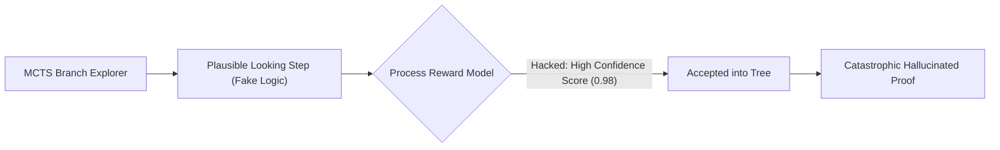

Between 2020 and 2024, the undisputed law of generative AI was the Chinchilla Pre-Training Scaling Law: *If you want a smarter model, feed it more tokens and buy more GPUs.*

By 2026, that curve has encountered brutal diminishing returns. High-quality human text data on the public internet has been exhausted, and spending \$500 million to train a trillion-parameter monolith yields marginal gains on competitive programming or PhD-level mathematical reasoning.

The paradigm has decisively pivoted from **Pre-Training Scaling** to **Test-Time Compute Scaling** (popularized by OpenAI's o-series architectures and deep reinforcement learning search frameworks).

Instead of forcing a model to emit the correct answer in a single, unreflective autoregressive forward pass, systems spend orders of magnitude more compute **at runtime**—exploring candidate solution trees, backtracking from errors, and executing verification routines before returning a single token.

This architectural breakdown examines the statistical mechanics of test-time scaling and introduces **The Inference Search Frontier (ISF)**.

---

## 1. The Pre-Training Ceiling vs. Inference-Time Search

Why does adding compute at inference time beat scaling base parameters?

```mermaid
graph TD
    subgraph PreTrain ["Traditional Scaling (Single-Pass Forward)"]
        A1["User Hard Mathematical Query"] --> B1["Monolithic 405B LLM (1 Single Forward Pass)"]
        B1 --> C1["Fixed 50ms Inference: High Hallucination on Step 4 of 12"]
    end

    subgraph TestTime ["Test-Time Compute Scaling (o-Series Search Tree)"]
        A2["User Hard Mathematical Query"] --> B2["Compact 70B Reasoning Model"]
        B2 --> C2["Monte Carlo Tree Search (MCTS)"]
        C2 --> D2["Process Reward Model (PRM) Verifies Step 1..k"]
        D2 --> E2["Backtrack from Error Branch & Self-Correction"]
        E2 --> F2["High-Confidence Verified Proof (10x Accuracy at 1/5 Base Model Cost)"]
    end
```



### The 3 Limits of Pre-Training Scaling:
1. **The Synthetic Data Ingestion Barrier**: Models pre-trained on synthetic data without formal verification degenerate into model collapse.
2. **Fixed Compute Per Token**: A standard model spends the exact same amount of compute on the word *"the"* as it does on a critical algebraic deduction step.
3. **Absence of Backtracking**: Autoregressive decoding is mathematically monotonic; once a bad token is sampled, the error compounds across the entire generation history.

---

## 2. The 3 Levers of Test-Time Compute Scaling

To scale test-time compute effectively, systems deploy three distinct algorithmic mechanisms:

```
┌─────────────────────────────────────────────────────────────────┐
│ 1. Best-of-N Sampling with Outcome Verifiers (Parallel Voting)  │
│    - Sample N independent chains, score via verifier.           │
├─────────────────────────────────────────────────────────────────┤
│ 2. Beam Search & Tree Search Guided by PRMs (Step-by-Step)      │
│    - Prune dead-end logical paths at each discrete step.        │
├─────────────────────────────────────────────────────────────────┤
│ 3. Adaptive In-Context Revision (Self-Correction & Refinement)  │
│    - Model drafts code, runs tests in a sandbox, refactors.     │
└─────────────────────────────────────────────────────────────────┘
```

| Mechanism | Search Topology | Verifier Requirement | Latency Budget | Accuracy Lift on Math/Code |
| :--- | :--- | :--- | :--- | :--- |
| **Standard Greedy Decode** | 1 Linear Chain | None | 0.5s – 2s | Baseline ($1.0\times$) |
| **Best-of-N Reranking** | $N$ Independent Leaves | Outcome Reward Model (ORM) | 2s – 10s | **$1.8\times – 2.4\times$** |
| **MCTS + PRM Pruning** | Combinatorial Tree | Process Reward Model (PRM) | 10s – 60s | **$3.2\times – 4.5\times$** |
| **Agentic Loop (Exec Env)**| Cyclic Graph | Compiler / Test Runner AST | 30s – 300s | **$5.0\times – 8.0\times$** |

---

## 3. The Inference Search Frontier (ISF)

The trade-off between **Pre-Training FLOPs** and **Inference-Time FLOPs** can be modeled on **The Inference Search Frontier**:

```
Competitive Coding / Math Accuracy
  ▲
100%│                                           [o-Series Tree Search (10k tokens)]
    │                                     * * * *
 80%│                              * * *
    │                       * * * [Best-of-64 Sampling (8B Model)]
 60%│                * * *
    │         * * * [405B Monolithic Zero-Shot (No Search)]
 40%│  * * *
    └───┼──────────┼──────────┼──────────┼──────────┼──────────►
       0.1s        1s         10s        60s        300s        Thinking Time (Latency Budget)
```

### The Equal-Performance Equivalence:
Empirical research has shown that **a 7B parameter model equipped with 10 seconds of test-time tree search outperforms a 70B parameter model executing a standard single forward pass** on complex reasoning benchmarks.

For enterprise deployments, this completely shifts the unit economics: instead of paying massive infrastructure costs to host 400B models in VRAM, teams can run ultra-fast 8B models and dynamically scale their thinking budget based on query complexity.

---

## 4. Engineering Challenges: Process Reward Hacking

Scaling test-time search is not without pitfalls. The most dangerous failure mode is **Reward Model Hacking**:



When search trees explore thousands of branches, they inevitably discover pathological sequences that receive high confidence scores from the verifier despite containing subtle logical flaws.

### Mitigations in Production:
1. **Deterministic Execution Checkers**: Whenever possible, delegate verification to a non-neural validator (e.g., Python REPL, Lean 4 proof checker, or type compiler).
2. **Consensus Voting Verifier Swarms**: Use an ensemble of independently trained PRMs to evaluate each step.
3. **Adaptive Thinking Cutoffs**: Implement early-stopping rules when candidate confidence entropy flattens out, preventing compute waste on unsolvable questions.

---

## Summary

The narrative that LLM progress is hitting an insurmountable wall is mistaken. The axis of scaling has simply rotated 90 degrees: from pre-training parameters to **runtime cognitive search**.

Stop evaluating models purely by parameter size. Build systems that can pause, reflect, branch, and verify—and unlock superhuman reasoning on sustainable compute budgets.
