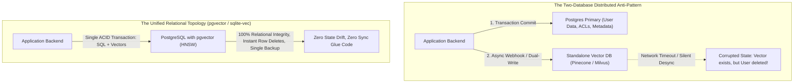

In late 2023, venture capitalists poured hundreds of millions of dollars into "pure-play" vector database startups (Pinecone, Weaviate, Milvus, Qdrant). The narrative was intoxicating: *Vector embeddings are an entirely new data primitive! Traditional relational databases can never handle high-dimensional HNSW indexing at scale!*

By 2026, the harsh reality of distributed systems engineering has reasserted itself:

**Vectors are not a database. Vectors are an indexing data type.**

Just like JSON, geospatial coordinates (GIS), and full-text search before them, vector retrieval has been thoroughly absorbed and commoditized by foundational battle-tested databases—most prominently **PostgreSQL (via `pgvector` and HNSW/IVFFlat)** and **embedded SQLite (via `sqlite-vec`)**.

Maintaining a dedicated, standalone vector database introduces an intolerable operational penalty: **the Two-Database Synchronization Nightmare**.

This technical teardown dissects the operational physics of vector commoditization and introduces **The Integrated Vector Locality Theorem**.

---

## 1. The Two-Database Synchronization Nightmare

When you run a standalone vector database alongside your production relational database, your engineering team must maintain dual-write distributed consensus without cross-database transactions.



### The 4 Operational Breakdowns of Standalone Vector DBs:
1. **The Dual-Write Race Condition**: If a customer deletes their account in PostgreSQL, but the async worker updating the vector database fails or gets throttled, their vector embeddings remain active, causing catastrophic GDPR violations and privacy leaks.
2. **Metadata Filtering Overhead**: In real enterprise queries, you never search vectors in a vacuum. You search vectors *filtered by tenant ID, organization role, created date, and document permissions*. Dedicated vector databases struggle with relational joins, requiring massive metadata payload duplication.
3. **Backup & Disaster Recovery Fragmentation**: Point-in-time recovery (PITR) across two independent database engines with different storage architectures is virtually impossible without state divergence.
4. **The Cold-Start Network Hop**: Round-trip network serialization between your application, your database, and your third-party vector cloud adds 30ms–80ms of unnecessary P99 latency.

---

## 2. pgvector and HNSW: Parity and Performance in 2026

The historical critique of `pgvector` was speed: *Postgres is too slow for million-scale nearest neighbor queries.*

With the maturation of **pgvector 0.7+ and HNSW indexing with parallel index build times**, that argument has evaporated:

```
Query Latency (P99 at 1,000,000 Vectors)
  ▲
60ms│ [Early pgvector IVFFlat (2023)]
    │          ▲
40ms│          │      [Dedicated Vector Cloud (Pinecone/Milvus)]
    │          │                 * * * * *
20ms│          │           * * *
    │          └────► * * * [Modern pgvector HNSW (2026)]
 0ms└───┼──────────┼──────────┼──────────┼──────────► Concurrency QPS
       100        500        1,000      2,500
```

| Database Architecture | Millions of Vectors Scale | Metadata Filtering Strategy | ACID Transaction Guarantees | Monthly Infrastructure Overhead |
| :--- | :--- | :--- | :--- | :--- |
| **Standalone Vector SaaS** | 5M – 50M | Clunky payload filters, no JOINs | None (Eventual consistency) | \$800 – \$3,500 / month |
| **PostgreSQL + pgvector** | **Up to 20M per node** | **Native SQL JOINs, indexes, ACLs** | **Full ACID Strict Serializability** | **\$0 (Part of existing Postgres DB)** |
| **sqlite-vec (Embedded)**| **Up to 500k in-memory** | Pure SQLite query syntax | Native SQLite transactions | **\$0 (Runs locally in 100KB binary)** |

---

## 3. The Rise of Embedded Local Vectors: sqlite-vec

While `pgvector` dominates the enterprise backend, **`sqlite-vec`** is sweeping the local and edge computing landscape:

```
┌─────────────────────────────────────────────────────────────┐
│ Your Node.js / Python / Rust Application Process            │
│ ┌─────────────────────────────────────────────────────────┐ │
│ │ In-Process Memory: SQLite Engine                        │ │
│ │ ┌───────────────────┐     ┌───────────────────────────┐ │ │
│ │ │ Tabular Data Rows │ <-> │ sqlite-vec Vector Table   │ │ │
│ │ └───────────────────┘     └───────────────────────────┘ │ │
│ └─────────────────────────────────────────────────────────┘ │
└──────────────────────────────┬──────────────────────────────┘
                               │ Zero-Copy In-Memory Vector SIMD Dot Product
                               ▼
               [Instant < 1.2ms Local Retrieval]
```

### Why Developers Are Ditching Cloud Vector APIs for `sqlite-vec`:
* **Zero Network Latency**: Vector similarity calculations run in-process using direct SIMD instructions (AVX-512 / ARM NEON), delivering **sub-2ms query times**.
* **Zero Infrastructure Setup**: No API keys, no monthly SaaS subscriptions, no Kubernetes pods. Just a single `.db` file that can be committed to disk, backed up, or shared.
* **Perfect for Edge & Desktop Agents**: Ideal for local IDE extensions, desktop note-taking apps, and on-device smartphone agents.

---

## 4. When Does a Dedicated Vector Database Still Make Sense?

Is there any remaining niche for specialized vector engines (Milvus, Qdrant, Vespa)?

Yes, but it is confined to **the 0.1% hyperscale enterprise tier**:

1. **Billion-Scale Vector Clustering**: If you are Pinterest, Spotify, or Uber searching through 500 million to 10 billion multimodal vector embeddings simultaneously, specialized distributed vector clustering across multi-node GPU clusters remains necessary.
2. **Extreme QPS Dynamic Re-Ranking**: Workloads demanding 50,000+ vector queries per second across sharded clusters exceed standard PostgreSQL connection pool configurations without complex read-replica setups.

For 99.9% of production applications—which operate on datasets under 10 million vectors—**PostgreSQL with pgvector is mathematically, operationally, and financially superior**.

---

## Summary

The history of databases is a graveyard of single-feature database startups swallowed by relational titans.

Stop building brittle two-database synchronization pipelines. Keep your vector embeddings where your data already lives: inside your relational PostgreSQL engine or embedded SQLite files. Simplify your architecture, eliminate sync bugs, and enjoy the peace of mind of true ACID transactions.
