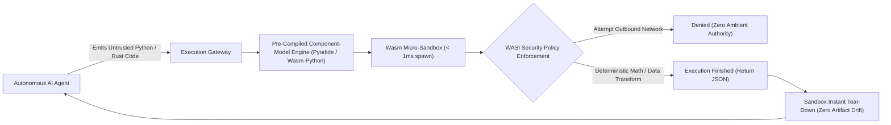

When autonomous AI agents write and execute their own code—whether generating Python scripts to query a database, running calculations in a financial planner, or executing shell tools—the most critical architectural question is:

**Where do you physically run untrusted, LLM-generated code safely at scale?**

In the early wave of agent development, the default knee-jerk answer was Docker containers.

By 2026, enterprise platforms operating thousands of concurrent agent workers have learned the hard way that **Docker and Linux containers are fatally flawed for high-throughput agent execution**:
* Spawning a Docker container takes 500ms to 2.5 seconds.
* Each container consumes 50MB–200MB of baseline memory overhead.
* The Linux kernel attack surface is vast, leaving systems vulnerable to container escapes and kernel privilege escalation.

The industry standard for secure agent tool execution has decisively migrated to **WebAssembly (Wasm) Sandboxing** using runtimes like Wasmtime and Extism.

This technical breakdown examines the physics of micro-isolation and introduces **The Zero-Trust Agent Execution Fabric (AEF)**.

---

## 1. The Container Bottleneck vs. The WebAssembly Sandbox

Why does Docker collapse when scaled across thousands of ephemeral agent tool invocations?

```mermaid
graph TD
    subgraph DockerIsolation ["Traditional Docker / VM Sandbox (Heavy & Slow)"]
        A1["Agent Generates 4-Line Python Script"] --> B1["Spin Up Docker Container"]
        B1 --> C1["Fork Linux Namespaces, Cgroups, Rootfs (800ms Latency)"]
        C1 --> D1["150MB RAM Allocated per Instance"]
        D1 --> E1["1,000 Concurrent Agents = 150 GB RAM Burned Just on OS Containers!"]
    end

    subgraph WasmIsolation ["Wasm Micro-Sandbox (Sub-Millisecond & Zero-Weight)"]
        A2["Agent Generates 4-Line Python Script"] --> B2["Instantiate Wasm Component (WASI)"]
        B2 --> C2["Linear Memory Isolated Sandbox (0.3ms Startup Latency)"]
        C2 --> D2["30KB Memory Overhead per Instance"]
        D2 --> E2["10,000 Concurrent Agents on a Single $40/mo VPS!"]
    end
```



### The 3 Fatal Inefficiencies of Traditional Containers for Agents:
1. **Cold-Start Latency Penalty**: An agent calling a tool needs instant results. Waiting 1.5 seconds for a Linux container to initialize destroys the conversational real-time loop.
2. **Memory Footprint Bloat**: Running 500 parallel agent workers in separate Docker containers requires 50GB–100GB of host RAM just to hold duplicate Linux root filesystems.
3. **Implicit Host Access Risk**: Linux containers share the host kernel. An LLM tricked into exploiting an unpatched kernel vulnerability (e.g., Dirty COW, eBPF exploits) can escape to the host root shell.

---

## 2. WebAssembly (Wasm) Isolation Mechanics: Linear Memory Bounds

WebAssembly solves security by design through **Software-Fault Isolation (SFI)**:

```
┌─────────────────────────────────────────────────────────────┐
│ WebAssembly Runtime (Wasmtime / WasmEdge)                   │
│ ┌─────────────────────────────────────────────────────────┐ │
│ │ Isolated Wasm Module Linear Memory (e.g. Max 64MB)      │ │
│ │ - All pointer addresses are relative offsets from 0x0   │ │
│ │ - Hard hardware-enforced boundaries (Zero memory leaks) │ │
│ ├─────────────────────────────────────────────────────────┤ │
│ │ Capability-Based WASI Security Policy                   │ │
│ │ - No filesystem access unless explicitly mounted         │ │
│ │ - No network sockets unless pre-authorized              │ │
│ │ - Deterministic CPU instruction cycle metering          │ │
│ └─────────────────────────────────────────────────────────┘ │
└──────────────────────────────┬──────────────────────────────┘
                               │ Guaranteed Complete Isolation from Host OS
                               ▼
               [Host Operating System Kernel Protected]
```

### The Core Architectural Guarantees of Wasm:
1. **Isolated Linear Memory**: A Wasm module cannot access any memory outside its explicitly allocated array. Pointer arithmetic cannot read host RAM or sibling sandboxes.
2. **Capability-Based WASI (WebAssembly System Interface)**: A Wasm binary possesses zero ambient authority. It cannot open a file, read the clock, or open an outbound network socket unless the host explicitly injects that specific capability handle at runtime.
3. **Deterministic Instruction Metering**: The host can inject a "gas counter" that limits the exact number of CPU instructions an agent script can execute, terminating infinite loops (`while True: pass`) with microsecond precision.

---

## 3. Sandboxing Technology Comparison

| Architectural Metric | Docker Containers | MicroVMs (Firecracker) | WebAssembly (Wasm) |
| :--- | :--- | :--- | :--- |
| **Startup / Cold-Start Time** | 500ms – 2,500ms | 100ms – 250ms | **< 1 millisecond (0.2ms – 0.8ms)** |
| **Memory Overhead per Sandbox**| 50MB – 200MB | 15MB – 30MB | **30KB – 2MB (Negligible)** |
| **Density (Instances per 16GB Host)**| 80 – 250 instances | 500 – 1,000 instances | **10,000 – 50,000 instances** |
| **Security Isolation Level** | Kernel namespaces (Shared) | Hardware virtualization (KVM) | **Formal Software-Fault Isolation (SFI)** |
| **Deterministic Resource Limiting**| Coarse (Cgroups OS throttles)| Virtual CPU clocks | **Instruction-level cycle metering (Gas)** |
| **Cross-Platform Portability** | Host architecture dependent | x86_64 / ARM64 locked | **Compile once, run on any CPU/OS** |

---

## 4. The Zero-Trust Agent Execution Fabric (AEF)

In production enterprise platforms, state-of-the-art agent infrastructure deploys **The Zero-Trust Agent Execution Fabric**:



### The 3 Production Commandments of Wasm Agent Sandboxing:
1. **Pre-Initialized Hot Component Pools**: Keep a pool of warm Wasm runtime instances holding standard language runtimes (like Python via Pyodide or QuickJS). Inject the agent's code payload in **0.1ms**, execute, and tear down immediately.
2. **Zero Ambient Outbound Network**: Enforce that the sandbox has no direct TCP/UDP access. If an agent script needs to fetch an API, it must make a request through an explicit host function that inspects and filters outbound URLs against a domain whitelist.
3. **Strict Gas Budgets**: Limit script execution to a hard cap of $10^8$ instructions to prevent CPU starvation attacks.

---

## Summary

The dream of autonomous AI agents executing code cannot survive if every tool call requires dragging an entire Linux operating system along with it.

WebAssembly provides the speed, density, and mathematical security boundaries that modern agent swarms require. By migrating from Docker to Wasm micro-sandboxes, teams can scale from hundreds to tens of thousands of concurrent executing agents on a fraction of their current infrastructure budget.
