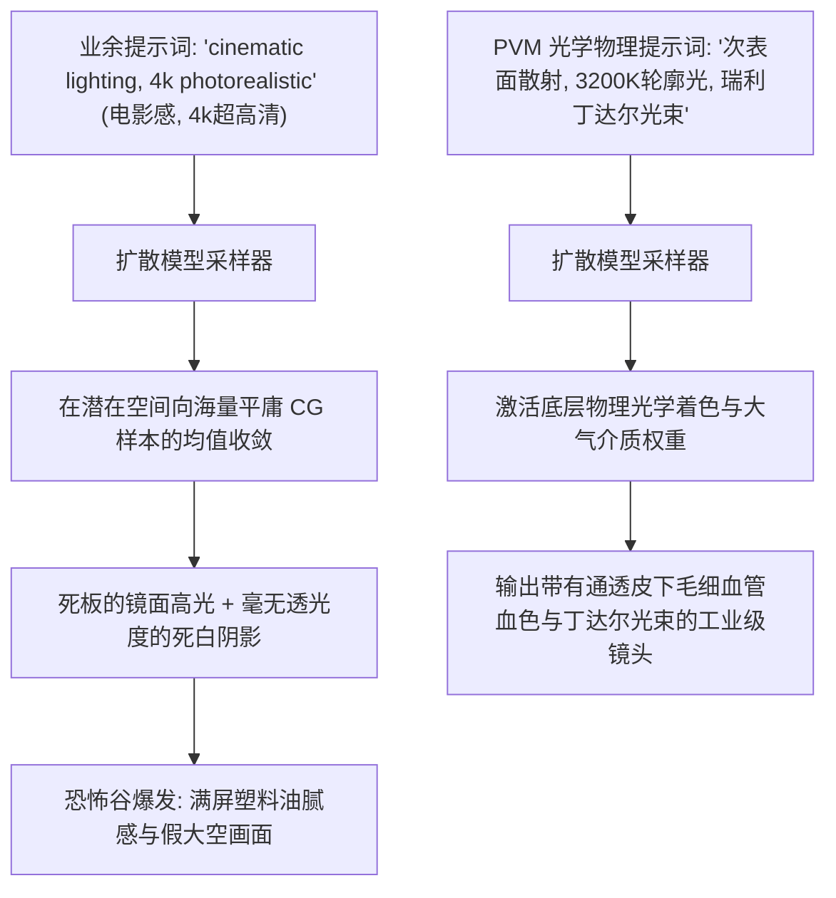

在 2026 年生成 AI 视频时，最困扰创作者的画质硬伤从来不是分辨率不够。顶尖视频扩散模型（Runway Gen-3、Sora、Kling 可灵、Luma）已经能轻松渲染出 4K 级别的像素细节。

真正让画面瞬间“露馅”、被一眼识破是 AI 生成的，是那种挥之不去的**“合成塑料蜡像感”**：
* 人物皮肤像涂了厚厚一层抛光硅胶，毫无真人的透光感。
* 光线是单调平庸的全局泛光，与空气中的微尘毫无交互。
* 物体反光如同廉价的 CG 镜面反射，缺乏真实物理微观粗糙度。

想要拍出真正的电影质感，你必须停止向模型祈求抽象的“电影感”，改用**物理光学法则（Photometry & Optics）去约束潜空间的采样路径**。

本文将拆解专业影视布光的物理本质，介绍**「光学体积矩阵模型」（The Photometric Volumetric Matrix, PVM）**，教你如何用工业级提示词精确调度体积光、次表面散射与胶片质感。

---

## 一、为什么扩散模型默认会吐出“塑料假人”？

训练视频大模型的数十亿互联网素材中，混杂了海量廉价的 3D 游戏渲染图与过度美颜滤镜的手机自拍。



当提示词只有模糊的修饰形容词时，采样器会本能地滑向“统计学平均值”，导致画面光影扁平、材质廉价。

---

## 二、光学体积矩阵 (PVM) 提示词三元法则

专业电影摄影指导（DP）是在操纵真实世界的光子与介质。在 AI 提示词工程中，请遵循**「光学体积矩阵」（PVM）**的三维物理坐标系构建指令：

```
┌─────────────────────────────────────────────────────────────────┐
│ 1. 光源矢量维度 (Source Vector: 光源类型、色温与入射角)        │
│    - 严禁空洞说“光”，指定色温 (2800K 低色温钨丝灯 / 6500K 阴天光)│
├─────────────────────────────────────────────────────────────────┤
│ 2. 大气悬浮介质 (Atmospheric Medium: 丁达尔效应与颗粒体积)     │
│    - 悬浮灰尘微粒、潮湿水汽、浓密雾气对光线的瑞利散射与光柱    │
├─────────────────────────────────────────────────────────────────┤
│ 3. 表面双向反射分布 (Surface BRDF & 次表面散射 SSS)             │
│    - 皮肤毛孔粗糙度、耳垂透光皮下毛细血管微红、拉丝金属各向异性│
└─────────────────────────────────────────────────────────────────┘
```

| 光学控制维度 | 业余提示词翻车写法 | PVM 工业级精准指令词汇 | 画面终极呈现效果 |
| :--- | :--- | :--- | :--- |
| **真实皮肤材质** | *“超细腻皮肤，高清毛孔”* | `subsurface scattering (SSS), epidermal translucency, micro-skin pores, unpolished natural sebum sheen` | 呈现通透真人的红润皮下漫反射，彻底告别蜡像假脸 |
| **大气体积感** | *“酷炫的光线穿过窗户”* | `dense Rayleigh atmospheric haze, visible Tyndall effect volumetric light shafts, illuminated floating dust motes` | 形成肉眼可见的立体光柱与浮尘空间深度 |
| **光比明暗反差** | *“有反差的戏剧化光影”* | `harsh 3:1 chiaroscuro contrast ratio, 5600K daylight key light, 2700K tungsten hair-light rim separation` | 主体轮廓与背景产生清晰的黄金高光剥离 |
| **电影镜头畸变** | *“胶片质感，大片风格”* | `horizontal anamorphic streak flare, subtle chromatic aberration, vintage spherical lens breathing` | 消除纯数字算法的工整感，还原变形宽银幕胶片瑕疵 |

---

## 三、直接可套用的工业级布光 Prompt 配方

以下配方已在多个顶尖视频模型中经过多轮种子验证，可根据场景替换主体：

### 配方 1：黑色电影百叶窗丁达尔体积光（Film Noir Chiaroscuro）
```text
Medium close-up of a weary detective sitting in a 1940s smoke-filled office. 
Lighting: Sharp low-angle morning sunlight slicing through half-open venetian blinds. Dense volumetric light beams piercing through smoke with visible swirling atmospheric dust motes (Tyndall effect). Strong 4:1 chiaroscuro contrast, deep rich shadows without digital noise.
Materials: Natural epidermal subsurface scattering on cheekbones, subtle perspiration specular highlights on temple, heavy textured wool coat. 85mm anamorphic lens, 24fps film motion blur.
```

### 配方 2：赛博朋克双色对冲雨夜轮廓光（Anisotropic Rim Lighting）
```text
Full-body tracking shot of a female hacker running through a rain-drenched alley at midnight. 
Lighting: Dual-tone rim lighting. Intense 4000K cyan neon tube illuminating the left shoulder, contrasting with a vibrant 6500K magenta sign backlight creating razor-sharp edge separation against the dark background. 
Atmosphere: Wet rising steam from manholes refracting neon volumetric shafts. 
Materials: Wet asphalt showing anisotropic specular reflections, realistic water beading on matte black Gore-Tex jacket.
```

### 配方 3：黄金时刻逆光透光剪影（Golden Hour Subsurface Rim）
```text
Over-the-shoulder shot of a wanderer looking at distant mountains at sunset. 
Lighting: Low-horizon 2800K golden hour backlighting. Direct golden sunlight bleeding over the subject's hair and shoulders with soft optical halation. 
Materials: Warm red subcutaneous light visibly transmitting through the earlobes and fingertips (subsurface scattering), backlit fine vellus facial hairs, oiled vintage leather strap. Shallow depth of field, f/1.4 aesthetic.
```

---

## 在 NavoKit 中做文字提示实验

[NavoKit AI 视频生成器](/zh/tools/free-ai-video-generator) 接收文字提示词，可选择画幅和自动或约 3、5、10、18 秒的时长档位。生成后可预览并下载片段；实际尺寸和时长以结果区及返回文件为准。

把光线写进提示词，再检查实际成片。工具没有布光风格预设、4K 输出设置或镜头/角色锁定开关。“电影感光线”是创作描述，不是输出规格承诺。

先生成一个简单镜头，再修改提示词中的一个要素进行比较。生成时间受队列影响，成片质量和细节需要人工检查。

## 结语

堆砌“4K、超高清、极致细节”的时代早已过去。在 2026 年，**光线的物理规律才是终结 AI 假象的终极咒语**。

熟练运用光学体积矩阵，精准调度色温、微尘与次表面透光，让你的每一段 AI 视频都拥有大荧幕级别的真实沉浸感。
