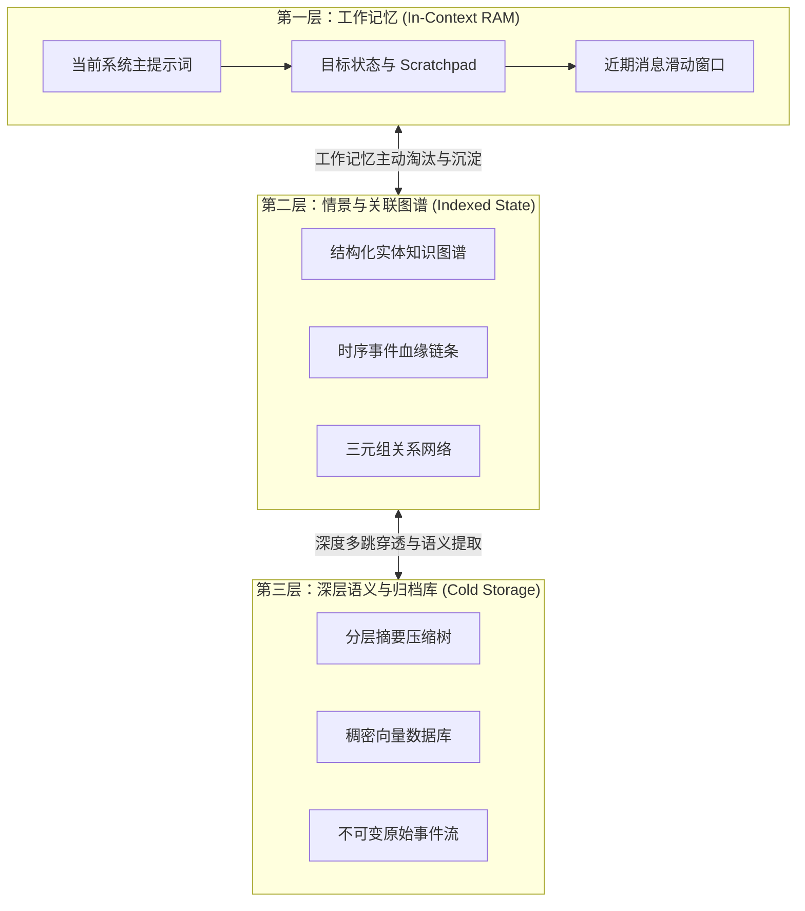

在 2023 年底，给大模型搭建“长期记忆”的标准做法非常直白：把用户聊天记录按 512 Token 切块，用 OpenAI 的 Embedding 模型生成高维向量，丢进 Pinecone 或 Qdrant，然后在运行时通过余弦相似度（Cosine Similarity）取 Top-$K$ 文本块塞回 Prompt。

但到了 2026 年，任何在生产环境中构建长程自主智能体（Autonomous Agents）的工程师都已经达成共识：**单纯依赖扁平向量检索给 Agent 做记忆，在数学和架构上都是一条死胡同。**

当一个智能体需要跨越数周执行复杂任务——比如重构一套微服务代码库、持续追踪行业情报或管理跨平台广告投放时，传统的向量检索很快就会因为**时间盲区、上下文漂移与多跳关系断裂**而彻底崩溃。

本文将拆解向量记忆的底层数学缺陷，介绍**「三层认知记忆架构」（The Tri-Layer Cognitive Memory Hierarchy）**，并解析为什么结合图谱的关联召回正在成为企业级 AI Agent 的标准基础设施。

---

## 一、扁平向量记忆的底层缺陷

为什么标准的向量 RAG 一旦放到 Agent 长期记忆场景就频频翻车？核心原因在于**时间维度的缺失、语义噪声模糊与关系拓扑断裂**。

```
                  ┌──────────────────────────────────────────────┐
                  │    传统扁平向量记忆 (余弦相似度检索)          │
                  └──────────────────────┬───────────────────────┘
                                         │
        ┌────────────────────────────────┼────────────────────────────────┐
        ▼                                ▼                                ▼
┌─────────────────┐            ┌───────────────────┐            ┌──────────────────┐
│ 时间盲区        │            │ 语义噪声涂抹      │            │ 关系拓扑断裂     │
│ (Temporal Lost) │            │ (Polysemy Blur)   │            │ (Graph Fracture) │
│                 │            │                   │            │                  │
│ 无法感知状态变更│            │ 相似句式召回      │            │ 无法跨实体完成   │
│ 新旧指令相互冲突│            │ 完全无关的上下文  │            │ A->B->C 逻辑推导 │
└─────────────────┘            └───────────────────┘            └──────────────────┘
```

### 1. 时间维度的彻底丢失
余弦相似度衡量的只是高维潜在空间里的几何夹角，它**完全没有任何时间先后概念**。
* 如果用户周一告诉 Agent：*“将测试集群部署在 `us-east-1`”*；到了周四又说：*“测试集群已整体迁移至 `eu-west-1`”*。
* 当 Agent 稍后检索 *“测试集群部署在哪？”* 时，两个文本块的向量相似度几乎一模一样。
* 缺乏时间维度的约束，Agent 会随机召回陈旧的过期指令，导致灾难性的执行回滚与代码覆盖。

### 2. 关系拓扑断裂（无法进行多跳逻辑推理）
智能体的决策依赖于因果链条：$实体_A \xrightarrow{关系_1} 实体_B \xrightarrow{关系_2} 实体_C$。
在纯向量数据库中：
* 检索 $实体_A$ 永远无法索引出 $实体_C$，除非它们刚好被切在同一个 512 Token 的文本块里。
* Agent 无法跨越离散事件推导出隐含状态（例如：“客户升级为企业版 VIP” $\rightarrow$ “企业版享有优先 API 配额” $\rightarrow$ “此时不应触发限流拦截”）。

---

## 二、三层认知记忆架构 (The Tri-Layer Cognitive Memory Hierarchy)

为了彻底解决扁平向量检索的缺陷，以 MemGPT/Letta、Zep 等为代表的前沿 Agent 认知架构演进出了**「三层认知记忆模型」**。



### 第一层：In-Context 工作记忆（高速、即时）
* **存储介质**：当前 LLM 的活跃上下文窗口（预留固定预算，如 8k～32k Tokens）。
* **职责**：相当于 CPU 的 L1/L2 缓存与内存。存放当前的执行栈、工具调用的 Scratchpad 和即时任务进度。
* **机制**：当 Token 使用率达到 80% 阈值时，后台触发**工作记忆淘汰机制**，将当前对话提炼为结构化三元组下沉至第二层。

### 第二层：情景与关联图谱记忆（关联、时序、状态化）
* **存储介质**：图关系数据库（如 Neo4j、FalkorDB 或内嵌 SQLite 边表）。
* **职责**：维护实体属性、用户偏好、业务规则及其时间依赖。
* **机制**：所有交互均被抽取为带有时序有效期的三元组 `(User, prefers, Rust, [t_start, t_end])`。

### 第三层：深层语义与归档库（冷存、海量）
* **存储介质**：分层向量索引 + 原始不可变日志。
* **职责**：存放非结构化的历史沉淀文档、数月前的历史项目快照或冷门规则。

---

## 三、传统向量 RAG vs. 分层图谱 Agent 记忆对比

| 架构维度 | 传统纯向量 RAG (Top-K) | 三层分层图谱 Agent 记忆 |
| :--- | :--- | :--- |
| **检索机制** | 静态切块的向量余弦相似度 | 知识图谱路径遍历 + 向量混合召回 |
| **时序感知能力** | 无（需人工外挂繁琐的 Meta 过滤） | 原生支持边时间戳与状态版本生命周期 |
| **多跳推理深度** | 极低（局限于单个切块内部） | 原生支持 $O(1) \sim O(k)$ 的多节点关系漫游 |
| **事实冲突解决** | 极高幻觉率（同时召回新旧矛盾块） | 显式边失效机制（新事实自动标记旧事实过期） |
| **上下文占用** | 包含大量重复与无效冗余切块 | 动态抽取精简子图关系 Markdown |
| **端到端延迟** | 15–40ms（单一向量计算） | 40–90ms（图遍历 + 实体映射） |

---

## 四、如何落地图增强的动态记忆流水线

在实际工程中，不能再把记忆当成被动的“存储桶”，而必须升级为**「主动式记忆合成引擎」（Active Memory Synthesis）**。

```
[输入交互 / 工具返回结果]
           │
           ▼
    [实体与三元组动态抽取]
           │
    ┌──────┴──────┐
    ▼             ▼
[实体对齐消歧]   [冲突检测引擎]
(合并近义同义词) (新事实是否与既有图谱冲突？)
    │             │
    │             ├─► 是：将旧边标记为已失效 [t_end = now]，追加新事实边
    │             └─► 否：以置信度权重写入新关系边
    ▼
[写入知识图谱并更新上层分层摘要节点]
```

### 生产级落地核心准则：
1. **动态边失效（Dynamic Invalidation）**：绝不能无脑往数据库追加向量。当 Agent 发现用户将技术栈从 React 切换为 Svelte 时，必须在图数据库中执行更新：将 `(Project)-[:TECH_STACK]->(React)` 的状态设为 `deprecated`，并记录变更时间戳。
2. **提示词动态注入剪枝**：把图谱召回的信息压缩为高密度键值对注入 System Prompt，而不是贴大段原始聊天记录：
   ```markdown
   - [用户偏好] -> 偏好技术栈 -> [Async Python / FastAPI] (确认时间: 2026-08-10)
   - [当前集群] -> 部署区域 -> [GCP europe-west3] (最近变更: 2026-08-18)
   ```

---

## 结语

大模型记忆架构的下半场，不再是谁的上下文窗口更大，而是谁能以最精准的图谱关系与时序版本管理，为智能体提供确定性的认知锚点。告别粗暴的扁平向量，拥抱分层知识图谱，是构建长生命周期 Autonomous Agent 的必由之路。
