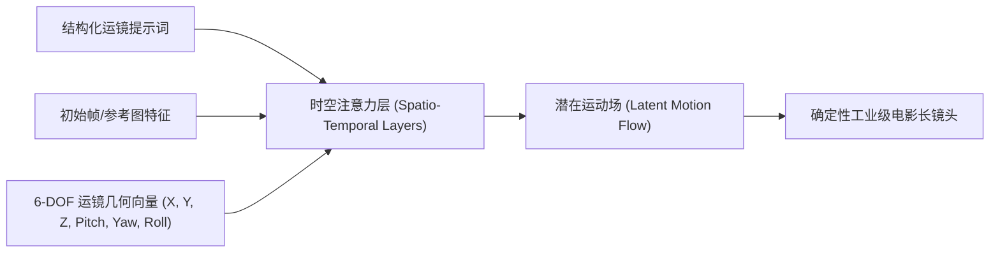

几乎所有 AI 视频创作者都踩过同样的坑：你写出了一段质感极佳的人物和光影提示词，但画面一动起来，镜头就像被喝醉的摄影师手持一样胡乱漂移、上下颠簸，甚至直接把人物扭曲成麻花。

在当下的主流视频扩散模型（Runway Gen-3、Luma Dream Machine、Kling、Sora）中，输入类似 *“电影感运镜”、“炫酷的无人机航拍”* 这种模糊的修饰词，**模型在底层几乎是完全随机采样的**。

想要获得导演级的精准控制，你必须放弃形容词，改用**镜头运动向量（Camera Motion Vectors）**去“编程”画面。

本文将为你拆解**「6 自由度镜头语法矩阵」（The 6-DOF Cinematographic Syntax Matrix）**，并提供可直接复制的工业级推、拉、摇、移、希区柯克变焦（Dolly Zoom）和环绕环拍提示词配方。

---

## 一、视频扩散模型如何理解镜头动力学

在现代视频生成架构中，运镜不是后期的 2D 缩放裁切，而是直接在**时空注意力机制（Spatio-Temporal Attention）**中计算空间几何形变。



当你只写 *“动态镜头”* 时，模型会在潜空间内同时激活多种相互冲突的运动概率（一边拉近镜头一边旋转还一边向左平移），最终导致严重的画面伪影与肢体崩坏。

---

## 二、6 自由度镜头语法矩阵 (6-DOF Syntax Matrix)

工业电影摄影机有 6 个基本自由度：3 个平移轴（$X, Y, Z$）和 3 个旋转轴（俯仰 Pitch、偏航 Yaw、滚转 Roll）。

```
                      Y 轴 (升降 Crane / Pedestal)
                      ▲
                      │    Z 轴 (推拉 Dolly In / Out)
                      │   /
                      │  /
                      │ /
                      └─────────────► X 轴 (横移 Truck / Tracking)
                     / 
                    /  旋转维度:
                   ▼   - 俯仰 (Tilt Up / Down)
                       - 偏航 (Pan Left / Right)
                       - 滚转 (Dutch Angle / Roll)
```

| 运动维度 | 专业电影术语 | 标准提示词语法结构 | 建议运动强度 ($\alpha$) |
| :--- | :--- | :--- | :--- |
| **$+Z$ 平移** | **推镜头 (Dolly In)** | `[Dolly in toward subject], [focal_length=50mm], [speed=constant_linear]` | `0.4 - 0.7` |
| **$-Z +$ 焦距缩放** | **希区柯克变焦 (Dolly Zoom)** | `[Dolly out with background compression], [subject scale fixed center]` | `0.8 - 1.0` |
| **$+X$ 平移** | **横移跟拍 (Truck Right)** | `[Tracking shot moving right], [lateral foreground parallax], [smooth glide]` | `0.3 - 0.6` |
| **Yaw 旋转环绕** | **180度/360度 环绕 (Orbital Arc)** | `[Orbital pan 180 degrees CCW], [pivot_target=subject_eyes], [fixed radius]` | `0.6 - 0.9` |
| **$+Y$ 平移** | **升降镜头 (Crane / Jib Up)** | `[Pedestal up from low ground], [smooth tilt down transition], [sky reveal]` | `0.5 - 0.8` |
| **Roll 滚转** | **荷兰倾斜角 (Dutch Angle)** | `[Dutch angle tilted 25 degrees], [slow clockwise roll transition]` | `0.2 - 0.5` |

---

## 三、生产级硬核运镜配方实战

以下是经过多轮种子验证的高成功率运镜提示词，可直接按需套用：

### 配方 1：希区柯克眩晕变焦（Dolly Zoom / Vertigo Effect）
```text
Cinematic courtroom drama scene, cold institutional lighting. 
Camera trajectory: Hitchcock vertigo effect, physical camera pulls backward rapidly along Z-axis while optical focal length zooms in on the defendant's face. 
Subject face remains fixed size in central frame, background walls and courtroom rows warp and compress dramatically. 4k resolution, 24fps motion blur.
```

### 配方 2：主角登场 180 度环绕长镜头（Hero Orbital Arc）
```text
Full body hero shot of a cybernetic warrior standing on a rainy neon rooftop in Neo-Tokyo. 
Camera trajectory: Continuous 180-degree counter-clockwise orbital tracking arc. Camera rotates smoothly around subject at fixed 2-meter radius at chest height. 
Strong parallax effect between foreground subject and background neon skyscrapers. Anamorphic lens flare.
```

### 配方 3：低角度地面升至俯瞰全景（Crane Up & Tilt Down）
```text
A solitary hiker standing at the edge of a mountain cliff at sunrise.
Camera trajectory: Jib up from low-angle ground level close-up of boots, rising vertically 10 meters into the air while tilting down 90 degrees into a top-down aerial view of the canyon below. 
Smooth gimbal stabilization, steady linear speed.
```

---

## 在 NavoKit 中做文字提示实验

[NavoKit AI 视频生成器](/zh/tools/free-ai-video-generator) 接收文字提示词，可选择画幅和自动或约 3、5、10、18 秒的时长档位。生成后可预览并下载片段；实际尺寸和时长以结果区及返回文件为准。

在提示词中描述一种运镜，并把结果与预期比较。工具没有 6-DOF 预设、镜头路径控制、种子锁定或批量渲染选项。文字提示不能保证精确的相机轨迹。

先生成一个简单镜头，再修改提示词中的一个要素进行比较。生成时间受队列影响，成片质量和细节需要人工检查。

## 结语

从“碰运气式抽卡”到“可控工业化生产”，核心就在于用镜头几何语言代替空洞的修饰词。掌握 6-DOF 运镜语法矩阵，你就能在提示词框里真正执掌摄影机。
