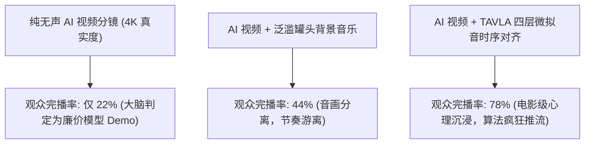

哪怕画面再逼真、光影再细腻的 AI 视频，一旦缺少了一个关键维度，就会瞬间显得无比苍白诡异：**声音**。

虽然 Sora、Runway Gen-3、Kling（快手可灵）和 Luma 等视频扩散模型能生成令人震撼的动态分镜，但它们导出的都是空荡荡的无声 MP4。当观众看到屏幕上一场巨大的爆炸发生却听不到任何次低频空气冲击波，或者高跟鞋踩在大理石地面上却一片死寂时，大脑会瞬间识破这是“人工合成的虚假 CG”。

在 2026 年，顶级 AI 影视制作的分水岭已经从纯粹的像素生成，进化为**视听时序潜在对齐（Audio-Visual Latent Alignment）**。

本文将拆解电影级拟音工程的声学原理，介绍**「时序视听潜在对齐框架」（TAVLA Framework）**，教你如何用工业级手法为 AI 视频制作并同步高沉浸感的微瞬态环境音效。

---

## 一、无声 AI 视频的感官不对称性与完播率死穴

人类感知世界的通道从来都是多模态复合的。心理声学（Psychoacoustics）研究表明：**在影视视听体验中，超过 60% 的质感与真实感直接来源于声音设计，而非屏幕分辨率**。



当画面中的动作撞击点（关车门、雨滴砸在车窗、拉链拉动、脚步踩踏）缺乏毫秒级对应的声音瞬态（Transients）时，观众的大脑会产生强烈的违和感，迅速划走。

---

## 二、TAVLA 框架：分层构建程序化声学生态

想要让无声视频瞬间“活过来”，声音设计绝不能只垫一首背景音乐，而必须在声学频段上分为四大层级：

```
┌─────────────────────────────────────────────────────────────────┐
│ 第 4 层：空间卷积混响 (Room Tone & Convolution Reverb)         │
│   - 还原空间体积感：大教堂回声、车厢内部闷响、空旷荒野风道     │
├─────────────────────────────────────────────────────────────────┤
│ 第 3 层：画面同步微拟音 (Micro-Foley Transients)               │
│   - 动作瞬态：皮鞋踩碎石、衣物摩擦、键盘敲击、微弱呼吸喘息     │
├─────────────────────────────────────────────────────────────────┤
│ 第 2 层：持续环境底噪 (Ambient Environmental Bed)               │
│   - 交代环境基底：夜雨淅沥、远方车流低鸣、冷气机嗡嗡轰鸣       │
├─────────────────────────────────────────────────────────────────┤
│ 第 1 层：次低频动能冲击 (Sub-Bass Impact)                       │
│   - 30Hz–60Hz 次低音膨胀：镜头猛推、特写切换时的生理压迫感     │
└─────────────────────────────────────────────────────────────────┘
```

| 声学分层 | 核心频段范围 | 工业级合成手段 | 目标心理学冲击 |
| :--- | :--- | :--- | :--- |
| **次低频动能** | $20\text{Hz} - 80\text{Hz}$ | 纯正弦低通滤波膨胀、侧链闪避 | 产生胸腔共振与生理级紧张感 |
| **环境底噪** | $100\text{Hz} - 4\text{kHz}$ | 持续立体声扩散潜空间生成 | 确立物理空间的现实存在感 |
| **微拟音瞬态** | $1\text{kHz} - 12\text{kHz}$ | 关键帧毫秒级贴合对齐 | 彻底打破虚假恐怖谷效应 |
| **空间混响** | 全频段脉冲 | 依据画面透视匹配卷积采样 | 让声音反射与视觉景深严丝合缝 |

---

## 三、专业级 AI 声音提示词工程公式

在使用声音生成大模型（如 AudioCraft、Stable Audio 或 ElevenLabs Sound Effects）时，输入类似 *“炫酷科幻爆炸声”* 这种业余词汇只会得到一团混浊的杂音。

请严格采用**「动作-材质-声学环境-麦克风位置」**四元结构公式：

$$\text{声音提示词} = [\text{动作动词}] + [\text{物理接触材质细节}] + [\text{空间声学特征}] + [\text{收音麦克风距离}]$$

```text
[动作动词]: 机械液压活塞重重咬合锁死
[材质细节]: 淬火重钢与钛合金外壳猛烈撞击，带有沉闷的金属共鸣回响
[声学空间]: 潮湿空旷的废弃工业厂房内部，带有 2.5 秒自然的湿声长衰减混响
[麦克风位置]: 双耳人头录音 close-mic 贴脸拾音，超清晰立体声瞬态打击，无底噪杂音
```

### 落地实战 Prompt 模板：
* **赛博朋克雨夜街道**：`"Binaural recording, rain drops sizzling against hot neon advertising glass, distant elevated subway hum 200 meters away, rubber car tire splashing through deep puddle at 10mph, cinematic dynamic range."`
* **高端医学实验室**：`"Sterile cleanroom ambiance, subtle 60Hz hum of humming server racks, crisp hyper-detailed snap of latex gloves being put on fingers, macro-lens audio perspective."`

---

## 在 NavoKit 中做文字提示实验

[NavoKit AI 视频生成器](/zh/tools/free-ai-video-generator) 接收文字提示词，可选择画幅和自动或约 3、5、10、18 秒的时长档位。生成后可预览并下载片段；实际尺寸和时长以结果区及返回文件为准。

先把工具用于视觉草稿，再检查返回文件是否包含可用声音。工具没有音频上传、同步音频开关、拟音轨编辑器或口型控制。需要可控声音时，请在独立编辑器中添加并对齐音轨；提示词不能保证声画同步。

先生成一个简单镜头，再修改提示词中的一个要素进行比较。生成时间受队列影响，成片质量和细节需要人工检查。

## 结语

在 2026 年的 AI 影像竞争中，无声的画面只完成了作品的一半。

善用 TAVLA 框架，为每一个像素的运动注入真实物理世界的声学灵魂，你的 AI 视频才能真正具备直击人心的电影质感。
