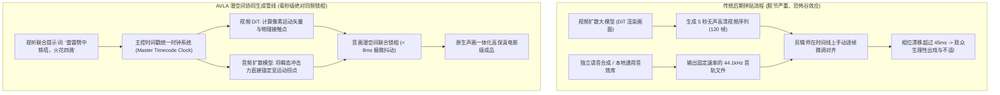

在世界电影工业中，流传着著名导演乔治·卢卡斯（George Lucas）的一句至理名言：  
**“声音，占据了整部电影观影体验的 50%。”**

然而，在 2025 年至 2026 年初生成式 AI 视频的爆发式繁荣中，网络上流传的绝大多数 AI 视频却处于一种荒诞的“失聪状态”：
* 一段 4K 60fps 的超写实慢动作镜头中，晶莹剔透的水晶花瓶在坚硬的大理石地面上撞击得粉碎，画面令人惊叹，但整个过程却死一般寂静；
* 创作者在剪辑软件里强行拼贴现成的版权音效库，声音的爆发点却总是比画面的碰撞瞬间慢了 150 毫秒，瞬间产生严重的假人出戏感；
* 在涉及角色说话的对白场景中，随着镜头推进超过 4 秒，人物的嘴型（Viseme）与声音的音素（Phoneme）便不可逆地分道扬镳，嘴巴在乱动，台词早已吐完。

观众可以容忍画面远景处的一抹模糊材质，**却绝对无法容忍声音与画面的脱节**。人类听觉与视觉皮层对声画不同步的生理容忍极限只有区区 **45 毫秒**。超出这个阈值，大脑便会本能地判定画面是“虚假的幻觉”。

为了彻底攻克这一难题，专业级 AI 影视创作者必须掌握**音画潜空间时序对齐工作流（The Audio-Visual Latent Alignment Workflow, 简称 AVLA 工作流）**。

---

## 1. 声画错位的底层物理学：为什么后贴音效总是令人出戏？

为什么分别生成一段画面和一段音频、再把它们拉到同一条剪辑轨上，永远无法做出真正的电影质感？



### 传统 AI 视频在声音层面的三大致命软肋：

1. **音素（Phoneme）与口型（Viseme）的累积相位漂移**  
   人类发声时，双唇闭合音（如 /p/、/b/、/m/）对应着极其严格的面部解剖学动作。如果在扩散模型的去噪推演过程中，没有将梅尔频谱（Mel-Spectrogram）的隐向量与面部网格特征联合交叉注意力计算，随着帧数增加，嘴唇开合节奏就会与音节完全错位。
2. **物理碰撞力学与瞬态声波不同步（Kinetic Desync）**  
   当重物落地、两刃相交或子弹击碎玻璃时，物体在画面中的运动速度在撞击瞬间会经历剧烈的负加速度（速度拐点）。拟音音效的瞬态冲击波峰（Transient Attack）必须精确落在发生动量逆转的那一帧上。哪怕相差 2 到 3 帧，原本充满力量感的一记重拳就会瞬间变成滑稽的哑剧。
3. **干音剥离与空间混响缺失（Dry Audio Disconnection）**  
   在静音录音室采集的标准音效是“干瘪”的。如果一段 AI 视频发生在空旷幽深的大教堂或下着暴雨的地下隧道中，纯净的干音会像贴纸一样漂浮在画面之上，彻底剥夺场景的空间真实感。

---

## 2. 音画潜空间时序对齐工作流（AVLA）四步法则

为了实现电影工业级的物理拟音与面部对齐，顶尖技术管线全面引入了 **AVLA 工作流**：

```
┌─────────────────────────────────────────────────────────────────────────────┐
│ 音画潜空间时序对齐工作流 (AVLA Workflow) 架构                               │
│                                                                             │
│ [第一阶段: 光流运动动能拐点检测 (Kinetic Peak Detection)]                   │
│ 提取逐帧运动矢量，精确定位物理碰撞与动作发力的绝对时间戳 t_impact           │
│ ─────────────────────────────────────────────────────────────────────────── │
│ [第二阶段: 材质感知拟音瞬态合成 (Acoustic Foley Synthesis)]                 │
│ 根据画面提示词材质 (如湿润花岗岩、生锈铁皮)，合成带强瞬态脉冲的物理声波    │
│ ─────────────────────────────────────────────────────────────────────────── │
│ [第三阶段: 亚帧级高频口型相位锁定 (Sub-Frame Viseme Warping)]               │
│ 在 240Hz 亚帧级时钟频率下完成音素与面部关键点网格的双向对齐                 │
│ ─────────────────────────────────────────────────────────────────────────── │
│ [第四阶段: 虚拟空间脉冲响应卷积 (Room Impulse Response Convolution)]        │
│ 依据画面单目深度图构建虚拟 3D 混响声场，赋予环境音真实的空气阻尼与反射回音  │
└─────────────────────────────────────────────────────────────────────────────┘
```

### AVLA 工作流的核心技术拆解：

#### 1. 动能波峰帧提取（Kinetic Peak Extraction）
利用光流算法计算连续帧之间的运动速度梯度。当画面中的物体发生接触碰撞时，系统自动捕捉加速度导数发生极值反转的绝对时间帧 $t_{\text{impact}}$，将其作为锁定音频波形的不可变时间基准。

#### 2. 材质感知瞬态物理拟音（Foley Matching）
由音频扩散模型根据画面中的材质标签（例如 *“湿润沥青路面上的轮胎急刹”* 或 *“碎石路面的重靴践踏”*）即时生成音效波形。算法将声波中能量最强的打击峰值（Attack Transient）强行对齐到上一阶段捕获的 $t_{\text{impact}}$ 上，误差严格控制在 **5 毫秒以内**。

#### 3. 240Hz 亚帧级口型锁相
针对人声对白镜头，系统在高于常规 60fps 视频 4 倍的 240Hz 采样率下，对面部微动作与音频包络进行非线性插值校准。这种高频微调彻底消除了说话时“下颌生硬颤抖”与“吞字不同步”的违和感。

#### 4. 空间体积脉冲响应卷积（3D Acoustic Convolution）
根据视频生成的深度信息反推当前虚拟场景的空间容积。若场景是一望无际的荒原，则切断早期反射声，施加自然的风声多普勒衰减；若场景是封闭的地下铁穹顶，则自动卷积生成 2.4 秒的金属空谷回音，赋予声音宏大的空间质感。

---

## 在 NavoKit 中做文字提示实验

[NavoKit AI 视频生成器](/zh/tools/free-ai-video-generator) 接收文字提示词，可选择画幅和自动或约 3、5、10、18 秒的时长档位。生成后可预览并下载片段；实际尺寸和时长以结果区及返回文件为准。

先把工具用于视觉草稿，再检查返回文件是否包含可用声音。工具没有音频上传、同步音频开关、拟音轨编辑器或口型控制。需要可控声音时，请在独立编辑器中添加并对齐音轨；提示词不能保证声画同步。

先生成一个简单镜头，再修改提示词中的一个要素进行比较。生成时间受队列影响，成片质量和细节需要人工检查。

## 总结

AI 视频的蛮荒期正在过去。当所有人都在比拼画面的分辨率时，真正决定作品能否打动人心、登上大银幕的关键分水岭，在于**声音的灵魂是否与画面的血肉完美嵌合**。

理解听觉皮层的生理阈值，熟练运用 **音画潜空间时序对齐工作流（AVLA）**，你便能跨越声画失谐的恐怖谷，让每一帧画面的每一次震颤，都在观众的耳膜与心跳中激荡起真实的共鸣。
