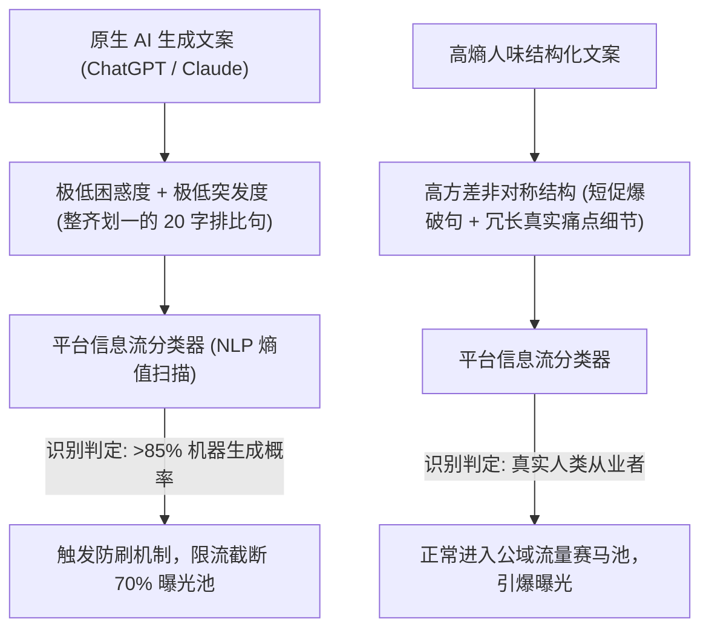

你是否发现，用 ChatGPT 或 Claude 随手生成的行业总结发到 LinkedIn、即刻或 X 上，浏览量经常死死卡在几十个曝光？

内容看似逻辑严密、排版工整，但数据就是一片死寂。与此同时，同行随手发的一条仅有两句话的暴躁吐槽，却轻松斩获数万展现与上百条讨论。

这绝不是玄学。到了 2026 年，**各大社交平台（Meta、X、LinkedIn、小红书）的信息流推荐系统，已经全面部署了针对低信息熵“AI味文案”的惩罚降权分类器**。

算法甚至不需要依赖水印，仅通过**困惑度曲线（Perplexity）、句长方差（Burstiness 突发度）与句式对称性**，就能在 10 毫秒内将一段平庸的 AI 生成内容标记为“工业垃圾”并掐断推流。

本文将为你揭开推荐算法识别 AI 垃圾文案的底层机制，并提供一套**「突发度-信息熵文案矩阵」（The Burstiness-Entropy Copywriting Matrix）**，让你的 AI 辅助文案重获算法青睐。

---

## 一、平台算法如何精准识别并降权 AI 文案

大语言模型（LLM）的本质是统计概率采样：它总是倾向于输出下一个“概率最高、最平滑、最不易出错”的 Token。这种数学特性导致生成的文本**极其工整、平淡且高度单调**。



### 推荐算法抓包 AI 文案的 3 大“显眼包”特征：
1. **句长方差极低（低 Burstiness）**：大模型写出来的句子长度惊人地一致（基本在 15~25 个字之间波动）。而人类真实的表达极其跳跃：前一句可能只有 3 个字，紧接着跟一句包含数十个专业术语的长难句。
2. **公式化的过渡套话**：频繁出现 *“不可否认”、“值得注意的是”、“在这个瞬息万变的时代”、“总而言之”* 等空洞承接词。
3. **强迫症式的列表对称**：每一条要点前面必须加一个 emoji（`🚀 💡 🔥`），后面跟四个字粗体加冒号，每行字数严格一致。

---

## 二、突发度-信息熵文案矩阵 (Burstiness-Entropy Matrix)

想要绕过算法的惩罚过滤器，就必须在文案中主动注入**结构非对称性**与**高信息熵**。

```
                  高信息熵 (出现冷门技术名词、精准度量、非通用词汇)
                                     ▲
                                     │
                   [学术生涩 /       │     [爆款专家从业者]
                    过于晦涩]        │     ★ 算法推流黄金区
                                     │     (超短抓人钩子 + 尖锐数据
                                     │      + 真实踩坑细节)
                                     │
  低突发度 ──────────────────────────┼────────────────────► 高突发度
  (句式整齐划一)                     │                     (长短句剧烈交替)
                                     │
                   [AI 工业废话]     │     [流水账碎碎念]
                   ❌ 算法限流区     │
                   (整齐排比、满屏   │
                    emoji、假大空)   │
                                     ▼
                  低信息熵 (通用套话、陈词滥调、毫无增量)
```

| 结构维度 | 容易被限流的典型 AI 句式 | 算法青睐的高熵高突发句式 |
| :--- | :--- | :--- |
| **开头钩子 (Hook)** | *“在当今数字化浪潮中，AI 正在深刻重塑开发者的编程范式。”* | *“我们刚刚删光了 14,000 行冗余 Python 代码。系统吞吐量直接翻了 4 倍。”* |
| **节奏与律动** | 中等长度长句匀速铺陈，每个论点都被妥帖包裹。 | 极度非对称。用短句砸出矛盾，紧接着跟一段充满情绪与工程细节的复杂长句。 |
| **列表排版** | 5 条要点，每条都是 `👉 核心优势：xxx`。 | 仅列 3 项：第 1 项一句话带过；第 2 项用具体数字硬核拆解；第 3 项直接指出行业通病。 |
| **结尾收尾** | *“你对此有什么看法？欢迎在评论区留下你的思考与建议！”* | 戛然而止的行业洞察，或者抛出一个引发争议的开放式技术矛盾。 |

---

## 三、生产级 5 大反 AI 改写金律

在把 AI 生成的草稿发布到社交平台前，花 30 秒执行这 5 个改写动作：

### 1. 拔掉满屏的 Emoji 拐杖
删掉每行开头的 🚀、🔥、💡。用自然的段落间距和纯文本数字（`1.` `2.`）来呈现逻辑。

### 2. 注入破折号与括注私语
大模型极少主动使用长破折号（——）和括号里的自我吐槽。加入这些口语化停顿，能极大拉高文本的局部信息熵。

### 3. 执行“尾部切除术”
无情删掉最后一段总结。如果 AI 在结尾写了 *“综上所述，拥抱这一技术将为企业构筑坚实护城河”*，直接按 Backspace 删掉，在最锋利的论点处直接收口。

### 4. 替换为未经四舍五入的真实数字
把 *“大幅提升了接口性能”* 改为 *“P99 延迟从 380ms 骤降至 64ms”*。精确的数据是击碎 AI 假大空标签的最好武器。

### 5. 引入鲜明的对立立场
AI 天生倾向于“既要又要”的和稀泥中立态度（*“虽然 A 有优势，但 B 也不容忽视”*）。而爆款内容必须有明确的取舍与态度。

---

## 四、用 NavoKit 一键生成高爆发社媒文案

如果每次手动重写 AI 草稿太耗时，不妨使用内置反降权机制的 **[NavoKit AI 社交文案生成器](/zh/tools/ai-social-post-generator)**：

* **自研 Anti-Slop 引擎**：在底层提示词中彻底屏蔽 AI 套话库与排比句模板，原生生成高突发度长短句。
* **多平台算法适配**：专为 X 字符密度、小红书视觉痛点与 LinkedIn 停留时长算法量身调优。
* **一键切换表达人格**：支持在“犀利创始人”、“硬核架构师”、“毒舌拆解家”等高辨识度音色间自由切换。

---

## 结语

2026 年的算法并不排斥用 AI 提高生产力，它排斥的是**毫无营养的统计学平庸**。

撕掉平庸的 AI 外皮，注入极具冲击力的真实数据与不对称节奏，让你的每一条社媒动态都成为算法疯狂推流的曝光收割机。
