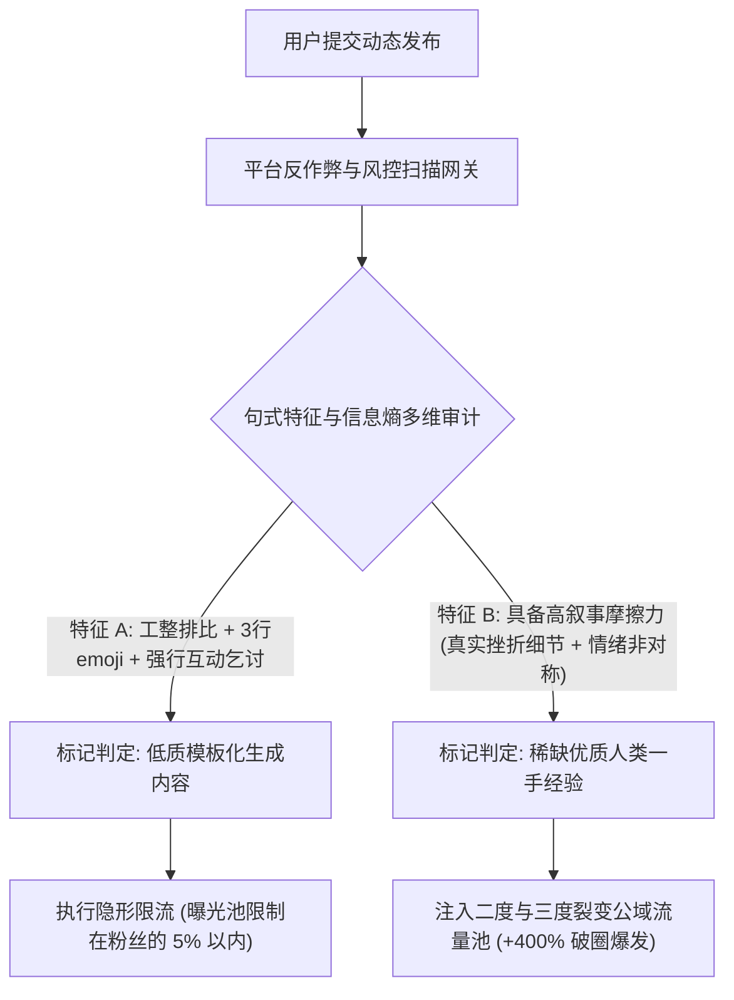

如果你最近频繁使用 AI 辅助撰写社交媒体动态或品牌营销文案，你大概率经历过那种令人窒息的**“算法幽灵限流”（Shadowban）**。

内容排版极其规整，条理清晰，包含了 5 个精炼的要点和精选的 emoji。然而发布 24 小时后，后台数据显示只有区区 70 次曝光——甚至绝大多数还是你同事实习生手滑刷出来的。

发生了什么？在 2026 年，各大社交巨头（X、LinkedIn、小红书、即刻）正在展开一场围剿“合成低质垃圾内容”的生死战。为了维护用户的真实停留时长与广告变现价值，平台的信息流推荐分类器已经从早期的粗暴关键词拦截，演进为**深度的句法结构与行为信息熵特征分析**。

当你的帖子散发着模板化的“AI 味”时，算法会在毫秒内将其标记为低成本工业水帖，并直接给你的曝光池焊上天花板。

本文将拆解反作弊算法的探测机制，并介绍**「叙事摩擦力架构」（The Narrative Friction Architecture, NFA）**，教你如何将干瘪的 AI 清单重塑为算法争相推流的高熵爆款故事。

---

## 一、2026 社交媒体反作弊引擎的底层拦截逻辑

平台的推荐算法并不天然敌视 AI 工具——它敌视的是**让人哈欠连天的统计学平庸**。当成千上万个账号都在发同样结构的“5个实用技巧”时，平台的用户流失率会急剧飙升。



### 触发算法降权的三大“模板死穴”：
1. **过于完美的句式平滑度**：纯 AI 生成的文本太“懂礼貌”、太工整了。每一个小段落都在做四平八稳的总结。而真实的人类叙事充满了意外的跑偏、生硬的转折与愤懑的吐槽。
2. **条件反射式的清单体（Listicle）**：把所有信息强行拆成 5 条并列的长句，算法一秒就能识别出这是从大模型里“蒸馏”出来的空洞摘要，缺乏一手体感。
3. **僵硬的人工互动乞求**：在末尾生硬地加上一句 *“你对此有什么看法？欢迎在评论区告诉我！”* 会直接触发算法的反互动诱导（Engagement-Bait）惩罚机制。

---

## 二、叙事摩擦力架构 (Narrative Friction Architecture)

想要彻底躲过垃圾内容分类器的绞杀，文案必须引入**「叙事摩擦力架构」（NFA）**：放弃居高临下的布道姿态，用充满瑕疵的真实经历创造张力。

```
┌─────────────────┐   ┌─────────────────┐   ┌─────────────────┐   ┌─────────────────┐
│ 1. 突发事故切入 │   │ 2. 踩坑认知误区 │   │ 3. 绝境反直觉转折│   │ 4. 带疤痕的教训 │
│                 │   │                 │   │                 │   │                 │
│ 毫无掩饰的惨败  ├──►│ 我们自作聪明   ├──►│ 误打误撞得出的  ├──►│ 一线总结出的    │
│ 或真实的数字暴跌│   │ 坚持半年的错误  │   │ 极其反直觉的真理│   │ 冰冷粗暴实操原则│
└─────────────────┘   └─────────────────┘   └─────────────────┘   └─────────────────┘
```

| 叙事阶段 | 容易被限流的 AI 陈词滥调 | NFA 高信息熵实战样本 |
| :--- | :--- | :--- |
| **开头钩子 (Hook)** | *“今天和大家分享微服务架构在现代系统扩展中的关键意义。”* | *“上周四凌晨 3 点 14 分，我们主数据库彻底锁死。18 分钟内蒸发了 42,000 美金。”* |
| **冲突铺陈 (Conflict)** | *“在扩展过程中，我们面临着各种复杂的架构权衡与挑战。”* | *“所有架构师都劝我们赶紧加 Redis 缓存。我们照做了，结果因为缓存雪崩，响应延迟反而暴涨了 3 倍。”* |
| **转折突破 (Pivot)** | *“经过团队的深度排查与细致优化，系统吞吐量得到了显著改善。”* | *“最后我们直接砍掉了 8 个所谓的微服务，换成一台单体裸金属物理机跑 Postgres。P99 延迟直接被砸到了 4 毫秒。”* |
| **沉淀收口 (Takeaway)** | *“这启示我们：在技术选型中，永远要保持对简单与优雅的敬畏。”* | *“在你的产品找到真正的 PMF 之前，千万别听网上博主瞎忽悠去折腾 Kubernetes。”* |

---

## 三、提升文案语言熵的 3 大实战杠杆

在对 AI 生成的内容进行润色时，请务必执行以下三项微手术：

### 1. 注入工程黑话与具体行话（Domain Slang）
用硬核的行业切口替换字典里的标准化词汇：
* ❌ 别写：*“我们部署了一套自动化监控流程。”*
* ✅ 改为：*“我们临时搭了个简陋的 cron 脚本，把报警无脑轰进杂乱的 Discord 频道。”*

### 2. 刻意制造标点非对称性
打破平缓的节奏。多使用破折号（——）、括号里的自嘲插话 `(事后证明这完全是个蠢主意)` 以及单字短句。这能显著拉高文本在算法扫描中的困惑度（Perplexity），证明这是真实人类在敲击键盘。

### 3. “不完美主角”定律
AI 总是习惯性把作者包装成无懈可击的大师。而引爆社交网络的爆款，永远属于那些勇敢承认自己犯了低级错误、并在废墟中爬出来的真实实干家。

---

## 用 NavoKit 起草，再人工核对

把一次真实经历、发生了什么以及你的收获写进 [NavoKit AI 社媒文案](/zh/tools/ai-social-booster) 的输入框，也可以用文字补充受众和语气要求。工具会请求生成 X、LinkedIn、Instagram 文案及开场句，供你选择、编辑和复制。

界面没有语气预设选择器或可读性评分循环，也不承诺提高流量。生成草稿不能证明本文其他部分讨论的框架或效果数据。

保留能核实的事实，删除未经证实的数字、个人经历和效果承诺；最后由你检查平台长度、语气与内容，再自行发布。

## 结语

在 2026 年，社交平台算法正在无情收割毫无生气的统计学平庸。

扔掉冰冷的教科书式清单，拥抱充满摩擦力的真实故事与尖锐细节，你的每一次发声才能真正穿透算法迷雾，引发全网共鸣。
