打开你今天的 LinkedIn 或 X（原 Twitter）信息流，你大概率会看到数十条充满善意、严谨周密但毫无波澜的技术动态：

> *“AI 正在深刻改变软件工程。虽然有些同行担心工作被替代，但我认为人机协同才是未来最完美的解法，双方相互配合能创造更大的价值。大家对此怎么看？”*

这类帖子的最终下场通常是什么？  
礼貌性的 4 个赞，0 次转发，评论区只有一位熟人回复了一句 *“写得真好，深有同感！”*。发布两小时后，平台的推荐引擎便彻底将其停止分发，永远埋入历史的尘埃。

这篇文案到底犯了什么致命错误？  
它触犯了现代推荐算法体系下最不可饶恕的原罪：**共识平庸（Consensus Apathy）**。

进入 2026 年，无论是 X 的开源 Heavy Ranker 推荐排序模型，还是 LinkedIn 的专业相关度关系图谱，其算法核心指标都高度锚定在一个权重因子上：**评论区的辩论交互速率与跨圈层争议密度（Comment Thread Velocity & Discourse Density）**。

如果你的观点让所有人都在第一秒默默点头，那就没有人会有冲动敲击键盘写下长评。而一旦缺乏评论互动，算法系统就会冷酷地判定该内容“不具备社交传播势能”，并在 15 分钟内掐断公域流量分发通道。

想要彻底击穿你现有的好友关系圈，你必须学会使用**双极争鸣漏斗模型（The Bipolar Discourse Funnel, 简称 BDF 模型）**。

---

## 1. 算法背后的秘密算子：互动深度权重梯队

社交平台的推荐引擎从来不会将用户的每一次点击等量齐观。一次顺手点赞是极其廉价的数据噪音，一次收藏是无声的自我留存，而一段充满张力、多层嵌套的评论区思想交锋，在算法眼里才是**具备极高商业变现价值的黄金活跃度指标**。

```mermaid
graph TD
    subgraph FlatPost ["平庸共识型文案 (算法瞬间降权)"]
        A1["观点: 'AI 能够帮助工程师提高工作效率'"] --> B1["读者心声: '废话，大家早就知道了'"]
        B1 --> C1["被动顺手点个赞 (算法加权: 极微弱 +1 分)"]
        C1 --> D1["无人愿意浪费时间在评论区打字"]
        D1 --> E1["推荐引擎判定: 该帖缺乏互动讨论势能 -> 停止推流"]
    end

    subgraph BDFPost ["BDF 双极争鸣型文案 (引发流量裂变)"]
        A2["观点: '拒绝让 AI 代写 80% 业务代码的资深程序员，将在 2027 年前全部面临降薪淘劣'"] --> B2["产生认知摩擦: 派系 A 极度支持，派系 B 感到强烈被挑衅"]
        B2 --> C2["派系 B 愤而在评论区写下 300 字硬核反驳"]
        C2 --> D2["派系 A 迅速反唇相讥，形成多层盖楼辩论"]
        D2 --> E2["算法 Heavy Ranker 检测到超高速评论交锋 (+150 权重分)"]
        E2 --> F2["文案被强行推入二度与三度人脉大盘信息流 (曝光量暴涨 10 倍)"]
    end
```



### 推荐模型对用户交互行为的隐性打分矩阵：
1. **纯划屏停留（Dwell Time）**：停留 5 秒以上（+2 分）。
2. **点赞（Like）**：单向被动认可（+1 分，几乎无法驱动破圈推荐）。
3. **转发（Repost / Retweet）**：中等扩散（+5 分，向一度人脉扩散）。
4. **一级评论（Top Comment）**：表明内容激发了读者的表达欲望（+15 分）。
5. **多层回复与楼中楼争鸣（Sub-thread Rebuttal Velocity）**：当用户 B 在用户 A 的评论下展开反驳，且 A 再次回击形成盖楼时，推荐系统会赋予高达 **+75 到 +150 分**的超高权重！系统会自动判定此话题具有极强的人群黏性，从而将该内容强行灌入更广泛的跨行业信息流。

---

## 2. 双极争鸣漏斗模型（BDF）四步结构拆解

高争鸣度绝对不等于低劣的情绪挑拨或无脑引战。缺乏技术事实的纯杠精言论只会损害个人与企业品牌，招致用户的集体拉黑屏蔽。

**双极争鸣漏斗模型（BDF）**的核心要义在于：**用极其鲜明犀利的立论划定战场，用极其严密客观的工程数据支撑论点，迫使同行不得不进行高质量的专业对线**。

```
┌─────────────────────────────────────────────────────────────────────────────┐
│ 双极争鸣漏斗模型 (BDF) 核心框架设计                                         │
│                                                                             │
│ [第一层: 剃刀切割钩子 (The Razor Cleave)]                                   │
│ "80% 盲目封装向量数据库的 AI 创业项目，将在年底前死于云厂商原生功能"       │
│ ─────────────────────────────────────────────────────────────────────────── │
│ [第二层: 硬核实证三角 (Empirical Triangulation)]                            │
│ 摆出真实的 AWS 账单开销、压测吞吐量指标与技术崩溃事实，建立专业壁垒         │
│ ─────────────────────────────────────────────────────────────────────────── │
│ [第三层: 预判性包容反转 (Validated Nuance Pivot)]                           │
│ 率先承认特殊边缘场景的存在，主动卸掉无脑反驳者的枪栓                       │
│ ─────────────────────────────────────────────────────────────────────────── │
│ [第四层: 强制二选一终局提问 (Polarizing Micro-Inquiry)]                     │
│ "你们团队现在的知识库选型，是在坚持专用向量库，还是已退回 pgvector？"       │
└─────────────────────────────────────────────────────────────────────────────┘
```

### BDF 模型的四大结构节点：

#### 1. 剃刀切割钩子（The Razor Cleave Hook，前两行）
开篇直接抛出一个能够将目标行业人群清晰划分为两派的犀利观点（通常保持 60% 认同 vs 40% 强烈反对的张力）。  
*禁忌*：大家都同意的温和废话（如“代码规范很重要”）。  
*典范*：具备技术判断力的断言（如*“在种子轮初创团队中引入微服务不是什么工程前瞻性，而是典型的简历驱动型技术自嗨”*）。

#### 2. 硬核实证三角（Empirical Triangulation，中间论证）
绝不依靠情绪化的形容词支撑论点，而是搬出冰冷客观的量化事实：如服务器每月云成本从 4,000 美元激增至 18,000 美元的明细对照表、P99 延迟劣化数据或真实的开源迁移趋势。这一步能让持反对意见的人无法轻视你的专业度，逼迫他们必须用同样严肃的技术逻辑来评论区回击。

#### 3. 预判性包容反转（Validated Nuance Pivot，段落后段）
在反对者还没来得及敲击键盘之前，主动把他们的论据优雅地说出来：  
*“诚然，如果你的核心业务严格受制于金融级物理合规隔离、且每秒必须处理千万级高维特征实时聚类，专用存储引擎依然是不可替代的。但除了这 1% 的特异团队之外……”*  
这种预判能极大过滤掉无意义的抬杠，逼出真正有深度的高价值长篇讨论。

#### 4. 强制二选一终局提问（Polarizing Micro-Inquiry，收尾）
永远不要用软绵绵的 *“你怎么看？”* 或 *“欢迎讨论”* 收尾。换用非此即彼的强制性站位问题：  
*“你的生产环境目前正在向哪端倾斜：是果断回归单体架构，还是继续硬抗分布式链路排查？”*

---

## 3. 内容形态实战效果对比矩阵

| 评估维度 | 温和中庸型文案 | 低劣引战 / 情绪水帖 | BDF 高争鸣专业文案 |
| :--- | :--- | :--- | :--- |
| **标题与钩子风格** | “为什么我们需要重视代码重构” | “现在的年轻程序员全是垃圾” | “大部分所谓的优雅重构，不过是工程师逃避交付业务的合法拖延” |
| **整体叙事基调** | 理论正确、温和、缺乏记忆点 | 恶意攻击、言之无物、毫无门槛 | **严谨犀利、数据支撑、逻辑闭环** |
| **曝光展示量 (Reach)**| 800 – 1,200 (困在熟人圈) | 30,000+ (但充斥负面举报) | **65,000 – 120,000+ (行业深度破圈)** |
| **评论区平均字数** | 5 个字 (“受教了 / 顶”) | 8 个字 (“作者脑子有病吧”) | **45 个字 (同行长篇工程实战交锋)** |
| **主页粉丝关注转化率**| 0.2% | -2.0% (被大量老粉取关) | **4.2% (吸引真正有话语权的技术骨干)** |
| **行业专业声誉影响** | 泯然众人，毫无行业辨识度 | 身败名裂，被主流圈子拉黑 | **树立具备独立批判思维的技术思想领袖形象** |

---

## 4. 借助 NavoKit AI Social Booster 快速打造破圈文案

要将日常的技术发现快速提炼为符合 BDF 模型的爆款文案，往往需要反复斟酌词句的火候。

使用 **[NavoKit AI 社媒文案生成器 (AI Social Booster)](/tools/ai-social-post-generator)**，你可以一键将任何技术观点转化为高争鸣度、高互动率的社交资产：


### 3 步生成实战法：
1. **输入原生观点**：在 NavoKit 输入框中输入你的业务直觉（例如：*“大家太迷恋微调大模型了，其实把检索语料洗干净效果好得多”*）。
2. **选择风格人设**：选择 *“反共识技术极客”* 或 *“硬核工程审计师”* 预设。
3. **输出排版就绪的成品**：工具会自动应用 BDF 架构，生成包含犀利金句、论点支撑点、反驳预判以及极具吸引力的评论引导问题，直接复制即可发布到 LinkedIn、X 或即刻。

立即访问 **[NavoKit 免费 AI 社媒文案生成器](/tools/ai-social-post-generator)**，开始打造你的下一篇破圈爆款。

---

## 总结

在算法当道的内容时代，信息流里最昂贵的是受众的认知注意力，最廉价的是人云亦云的安全共识。

学会运用 **双极争鸣漏斗模型（BDF）**，并不是教你成为一个哗众取宠的跳梁小丑，而是学会用更锋利的技术手术刀切开浮躁的行业迷雾，在激烈的同行思辨中收获平台推荐算法的超级红利，建立不可撼动的技术影响力。
