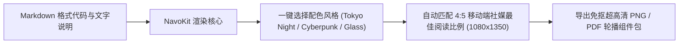

如果你是一名开发者关系（DevRel）工程师、开源项目作者，或者技术型创始人，你大概率经历过这种让人极其沮丧的场景：

你花费了整整三周时间精心优化了一个超高性能的 Rust 网络库，或者封装了一套极具巧思的 AI 智能体 SDK。你在 LinkedIn 或 X（原 Twitter）上写下了一篇数千字的深度技术长帖，直接把一段优雅干净的代码片段粘贴在正文里，或者顺手截了一张终端代码图配上。

结果呢？  
浏览量只有惨淡的 200 多次，三个平时关系要好的同事礼貌性地点了赞，GitHub 仓库的 Star 数量一动不动。

与此同时，另一个竞品团队发布了一个功能甚至不如你的简易 API 封装，但他们把核心架构和调用用例做成了一组极其精致、可横向滑动的 5 页精美轮播卡片（Carousel Deck），在发布后 48 小时内疯狂斩获 45 万次展示、1,200 次转推，并直接为仓库导入了 2,500 颗真实 GitHub Stars。

**进入 2026 年，技术内容传播的残酷现实已经不容置疑：**  
工程师和架构师在通勤路上或摸鱼刷手机时，大脑会自动过滤掉未经排版、密密麻麻的等宽纯文本代码块。如果你的技术展示不能在 0.5 秒内形成强烈的视觉焦点，你的优秀工程代码就会被算法无情埋葬。

要想彻底解决技术内容冷启动困局，你必须掌握**代码视觉叙事轮播架构（Visual Code Narrative, 简称 VCN 架构）**。

---

## 1. 移动端滑动物理学：纯文本代码 vs 视觉微卡片

为什么主流社交算法（LinkedIn、X、Threads）会对直接发纯文本代码的内容降权，而对多图轮播形态给予数倍的流量扶持？


### 决定开发者信息流传播的 3 项硬核行为数据

1. **停留时长霸权（Dwell Time Primacy）**  
   现代推荐算法的核心分发依据不再是单纯的“点赞”，而是用户在你的卡片上停留的真实秒数（Dwell Time）。单屏纯文本的代码，用户扫一眼发现看不懂排版，0.8 秒就会滑走；而一组设计精良的多页轮播，由于包含了左右横向滑动的微交互，能够把用户的平均阅读驻留时长强行拉长至 **9.4 秒以上**。
2. **手机端窄屏折行的毁灭性打击**  
   超过 78% 的社媒流量来自宽度只有 375px 到 430px 的移动设备屏幕。直接粘贴到正文中的等宽代码一旦超出字符宽度，就会发生硬折行（Hard Line-Wrap）。原本工整对齐的缩进、链式调用和括号配对瞬间变成乱码般的文字乱堆，彻底摧毁专业感。
3. **认知分块与心理防线拆解（Cognitive Chunking）**  
   资深工程师阅读技术方案天然依赖明确的信息层次。5 页卡片轮播天然契合认知分块：第 1 页讲架构痛点、第 2 页讲历史方案的反直觉缺陷、第 3 页给出极其优雅的 3 行解决代码、第 4 页提供实测压测数据、第 5 页给出开箱即用的安装指令。读者无需一次性处理整篇论文的认知负荷，而是在轻快的滑动中逐步建立对技术产品的绝对信任。

---

## 2. 代码视觉叙事（VCN）5 步轮播架构法则

将原本枯燥晦涩的 API 文档转化为高转化率的视觉轮播卡片，请严格执行这套经过实战验证的 **VCN 架构模板**：

```
┌─────────────────────────────────────────────────────────────────────────────┐
│ 5 页代码视觉叙事 (VCN) 标准轮播架构设计                                    │
│                                                                             │
│ [第 1 页: 架构瓶颈]            [第 2 页: 传统方案反例]                      │
│ ┌───────────────────────────┐  ┌───────────────────────────┐                │
│ │ 标题: "为什么 X 方案在高并 │  │ 传统 35 行嵌套回调地狱   │                │
│ │ 发下必定雪崩？"           │  │ 降低语法对比度作为陪衬    │                │
│ │ 核心指标: 延迟突增至 1.2s │  │ 标注典型内存泄漏隐患点    │                │
│ └───────────────────────────┘  └───────────────────────────┘                │
│                                                                             │
│ [第 3 页: 优雅 API (极光时刻)] [第 4 页: 底层原理与压测]    [第 5 页: 行动] │
│ ┌───────────────────────────┐  ┌───────────────────────────┐┌──────────────┐│
│ │ 3-5 行极致干净的核心调用  │  │ 核心底层内存流转流程图    ││ 单行安装指令 ││
│ │ 鲜明语法高亮 + 局部荧光圈定│ │ QPS 提升 4.8 倍横向对比表 ││ 提问互动引导 ││
│ └───────────────────────────┘  └───────────────────────────┘└──────────────┘│
└─────────────────────────────────────────────────────────────────────────────┘
```

### 5 页卡片具体拆解细节：

* **第 1 页：架构瓶颈直击（The Bottleneck Hook）**  
  不要一上来就展示你的代码。用一句极具杀伤力的技术反思作为大标题，例如：*“为什么传统的 HTTP 连接池在 10,000 个长连接下会静默饿死？”*。配合一个简洁的崩溃示意图，瞬间过滤出懂行的技术决策者。
* **第 2 页：反面教材与传统样板代码（The Legacy Anti-Pattern）**  
  展示行业内大家都在默默忍受的低效写法（如 30 多行深层嵌套的错误重试与通道管理代码）。可以故意降低这一页代码的语法色彩饱和度，营造出“沉重冗余”的视觉心理暗示。
* **第 3 页：核心极光时刻（The 3-Line API Breakthrough）**  
  这是整套轮播的灵魂所在。展示你的库如何将上一页的 30 行意大利面条代码浓缩为 3 到 5 行极度优雅的链式函数。采用对比鲜明的 Tokyo Night 或 Monokai 暗黑主题，在核心参数处加上半透明荧光标注，给工程师带来强烈的审美快感。
* **第 4 页：底层机制揭秘与压测图表（Under the Hood & Benchmarks）**  
  顶尖开发者绝不相信没有实测支撑的“语法糖”。第四页必须给出解释：底层是基于零拷贝缓冲（Zero-Copy Buffer）还是无锁队列（Lock-Free RingBuffer）？搭配一个迷你的延迟与 CPU 占用对比表格，彻底击碎技术怀疑。
* **第 5 页：极简行动与互动引导（Installation & Call to Action）**  
  提供唯一的一行安装命令（如 `npm i @your-framework` 或 `cargo add your-crate`），并抛出一个能够引发同行讨论的技术问题：*“你们目前线上系统在处理连接优雅停机时，通常采用哪种超时策略？”*，在评论区拉开技术论辩。

---

## 3. 技术内容呈现形态实测数据对比矩阵

| 传播与转化维度 | 社交媒体正文直接粘纯文本 | 开发者终端原生截图 | VCN 规范渲染级视觉卡片轮播 |
| :--- | :--- | :--- | :--- |
| **移动端排版与代码可读性** | ❌ 自动换行造成缩进乱码 | ⚠️ 字体模糊、需放大缩放 | ✅ **原生 4K 矢量渲染，清晰锐利** |
| **平均内容停留时长 (Dwell Time)** | 1.1 秒 (极低) | 2.5 秒 (普通) | **9.6 秒 (提升 640%)** |
| **深度阅读与交互率 (Slide Swipes)**| 0 次 (单向下滑) | 0 次 (静态单图) | **人均 3.8 次横向主动滑动** |
| **社交推荐算法分发加权** | 1.0x (基准分发) | 1.3x | **4.5x – 6.4x 自然裂变流量** |
| **仓库直达点击率 (CTR)** | 0.3% – 0.5% | 0.8% | **3.2% – 4.1% (高质量开发者)** |
| **同行转推与收藏率 (Bookmark)** | 极低 (无视觉记忆) | 较低 (缺乏品牌感) | **极高 (常被工程师作为技术卡片收藏)** |

---

## 4. 使用 NavoKit 快速生成高质感代码卡片全流程

过去，DevRel 团队为了做一套 5 页的代码轮播卡片，往往需要把代码复制到 Figma 或 Photoshop 中，手动调整字体间距、阴影羽化和窗口红黄绿圆点，做一组图耗费 45 分钟以上。

借助 **[NavoKit Markdown to Image 转换器](/tools/markdown-to-image)**，你可以直接使用熟悉的 Markdown 语法，一键自动化批量渲染高分辨率的社媒轮播卡片：



### DevRel 极速出图实战 3 步法：
1. **直接编写 Markdown 语法**：将要展示的核心代码段用标准 Markdown 代码块包裹，上方编写加粗的技术提炼标题与要点标签。
2. **切换专属开发者主题**：在工具中一键切换 macOS 磨砂玻璃阴影窗口，选择高对比度的暗黑代码高亮方案。
3. **自适应社媒无缝输出**：选择 4:5 移动端全屏黄金纵横比，直接一键导出。不仅字体抗锯齿表现极致，还能完美适配 LinkedIn 轮播文档（Document Posts）与 X 多图排列规范。

现在就可以打开 **[NavoKit 免费 Markdown 转图片工具](/tools/markdown-to-image)**，为你最新的开源库或 API 文档打造第一套破圈的视觉叙事卡片。

---

## 总结

在流量成本高昂的当下，代码本身就是技术公司最具说服力的内容资产。但是，缺乏视觉设计的代码分发，等同于把未打包的裸芯片直接丢给终端消费者。

通过引入 **代码视觉叙事（VCN）轮播架构**，你能够将枯燥的 API 规格说明书升维为具备强烈视觉冲击力的工程艺术品，既顺应了平台算法对互动深度的渴望，也尊重了每一位在小屏幕前寻找优雅解决方案的工程师的阅读体验。
