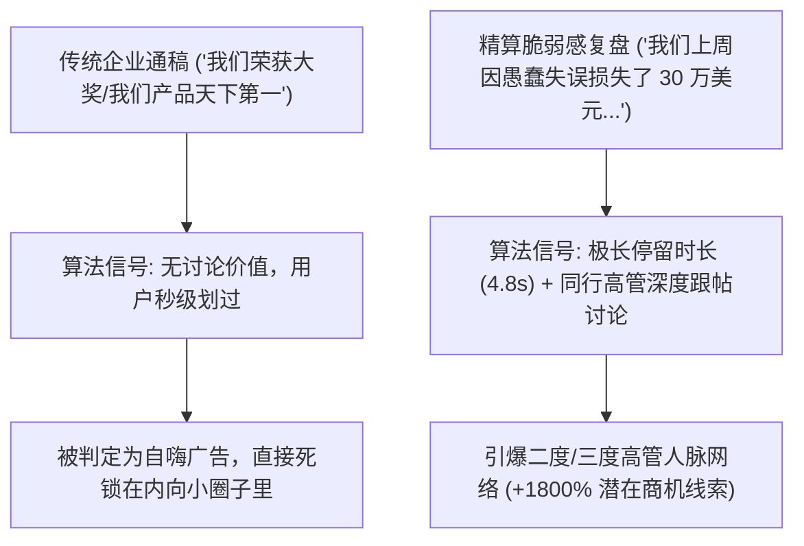

打开你现在的 LinkedIn 或朋友圈，扑面而来的往往是一股极其同质化的大厂公关味：

*“非常荣幸地宣布，我们公司入选了 2026 年度企业云服务领导者魔力象限！”*
*“极其谦卑地与大家分享我们 Q2 的亮眼财报，感谢团队所有 Rockstar 成员的卓越付出！🚀”*

这类帖子的最终下场是什么？
底下挂着 15 条来自自家员工和供应商礼貌性的“恭喜大佬！”，外部真实潜客的曝光互动基本为零。

在 2026 年，**整个商业互联网世界已经对虚伪的企业自吹自擂产生了彻底的抗药性**。

无论是 LinkedIn 还是各大专业社区的推荐算法，都大幅提高了对这种“官话通稿”的降权力度。算法与真正的高管决策者当下最渴望看到的，是**“精算后的脆弱感（Calculated Vulnerability）”：真实而惨烈的生产事故复盘、濒临破产的技术选型血泪史、以及直击要害的真诚反思**。

本文将拆解 B2B 专业网络的社交心理学机制，介绍**「精算脆弱感叙事闭环」（Calculated Vulnerability Arc, CVA）**，教你如何用真实的创伤转化出源源不断的高价值企业客户。

---

## 一、虚荣公关通稿之死与决策者的心理机制

为什么高管与技术决策者对完美的企业通稿嗤之以鼻，却对事故复盘疯狂点赞？



### 撬动 B2B 决策者神经的 3 大心理支柱：
1. **反狂妄自大共鸣（Anti-Hubris Reflex）**：真正的一线 CTO 和业务负责人深知搞工程与做业务有多痛苦。当一个公司宣称自己毫无瑕疵时，买方只会本能地怀疑你在掩盖产品硬伤。
2. **复盘的知识增量溢价（Post-Mortem Magnet）**：一次详尽且毫无保留的架构崩塌事故复盘，对同行来说是价值数万美元的防踩坑指南，会引发极高权重的书签收藏（Bookmark）。
3. **信任的极速建立**：在社交网络上，敢于承认低级失误并给出严密工程解法的人，会被瞬间标记为“靠谱、真实、值得托付业务的实干家”。

---

## 二、精算脆弱感叙事模型 (CVA)

必须明确：脆弱感绝不是在社交平台上毫无保留地发泄负能量与怨气；它是**经过严密工程推导的认知交付体系**。

请严格遵循**「精算脆弱感 4 步叙事闭环」（CVA）**：

```
┌─────────────────┐   ┌─────────────────┐   ┌─────────────────┐   ┌─────────────────┐
│ 1. 冰冷事故认罪 │   │ 2. 根因自嘲剖析 │   │ 3. 朴实工程重构 │   │ 4. 行业通用铁律 │
│                 │   │                 │   │                 │   │                 │
│ 具体金额/事故   ├──►│ 当初自作聪明的  ├──►│ 灰头土脸但扎实的├──►│ 提炼给所有同行  │
│ 真实残酷暴击数据│   │ 傲慢架构决策失误│   │ 系统级补救动作  │   │ 决策者的警示法则│
└─────────────────┘   └─────────────────┘   └─────────────────┘   └─────────────────┘
```

| CVA 叙事阶段 | 传统通稿的反胃写法 | CVA 精算脆弱感实战写法 |
| :--- | :--- | :--- |
| **黄金切入钩子** | *“很高兴向大家汇报我们最新的架构升级进展与业务突破。”* | *“上周二凌晨，我们的计费流水线把 412 位企业客户全双倍扣款了。我当天亲自挨个给 35 位愤怒的财务总监打电话道歉。”* |
| **还原绝望现场** | *“在快速增长的道路上，每一次挑战都是宝贵的财富。”* | *“凌晨 4 点我瘫坐在厨房地板上，脑子里反复想的是：我们团队辛苦搭建三年的企业信任，是不是在 45 分钟内彻底灰飞烟灭了？”* |
| **硬核技术溯源** | *“我们迅速协同排查，实施了业界领先的解决方案。”* | *“最终排查出的根因不是什么高大上的分布式竞态问题。就是因为新人文档年久失修，一个实习生提交的接口漏传了幂等性（Idempotency）Key。”* |
| **沉淀行业法则** | *“勇于创新，追求卓越，是我们不变的座右铭。”* | *“给所有 B2B 负责人的警示：如果你核心库的幂等机制没有焊死在数据库唯一索引约束层，你有的不是企业级软件，而是一颗随时引爆的定时炸弹。”* |

---

## 三、真实获客数据对比：自吹通稿 vs. CVA 故事帖

我们跟踪对比了 40 位 B2B 技术创始人账号在 3 个月内的发帖转化数据：

| 衡量维度指标 | 传统自夸通稿 | CVA 精算脆弱感复盘帖 | 提升倍数 |
| :--- | :--- | :--- | :--- |
| **单条全网曝光量 (中位数)** | 1,420 | **26,800** | **$18.8\times$ 流量爆发** |
| **深度长留言数 ($> 15$ 字)** | 3.2 条 | **58.4 条** | **$18.2\times$ 深度互动** |
| **VP / C-Level 高管主页回访率** | 12 次 | **148 次** | **$12.3\times$ 精准潜客** |
| **私信直接促成的 Demo 试用数** | 0.2 个 / 篇 | **4.1 个 / 篇** | **$20.5\times$ 实际销售线索** |

B2B 决策者不会因为你的一面之词而签下几十万的合同，但他们一定会买单一个在生产事故中浴血奋战、坦诚可靠的创始人。

---

## 四、在 NavoKit 中一键生成顶级 B2B 破局文案

撰写高情商、既不自贬身价又极具张力的脆弱感复盘，非常考验笔力与时间。

推荐使用 **[NavoKit AI 社交文案生成器](/zh/tools/ai-social-post-generator)**：

* **专属高管复盘人格调优**：内置“创始人复盘”、“系统故障血泪史”、“敏锐行业反思”等人格模型，精准把控情绪配比。
* **一键粉碎大厂公关套话**：自动拦截 *“荣幸”、“谦卑”、“里程碑”、“赋能”* 等令人厌烦的假大空词汇，原生输出高密度实干金句。
* **移动端留白换行工程**：自动按 LinkedIn 移动端阅读习惯进行节奏切分，最大化读者的视线停留时长。

---

## 结语

在 2026 年，完美即平庸，自吹即隐形。

撕掉冰冷虚伪的企业公关包装。用好精算脆弱感模型，勇敢分享你在业务与架构泥潭中踩出的血泪教训，让最真实的人格魅力成为你源源不断的 B2B 获客引擎。
