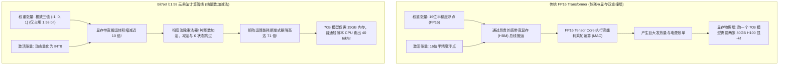

在过去四十年的计算机图形学、科学计算以及现代深度学习发展历程中，底层的计算物理基石始终被同一个数学原语所统治：**浮点通用矩阵乘法（General Matrix Multiplication, 简称 GEMM）**：

$$Y = W \cdot X + b$$

在当今生成式 AI 智算中心里，半精度浮点（FP16 与 BF16）的 Tensor Core 乘积累加（MAC）运算占据了全网 GPU 算力集群**超过 92% 的散热能耗与电力预算**。数以万计的服务器机柜在兆瓦级电网支持下轰鸣，仅仅是为了以微秒级的频率持续计算成百上千亿次浮点矩阵乘法。

然而，在 2024 年末至 2026 年初，微软研究院推出的 **BitNet b1.58** 以及随之而来的 **1-Bit / 1.58-Bit 神经网络革命**，彻底击碎了这一长达数十年的算力教条。

通过将模型中所有线性投影层的权重严格限制为三值参数 $\{-1, 0, 1\}$，BitNet b1.58 **彻底在推理计算中淘汰了浮点乘法**！庞大的矩阵计算在数学底层被完全降维为最基础的整数加法、减法与零跳过。

本文将从硬件电路与信息论的物理底层出发，深入解构 1-Bit 大模型架构的运行机理，并正式提出**三值权重极限量化边界（The Ternary Weight Quantization Boundary, 简称 TWQB）**。

---

## 1. 矩阵计算的硬件物理学：为什么 MAC 操作正在榨干 GPU？

要理解 BitNet b1.58 为何能够引发算力经济学的降维打击，我们首先要对比在 7nm 先进半导体工艺下，一次浮点乘法与一次整数加法消耗的真实电能：



### 芯片物理层面的核心算子功耗对比（7nm 制程）：
* **FP32 浮点乘法**：消耗约 $3.7\text{ pJ}$（皮焦耳）
* **FP16 浮点乘法**：消耗约 $1.1\text{ pJ}$
* **INT8 整数乘法**：消耗约 $0.2\text{ pJ}$
* **INT8 整数加法**：消耗仅需约 **$0.03\text{ pJ}$**

浮点乘法消耗的能量是整数加法的 **36 倍以上**！  
在大语言模型以自回归（Auto-regressive）方式逐字吐出 Token 时，每生成一个词，整个模型几百亿个参数都要在芯片内完整流转并计算一次。将所有的乘法单元替换为纯加法器，不仅瞬间移除了芯片中最发热的逻辑电路，还将显存带宽消耗压缩到极限。

---

## 2. 数学公式深度拆解：为什么是精确的 1.58 位（Bits）？

很多人会好奇：计算机中的二进制位（Bit）只有 0 和 1 两种状态，为什么这个架构被精确命名为 **b1.58**？

在经典信息论中，一个标准的 1-bit 开关只能表达两种离散状态（$2^1 = 2$），通常被设计为二进制权重 $\{-1, +1\}$。

但在深度神经网络中，参数的**特征稀疏性（Feature Sparsity）**是模型过滤噪声、保留关键注意力模式的核心生命线。如果模型只有 $-1$ 和 $+1$，它就丧失了“对无用特征视而不见（权重置为 0）”的能力。

微软研究团队通过将状态空间扩展为**三值状态（Ternary States）** $\{-1, 0, +1\}$，引入了显式的绝对零状态。根据香农信息熵公式，存储一个包含三种等可能状态的变量所需的理论二进制位数正是：

$$\text{Bit capacity} = \log_2(3) \approx 1.58496 \text{ bits}$$

### BitNet b1.58 的前向传播数学推导：
在模型前向计算时，全精度的浮点权重 $\tilde{W}$ 通过绝对平均值缩放（Absmean）被动态量化为三值 $W \in \{-1, 0, 1\}$：

$$\gamma = \frac{1}{nm} \sum_{i,j} |\tilde{W}_{i,j}|$$

$$W_{i,j} = \text{Clip}\left(\text{Round}\left(\frac{\tilde{W}_{i,j}}{\gamma + \epsilon}\right), -1, 1\right)$$

而激活值（Activation）$X$ 则在每个 Token 级别动态量化为 8 位有符号整数（INT8）：

$$X_{\text{quant}} = \text{Clip}\left(\text{Round}\left(X \times \frac{127}{\max(|X|)}\right), -128, 127\right)$$

在线性层的计算过程中，$Y = W \cdot X_{\text{quant}}$ 的物理执行过程变为：
* 若 $W_{i,j} = +1$，硬件直接执行**加法**：$+X_j$；
* 若 $W_{i,j} = -1$，硬件直接执行**减法**：$-X_j$；
* 若 $W_{i,j} = 0$，硬件直接**跳过该计算指令**，无需任何时钟周期消耗。

**在整个模型的线性投影层中，没有发生任何一次浮点乘法运算。**

---

## 3. 三值权重极限量化边界（TWQB 定理）

将原本拥有数万个精细浮点数区间的权重压缩为区区三个离散离散值，模型的逻辑推理与复杂语言理解能力真的不会崩溃吗？

最新的扩展定律（Scaling Laws）研究揭示了清晰的**三值权重极限量化边界（The TWQB Matrix）**：

```
┌─────────────────────────────────────────────────────────────────────────────┐
│ 三值权重极限量化边界 (The TWQB Matrix) 演化区间                             │
│                                                                             │
│ 微小模型区间 (< 1.5B 参数) ──► 表现受限区 (Capacity Bottleneck)             │
│ - 三值量化相较于 FP16 基线模型出现轻微困惑度（Perplexity）损失。            │
│ - 原因: 模型潜空间维度过小，缺乏足够的冗余自由度来吸收离散量化误差。        │
│                                                                             │
│ 关键尺度跃迁点 (3B – 7B 参数) ──► 性能完全等价拐点 (Parity Inflection)      │
│ - BitNet b1.58 在各项主流基准上达到与 FP16 原始模型 100% 相当的推理水平!     │
│                                                                             │
│ 前沿大尺度区间 (> 14B 参数) ──► 超能效统治区 (Super-Efficiency Regime)       │
│ - 性能全面持平甚至反超浮点模型，吞吐量提升 4.1 倍，显存节省 75% 以上。      │
└─────────────────────────────────────────────────────────────────────────────┘
```

TWQB 定理的核心科学结论在于：**超大参数量模型在过去的浮点表示中存在严重的“参数过拟合与精度冗余”**。当模型参数规模突破 30 亿之后，由亿万个三值开关组合而成的高维拓扑流形，已经具备了足以拟合人类全部复杂思维链的表征容量，而浮点数尾数部分的微小数值，不过是无意义的统计噪音。

---

## 4. 全景技术对比矩阵：FP16 vs 4-Bit 传统量化 vs BitNet b1.58

| 核心评估指标 | 传统 FP16 原始 Transformer | 4-Bit 训练后量化 (AWQ / GPTQ) | 原生 BitNet b1.58 (1.58-Bit) |
| :--- | :--- | :--- | :--- |
| **单参数实际存储位数** | 16 bits (半精度浮点) | 4 bits (整型打包) | **1.58 bits (物理 2 bits 打包)** |
| **底层硬件计算原语** | FP16 浮点乘积累加 (MAC) | INT4 反量化为浮点 $\rightarrow$ 乘法 | **纯 INT8 整数加法 / 减法 / 零跳过** |
| **70B 模型所需物理内存** | 约 140 GB 显存 (需多卡并行) | 约 35 GB 显存 (需高显存主机) | **仅 14.8 GB 内存 (普通 PC 即可装入!)** |
| **矩阵运算理论能耗开销** | 1.0x (基准能耗) | 约 0.65x (包含反量化开销) | **0.014x (暴降达 71 倍能耗!)** |
| **无 GPU 的普通 CPU 运行速率**| 无法实用 (< 1 tok/s) | 勉强可用 (4 – 8 tok/s) | **飞速流通 (轻松突破 35 – 50 tok/s)** |
| **模型训练生产方式** | 标准预训练流程 | 依赖现有大模型事后压缩 | **量化感知预训练 (QAT 需原生训练)** |

---

## 5. 边缘端 AI 的历史性转折

BitNet b1.58 正在推动整个 AI 基础设施发生根本性重构：

1. **摆脱对昂贵 HBM 显存的病态依赖**  
   Nvidia H100、B200 等顶级显卡之所以价格高昂且产能受限，根本瓶颈不在于 GPU 核心本身，而在于紧密贴合的 HBM 高带宽显存颗粒。因为 BitNet 将 70B 级别的大模型压缩到 15GB 以内，普通的消费级 LPDDR5X 内存芯片就能够提供支撑每秒 30 字以上吐字的带宽。
2. **边缘微型专用 ASIC 芯片的爆发**  
   为 1.58-Bit 架构定制的专用计算芯片根本不需要昂贵复杂的浮点 Tensor Core，只需集成海量并行的超低功耗整数加法器。这使得芯片晶圆面积减少 80% 以上，使得 70B 级别的超级智能体在无风扇智能手机、车载中控甚至无人机边缘盒子上全天候本地离线运行成为现实。

---

## 总结

FP16 矩阵乘法在大模型时代的长期霸权，不过是人类早期借用图形渲染硬件探索认知智能的历史妥协。

**BitNet b1.58** 用数学与工程实测给出了无可辩驳的证明：智能的涌现并不依赖连续的浮点微积分运算。

拥抱三值权重、彻底消灭乘法运算，正在将千亿参数级的人工智能从高能耗的智算中心牢笼中彻底释放出来，大步迈入万物皆有超级智能的低功耗边缘时代。
