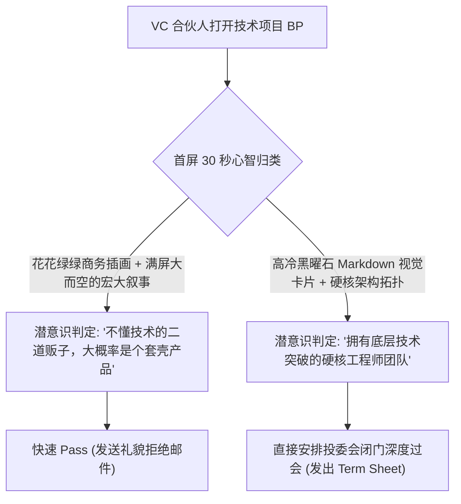

几乎所有技术出身的创业者在第一次向风险投资人（VC）融资时，都会遭遇这种巨大的认知代沟：

你做出了一个石破天惊的技术突破——一个吞吐量提升 10 倍的底层状态机、一个零拷贝内存数据库引擎、或者一套极度优雅的智能体编排网络。但当投资人索要 Pitch Deck（商业计划书）时，你不得不痛苦地打开 PowerPoint 或 Canva，硬着头皮拖拽各种花花绿绿的几何图形、到处找不搭调的免版税商务假人照片。

最后做出来的 PPT，看起来就像一家三流外包公司或保险中介的产品手册。

顶级投资人打开扫了 2 分钟，礼貌性地回了一句 *“方向很棒，但我们暂时看不太懂”*，然后就再无下文。

为什么？因为在 2026 年，**懂技术的顶尖一线 VC（如 Founders Fund、红杉、Benchmark）最反感的就是花哨空洞的营销风 PPT；他们最渴望看到的是纯粹的技术确信力、严谨的系统架构美感与工程师的思维逻辑**。

当一位技术创始人直接用**「Markdown 视觉卡片」**进行商业路演——用高反差暗黑主题、精致的代码高亮、以及简洁的系统状态机图表呈现核心壁垒时，投资人能瞬间嗅到顶级极客的杀气与权威感。

本文将为你揭密硅谷顶尖技术团队的融资美学，并提供**「5 张卡片技术叙事闭环」（Technical Narrative Loop, TNL）**。

---

## 一、VC 投资人的认知扫描：为什么传统花哨 PPT 会引发反感？

顶级风险投资机构每周都要审阅数百份 BP，合伙人在每份 Deck 上停留的平均中位数时间仅有 **2 分 18 秒**。



### 真正懂技术的顶流投资人只看 3 个核心信号：
1. **代码级护城河（Code-Level Moat）**：你能否用 5 行极简的代码调用，证明你的架构比传统老旧方案简单 10 倍、快 10 倍？
2. **严密的系统状态思维**：你能否用一个状态转换图解释你的商业模型闭环，而不是画几个空洞的漏斗？
3. **极高信息密度**：版面是否剥离了一切无意义的装饰性视觉垃圾，每一行字符都在传递技术本质？

---

## 二、5 张卡片技术叙事闭环 (TNL)

扔掉那套冗长不堪的 20 页通用 PPT 模板。真正能拿下千万元早期融资的技术 Deck，只需要一套**「5 张卡片叙事闭环」**：

```
┌─────────────────────────────────────────────────────────────┐
│ 第 1 张卡片：旧世界架构的崩塌与折磨 (The Anti-Pattern)      │
│ - 一张高对比度拓扑图：展示现有方案由 10 个混乱工具强行胶水拼凑│
├─────────────────────────────────────────────────────────────┤
│ 第 2 张卡片：核心技术抽象突破 (The 5-Line Breakthrough)     │
│ - 精致代码语法高亮：展示本项目如何用 5 行代码优雅降维打击   │
├─────────────────────────────────────────────────────────────┤
│ 第 3 张卡片：冷酷无情的物理基准测试 (The Unfair Physics)     │
│ - 延迟对比表与算力账单对比：单次调用成本直降 85%，P99 降低 10 倍│
├─────────────────────────────────────────────────────────────┤
│ 第 4 张卡片：飞轮分发与开发者生态 (Distribution Engine)      │
│ - 极简生态增长流向图：开源社区如何自发形成客户转化闭环     │
├─────────────────────────────────────────────────────────────┤
│ 第 5 张卡片：创始人技术基因与融资诉求 (Execution & Ask)     │
│ - 极简等宽字体履历清单 + 明确的阶段性工程里程碑与融资额     │
└─────────────────────────────────────────────────────────────┘
```

| 卡片序号 | 回答的核心商业拷问 | 视觉呈现资产策略 | 推荐排版格式 |
| :--- | :--- | :--- | :--- |
| **卡片 1：痛点解构** | *“现在的解决方案为什么蠢且昂贵？”* | 传统网状混乱依赖架构图 | 暗黑背景配警示红色高亮圈注 |
| **卡片 2：核心突破** | *“你们到底发明了什么不公平优势？”* | **高质量代码语法高亮 Diff** | 5~8 行纯粹的 Rust/TypeScript 核心接口 |
| **卡片 3：数据自证** | *“怎么证明不是在吹牛？”* | 权威基准性能对比表 | 严密的吞吐量 QPS 与并发测试曲线 |
| **卡片 4：增长闭环** | *“怎么把技术变成真实的商业订单？”* | 开发者自传播飞轮拓扑 | 极简灰度 Mermaid 有向流程图 |
| **卡片 5：终局与要价** | *“拿钱打算达成什么具体的工程指标？”* | 等宽字体的代码路线图清单 | 干净利落的里程碑 Checkbox 列表 |

---

## 用 NavoKit 整理一张 Markdown 卡片

在 [NavoKit Markdown 转图片](/zh/tools/markdown-to-image) 中粘贴演示文稿中的一个技术要点。用标题、列表、表格或代码块组织内容，检查实时预览，再导出 PNG。转换在浏览器中完成，图片包含 NavoKit 标识。

当前界面采用固定的白色卡片样式，没有主题、语法高亮、窗口边框、透明背景或画幅比例选择器；也不提供 PDF、矢量或批量导出。图片高度随内容变化，长内容需要先拆分。

制作轮播或演示文稿时，请逐张整理和导出，再在发布平台或演示工具中组合。 保留可复制的原始文本与代码链接，让图片起到辅助说明的作用。

## 结语

在硬核科技领域，代码才是最高级的商业叙事语言。

扔掉那些充满套路感的企业 PPT 模板。用 Markdown 凝练你的系统思考，用极简的视觉卡片呈现技术不可替代的锋芒，让真正懂行的投资人毫不犹豫地为你签下支票！
