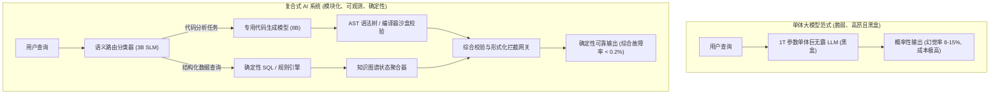

在 2020 到 2024 年间，全行业的通用套路非常一致：苦等下一个参数规模更大的基础大模型发布（GPT-3 $\rightarrow$ GPT-4 $\rightarrow$ Claude 3.5），然后把更长的 System Prompt 塞进去，指望大模型涌现出的“通用智能”能够神奇地解决业务中的所有边界 Corner Case。

但到了 2026 年，这一粗暴的暴力美学彻底撞上了物理与经济学的高墙。

将基础模型参数从千亿级堆到万亿级，在 Benchmark 基准测试上的边际收益越来越微弱，却带来了显存开销暴增、Token 延迟飙升以及概率性幻觉无法消除的灾难性后果。在金融结算、医疗诊断、自动化合规等容错率极低的工业级业务中，一个“综合准确率 92% 的单体黑盒大模型”在实际工程上等于**完全不可用**。

行业的技术共识已经发生了历史性转向：由伯克利 BAIR、斯坦福以及一线 AI 领军团队共同定义的 **「复合式 AI 系统」（Compound AI Systems）** 正在成为主流。

本文将从系统架构层面拆解为什么模块化流水线正在淘汰单体巨无霸模型，并介绍衡量生产级 AI 可靠性的**「4 支柱复合系统可靠性指数」（4-Pillar Reliability Index）**。

---

## 一、单体大模型的死胡同 vs. 复合式系统的协同效应

**单体 AI 系统（Monolithic System）**试图在一次万亿参数前向计算中，同时完成意图识别、数据提取、业务校验、多步推理与排版格式化。

而**复合式 AI 系统（Compound AI System）**则将其作为典型的分布式软件工程问题来解决：通过多个专用的小参数语言模型（SLM）、确定性规则引擎、语义路由器和编译器沙盒紧密协同。



### 为什么模块化流水线在数学上完胜单体模型？
1. **错误局部化与微秒级重试（Localized Retries）**：如果一个单体模型在 8 步推理的第 4 步产生了幻觉，整条链路彻底报废（100% 的算力被白白浪费）。而在复合系统中，每个小模块只负责独立闭环，单步校验失败可在 10ms 内针对性微重试。
2. **确定性沙盒增强（Deterministic Guardrails）**：神经网络是概率性的，而编译器、AST 解析器和正则表达式是确定性的。将 8B 级别小模型包裹在 WebAssembly/Python 执行沙盒中，系统可靠性直接从 88% 跃升至 99.8% 以上。
3. **极度夸张的成本收益比（$10\times$ 降本法则）**：把 70% 的常规文本清洗与简单分支路由分流给超轻量的 3B 模型，仅将最艰难的冲突仲裁交给顶尖推理模型，可直接**降低 85%~90% 的企业 Token 账单**。

---

## 二、4 支柱复合系统可靠性指数 (4-Pillar Index)

为了量化评估企业级 AI 架构的健壮度，我们定义了**「4 支柱复合系统可靠性指数」（$R_{sys}$）**：

$$R_{sys} = w_1 \cdot \text{确定性验证能力} + w_2 \cdot \text{状态隔离度} + w_3 \cdot \text{成本弹性} + w_4 \cdot \text{模块可组合性}$$

```
                          1. 确定性形式化验证能力
                                     ▲
                                     │
                 [静态代码编译       │     [企业级复合式 AI 系统]
                  形式化验证]        │     ★ 工业生产级架构
                                     │     (模块解耦、单步可测、
                                     │      确定性拦截兜底)
                                     │
4. 模块可组合性 ─────────────────────┼────────────────────► 2. 状态与上下文隔离度
(即插即用的 SLM)                    │                     (物理沙盒隔离)
                                     │
                 [脆弱的 Prompt      │     [单体大模型 Wrapper]
                  链式智能体]        │     ❌ 幻觉与成本黑洞
                                     │     (单点脆弱性，黑盒不可测)
                                     ▼
                          3. 成本与延迟弹性
```

| 评估维度 | 单体大模型暴力求解 | 复合式 AI 架构流水线 |
| :--- | :--- | :--- |
| **组件颗粒度** | 单一全能通用大模型（$>70\text{B} \sim 1\text{T}$） | 动态微调 SLM 集群（$3\text{B} \sim 14\text{B}$）+ 外部运行时工具 |
| **可观测性与 Debug** | 无法观测潜空间神经元激活（纯黑盒） | 每一个微服务调用节点拥有完整的分布式链路追踪（Tracing） |
| **迭代升级风险** | 牵一发而动全身，全局重新调优 Prompt | 独立热插拔（单独升级 SQL 解析器，不影响主路由逻辑） |
| **输出准确性保障** | 靠运气提示词祈祷（Soft Prompting） | 强制类型检查拦截（JSON Schema、编译器 AST 类型约束） |
| **每百万可靠 Token 成本** | \$15.00 – \$30.00 | **\$0.80 – \$2.40**（直接降低 10~15 倍） |

---

## 三、如何设计一套工业级复合流水线

在落地复合式 AI 系统时，推荐遵循三大核心设计模式：

```
[用户请求进入] ──► [超轻量语义路由器 (DistilBERT / Llama-3-3B)]
                         │
        ┌────────────────┴────────────────┐
        ▼                                 ▼
[分支 A: 结构化查询/计算]          [分支 B: 复杂模糊推理]
        │                                 │
[确定性 SQL / 算法工具]            [专有小模型草稿 + 局部自修正]
        │                                 │
        └────────────────┬────────────────┘
                         ▼
             [形式化类型与合规拦截网关]
             (校验是否通过？是: 输出; 否: 局部回退重试)
                         ▼
                   [最终结果交付]
```

### 生产级落地核心准则：
1. **语义路由器前置**：绝不要让贵重的大模型去回答简单的知识检索。在最前层部署微秒级路由器，将请求分流给缓存、规则库或小模型。
2. **可执行代码作为通用中间表示（IR）**：面对复杂的数学逻辑与业务规则，不要让大模型用自然语言“硬猜”，而是让其生成可执行的 Python/Rust 脚本，在隔离沙盒里跑出确定性结果。
3. **决策者与审批者彻底解耦**：负责生成解决方案的 Agent 绝不能同时担任自己的裁判员。必须外挂一个对立视角的独立校验模型，配合硬编码规则执行双重审计。

---

## 结语

AI 时代的工业革命，绝不会建立在“祈祷单一巨无霸模型永远不犯错”的幻觉之上。

学会把大模型视作流水线中的一个普通计算节点，通过优秀的系统工程架构将其与确定性工具深度咬合，才是企业构建不可替代的 AI 壁垒的真正基石。
