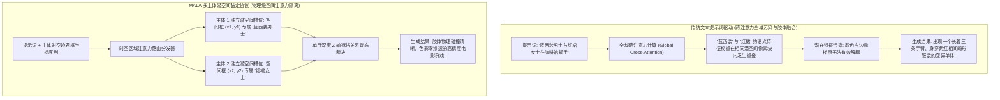

在当下的 AI 生成式视频（Generative Video）创作中，让模型生成一个单独的主体——无论是让一名赛博朋克风侦探漫步在霓虹闪烁的雨夜街道，还是一台浓缩咖啡机缓慢萃取液体——画面都能呈现出令人窒息的超写实电影质感。

然而，一旦你将提示词（Prompt）修改为真正具备电影叙事张力的复杂多主体群戏：
> *“五名身穿黑色西装的银行劫匪在拥挤的地铁站台飞速狂奔，穿梭在数十名神色慌张的通勤乘客之间。”*

渲染出的视频往往会在短短 3 秒内演变成不可名状的恐怖片现场：
* 奔跑的主体在身体擦肩而过的瞬间，手臂和躯干像融化的橡皮泥一样粘连扭曲成一体；
* 背景中几十名群众演员的面部沦为毫无五官特征的肉团，眼球与鼻梁在帧与帧之间诡异浮动；
* 身穿黑西装的劫匪穿过穿红衣服的路人身旁时，两人瞬间发生服装颜色对调与种族面容互换。

在视频扩散 Transformer（DiT）的底层物理学中，这一灾难性现象被称为**跨注意力机制串扰与潜空间特征渗透（Cross-Attention Crosstalk & Latent Feature Bleeding）**。

本文将深入拆解多主体视频生成崩溃的深层原因，并正式介绍行业前沿的**多主体潜空间锚定协议（The Multi-Actor Latent Anchoring Protocol, 简称 MALA 协议）**。

---

## 1. 潜空间串扰物理学：为什么扩散模型一遇到群像就融化？

要彻底解决多主体畸变，我们必须观察文本提示词（Text Conditioning）是如何映射到时空视频潜空间（Spatial-Temporal Latent Space）之中的：



### 多主体视频生成的 3 大核心技术阻碍

1. **跨注意力热力图发散与全域污染（Global Attention Crosstalk）**  
   在标准的文本到视频架构中，文本词元（Text Tokens）是面向整张画布进行全域广播的。当画面中同时出现两个以上的主体时，形容主体 A 的属性（如“短发、皮夹克”）与形容主体 B 的属性（如“金发、白衬衫”）在逆向扩散去噪的中间步中发生梯度混淆，导致模型无法区分哪些像素归属于谁。
2. **时序遮挡导致的身份丢失（Temporal Occlusion Amnesia）**  
   当主体 A 在运动中被主体 B 短暂遮挡（即使仅持续 12–24 帧），现有的时序注意力模块无法长期维持不可见主体的特征记忆。一旦主体 A 从遮挡物后重新出现，模型往往会将其重置为一个完全不同的随机路人。
3. **高频面部网格在低分辨率潜空间下的信息坍塌**  
   在由 10 个人组成的群像画面中，分摊到每个背景人物面部的实际像素面积往往不足 $32 \times 32$ 像素。标准 VAE（变分自编码器）经过 8 倍或 16 倍的下采样后，背景人脸在潜空间中仅仅剩下几个离散的浮点数，在数学上彻底丧失了表征眼眶、瞳孔与唇部肌理的维数容量。

---

## 2. 多主体潜空间锚定协议（MALA 协议）核心工作流

为了在纷繁复杂的群像与动作交互中精准锁定每一个演员的独立轨迹与外貌一致性，工业级影视工作流普遍引入了 **MALA 协议**：

```
┌─────────────────────────────────────────────────────────────────────────────┐
│ 多主体潜空间锚定协议 (MALA Protocol) 执行链路                               │
│                                                                             │
│ [阶段 1: 3D 时空运动轨迹先验离散化]                                         │
│ 预先规划每个角色的时空包围盒: B_i(t) = [x, y, w, h, 深度 z]                 │
│ ─────────────────────────────────────────────────────────────────────────── │
│ [阶段 2: 区域掩码跨注意力空间解耦 (Masked Cross-Attention)]                 │
│ 限制角色描述词元的梯度更新严格发生在自身潜空间包围盒内，切断跨区域污染     │
│ ─────────────────────────────────────────────────────────────────────────── │
│ [阶段 3: 深度感知 Z 轴动态遮挡缓存]                                         │
│ 引入深度估计，在发生前后遮挡时将后方角色特征冻结存入持久化外置缓存         │
│ ─────────────────────────────────────────────────────────────────────────── │
│ [阶段 4: 微瓦片局部动态超分网络 (Micro-Tile Facial Refinement)]              │
│ 针对背景次要角色面部执行动态局部切块，以 512px 独立通道实施高频纹理重构     │
└─────────────────────────────────────────────────────────────────────────────┘
```

### MALA 协议的关键步骤深度解读：

#### 1. 显式时空轨迹约束（Spatial-Temporal Trajectory Partitioning）
彻底抛弃用自然语言模糊描述空间方位的低效做法（如“一个在左边，一个在右边”）。系统在生成初期注入显式的四维轨迹张量 $[x(t), y(t), w(t), h(t)]$，在每一帧预先划定不同主体的势力范围，构建物理运动骨架。

#### 2. 基于掩码的跨注意力隔离（Masked Cross-Attention）
在 DiT 的去噪核心层，将原本全域的 Softmax 注意力计算强制注入区域空间掩码矩阵 $M_{\text{regional}}$：
$$\text{Attention}(Q, K, V) = \text{Softmax}\left(\frac{Q K^T}{\sqrt{d}} + M_{\text{regional}}\right) V$$
将角色 1 对应的文本词元与角色 2 所在空间区域的注意力亲和度（Affinity）强行置为 $-\infty$。从数学物理底座上彻底粉碎“红衣服染红蓝裤子”的色彩渗透隐患。

#### 3. 动态遮挡特征持久化（Occlusion-Proof Persistent Cache）
当深度网络判定角色 A 走入角色 B 身后时，系统并不让角色 A 参与当前帧的去噪竞争，而是将其在遮挡前最后一帧提取的潜空间特征向量原样沉降到持久化特征队列（Identity FIFO Buffer）中；一旦两人的包围盒分离，立即无缝热插回潜空间，确保护目镜、发色与轮廓在重新现身时 100% 完美复现。

---

## 在 NavoKit 中做文字提示实验

[NavoKit AI 视频生成器](/zh/tools/free-ai-video-generator) 接收文字提示词，可选择画幅和自动或约 3、5、10、18 秒的时长档位。生成后可预览并下载片段；实际尺寸和时长以结果区及返回文件为准。

从简单场景开始，用文字描述角色。工具没有角色控制台、肖像上传、边界框画布或每个角色独立的运动路径设置。复杂互动可能产生错误，使用片段前需要检查脸部、肢体和遮挡。

先生成一个简单镜头，再修改提示词中的一个要素进行比较。生成时间受队列影响，成片质量和细节需要人工检查。

## 总结

AI 视频生成的演进史，正在从单人独白的小格局短片，大踏步跨入波澜壮阔的电影级多主体交锋新纪元。

单纯依靠冗长的大段文字描述已经无法驯服复杂的时空潜空间。只有深刻理解跨注意力的物理边界，全面拥抱 **多主体潜空间锚定协议（MALA）**，创作者与开发者才能真正攻克肢体黏连与容貌漂移的最后一公里，自如调度千军万马的史诗级视觉叙事。
