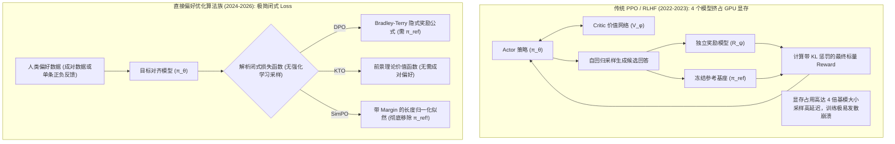
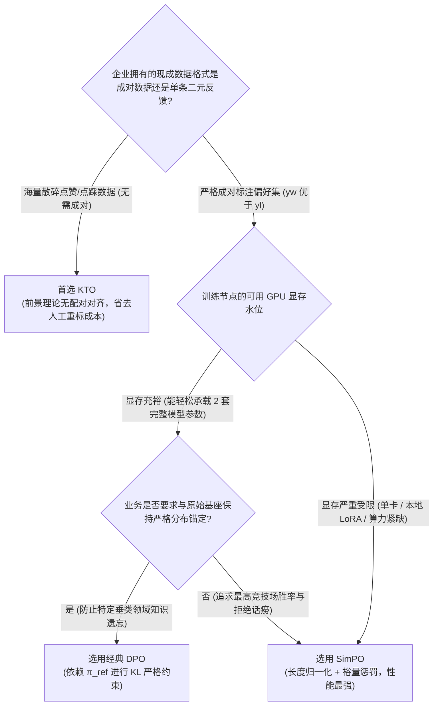

在大语言模型（LLM）后训练对齐的蛮荒年代（2022–2023年），近端策略优化（PPO，Proximal Policy Optimization）——也就是支撑 ChatGPT 惊艳问世的经典 RLHF 强化学习算法——曾被奉为不可撼动的行业圭臬。

然而在现实工程落地中，PPO 是所有算力工程师挥之不去的噩梦。

为了跑通一套标准的 PPO 对齐流水线，工程团队必须在 GPU 显存中同时维持**四个百亿级参数的庞大深度学习模型**并保持多进程显存同步：
1. **Actor 模型**（正在进行梯度更新的目标策略网络 $\pi_\theta$）
2. **Critic 模型**（负责估算状态价值的评价网络 $V_\phi$）
3. **Reward 模型**（预先在人类成对偏好数据上微调训练的独立奖励模型 $R_\psi$）
4. **Reference 模型**（被完全冻结的基座策略 $\pi_{\text{ref}}$，用于通过 KL 散度惩罚防止策略漂移奔溃）

不仅显存消耗极其恐怖，PPO 的训练过程还以“极度脆弱”闻名：学习率稍有波动、奖励模型出现局部“奖励作弊（Reward Hacking）”，或者 Value 网络的 Loss 发生抖动，整个由 8 台 8 卡 H100 构成的昂贵训练集群就会在梯度爆炸中毁于一旦。

进入 2024 至 2026 年，大模型学界与工业界爆发了一场以“奥卡姆剃刀”为哲学核心的极简化革命。一系列**无显式奖励模型（Reward-Model-Free）的直接偏好优化算法**迅速接管了后训练舞台。

本文将从严谨的数学推导与底层工程显存机理出发，深度复盘 **DPO**、**KTO** 与 **SimPO** 的演进脉络，并正式提出用于指导生产选型的**偏好损失拓扑矩阵（The Preference Loss Topology Matrix, 简称 PLT 矩阵）**。

---

## 1. 架构演进：从四模型并发到单模型闭环

现代直接对齐算法是如何用优雅的闭式损失函数（Closed-Form Loss），彻底消灭脆弱的强化学习采样循环的？

---

## 2. 核心数学机理深度拆解：DPO、KTO 与 SimPO

### A. DPO（直接偏好优化，Direct Preference Optimization）
斯坦福大学 Rafailov 等人在 2023 年揭示了一个极为优美的数学对偶关系：在经典的 Bradley-Terry 偏好模型假设下，最优策略 $\pi^*$ 与真实奖励函数 $r(x,y)$ 之间存在唯一的闭式映射：

$$r(x, y) = \beta \log \frac{\pi_\theta(y | x)}{\pi_{\text{ref}}(y | x)}$$

DPO 的绝妙之处在于直接将这一数学恒等式代入成对偏好的最大似然估计中，从而推导出**完全绕过独立奖励模型与强化学习采样**的目标函数：

$$\mathcal{L}_{\text{DPO}}(\pi_\theta; \pi_{\text{ref}}) = -\mathbb{E}_{(x, y_w, y_l)} \left[ \log \sigma \left( \beta \log \frac{\pi_\theta(y_w | x)}{\pi_{\text{ref}}(y_w | x)} - \beta \log \frac{\pi_\theta(y_l | x)}{\pi_{\text{ref}}(y_l | x)} \right) \right]$$

* **核心优势**：将原本不稳定的 RL 强化学习彻底退化为标准的二元交叉熵分类任务，训练稳定性媲美普通监督微调（SFT）。
* **工程妥协**：为了实时计算分母上的概率比值，GPU 显存中必须时刻挂载一个被冻结的 $\pi_{\text{ref}}$ 副本，显存占用仍是单模型的 2 倍。

---

### B. KTO（前景理论对齐，Kahneman-Tversky Optimization）
Contextual AI 团队在 2024 年对“必须提供成对标注 $(y_w \succ y_l)$”这一前提假设发起了挑战。在真实企业生产日志中，用户极少会为了一个问题并行生成两个回答并选出更优者；绝大多数数据是单条回答下的点赞（$y \in \mathcal{Y}^+$）或点踩（$y \in \mathcal{Y}^-$）。

KTO 引入诺贝尔经济学奖得主卡尼曼与特沃斯基的**前景理论（Prospect Theory）**，构建了非成对、单样本级别的效用函数：

$$\mathcal{L}_{\text{KTO}}(\pi_\theta; \pi_{\text{ref}}) = \mathbb{E}_{x, y} \left[ w(y) \left( 1 - v_{\text{KTO}}\left( \beta \log \frac{\pi_\theta(y | x)}{\pi_{\text{ref}}(y | x)} - z_{\text{ref}} \right) \right) \right]$$

其中价值函数 $v(z)$ 呈非对称的 S 型曲线——在获得收益时凹函数，在遭受损失时凸函数且斜率更陡峭，深刻还原了人类“厌恶损失超过渴望收益”的心理学偏好（设置损失惩罚权重 $w(y^-) > w(y^+)$）。

* **核心优势**：直接吃下企业海量的单点打分日志（如客服好评/差评、搜索点击/跳出），彻底摆脱高成本的人工成对对比清洗。
* **工程妥协**：对于参考基准锚点 $z_{\text{ref}}$ 的动态估计较为敏感，跨业务域泛化时超参数微调成本略高。

---

### C. SimPO（极简偏好优化，Simple Preference Optimization）
2024 年中，普林斯顿大学 Meng 等人提出了直击灵魂的追问：  
**既然我们已经抛弃了奖励模型，为什么还要在显存里浪费几十 GB 供奉一个一动不动的参考模型 $\pi_{\text{ref}}$？**

SimPO 彻底剔除了参考模型，将**序列长度归一化的平均对数似然（Length-Normalized Average Log-Likelihood）**直接作为隐式奖励，并引入硬性目标边界边际 $\gamma$（Target Margin）：

$$\mathcal{L}_{\text{SimPO}}(\pi_\theta) = -\mathbb{E}_{(x, y_w, y_l)} \left[ \log \sigma \left( \frac{\beta}{|y_w|} \log \pi_\theta(y_w | x) - \frac{\beta}{|y_l|} \log \pi_\theta(y_l | x) - \gamma \right) \right]$$

* **除以长度 $|y|$ 的物理意义**：直接摧毁大模型对齐中最顽固的“长度偏见（Length Bias）”。传统 DPO 容易学会通过生成极其冗长的话痨式回答来换取高隐式得分，而 SimPO 从数学公式上直接将长度奖励归一化为 0。
* **目标裕量 $\gamma$ 的引入**：强制要求胜出回答 $y_w$ 的平均似然必须领先败者 $y_l$ 至少 $\gamma$ 个绝对单位，杜绝概率微弱领先时的梯度饱和现象。
* **真正的单模型极简显存**：无需加载参考基座，显存开销较 DPO 直接腰斩减半！

---

## 3. 偏好损失拓扑矩阵（PLT Matrix）工程选型决策

在算力预算与标注数据形态受限的工业级训练中，团队应通过 **偏好损失拓扑矩阵（PLT）** 进行确定性架构决策：

---

## 4. 四大对齐方案关键指标工程对比矩阵

| 评估指标 | 经典 PPO (强化学习) | DPO (直接偏好) | KTO (前景理论) | SimPO (极简无参考模型) |
| :--- | :--- | :--- | :--- | :--- |
| **GPU 显存中活跃模型数量** | 4 个 (Actor, Critic, RM, Ref) | 2 个 (目标模型 + 冻结 Ref) | 2 个 (目标模型 + 冻结 Ref) | **仅 1 个 (目标模型独享全部显存!)** |
| **最低数据形态要求** | Prompt 集合 + 预训练 RM | 成对偏好 $(y_w \succ y_l)$ | 单条点赞/点踩 $(y^+ \text{ 或 } y^-)$ | 成对偏好 $(y_w \succ y_l)$ |
| **70B 参数全量微调显存门槛**| 约 320 GB (需 8 张 80G H100) | 约 160 GB (需 4 张 H100) | 约 160 GB (需 4 张 H100) | **约 80-90 GB (仅需 2 张 H100 或配合 FSDP)** |
| **训练梯度稳定性** | 极度脆弱，极易崩溃 | 极高 (标准分类交叉熵) | 高 (需校准参考偏置) | **极高 (带边界裕量截断)** |
| **抵御模型“话痨偏见”能力**| 较弱 (易利用 RM 长度漏洞) | 一般 (回答往往比 SFT 显著变长)| 良好 | **极强 (严格长度归一化公式，答案干练紧凑)** |
| **主流基准竞技场性能 (Arena)**| 历史早期基线 | 行业主流基准 | 二元数据场景表现卓越 | **刷新 SOTA (AlpacaEval 2 / MT-Bench 领先)** |

---

## 总结

机器学习优化的演进历史，本质上是一部不断给工程系统“做减法”的历史：用严谨优美的解析闭式数学，取代臃肿脆弱的多阶段启发式系统。

从 **PPO $\rightarrow$ DPO $\rightarrow$ KTO $\rightarrow$ SimPO** 的技术跃迁，彻底打破了后训练对齐技术被极少数超级实验室垄断的局面，让任何一家算力有限的工程团队，都能在普通的云服务器上训练出对齐良好、拒绝话痨、逻辑严密的顶尖模型。

在 2026 年的技术选型中：如果你的团队坐拥海量用户无配对的点击日志，果断拥抱 **KTO**；而在拥有标准偏好集且追求极致吞吐与显存利用率的场景下，**SimPO** 无疑是当下最先进、最优雅的无奖励对齐工程终局。
