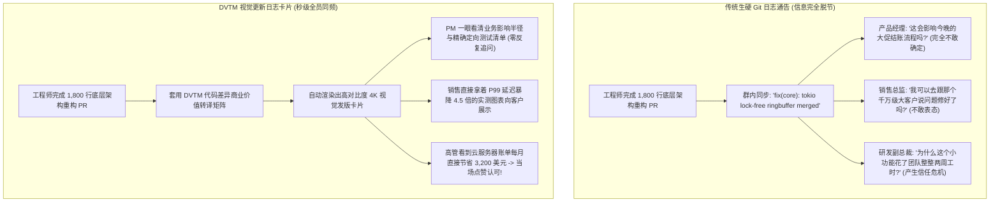

在每一个现代科技公司或远程分布式团队中，工程研发与非技术业务部门之间，永远横亘着一道深不见底的“沟通鸿沟”：

周五下午，核心后端架构师经历了一整周艰苦卓绝的排查重构，终于提交了一个包含 32 个 Commit、涉及 48 个核心文件、修改了 1,800 行底层代码的巨大 Pull Request（PR）。

在公司的发版沟通大群里，工程师敲下了这样一行通告：
> *“已合并 PR #412: `refactor(core): 将连接池迁移至基于无锁 RingBuffer 实现，重构 tokio epoll 事件绑定，修复套接字耗尽导致的 OOM 崩溃`。”*

业务负责人、产品经理（PM）以及运营总监看到这行字后的反应是什么？  
**全员沉默，一脸茫然。**  
非技术同事根本看不懂这行专业术语究竟意味着什么：是核心交易链路变快了？还是大客户投诉的卡顿问题终于被解决了？还是本次发版存在未知的线上故障风险？

与此同时，市场运营团队只能在对外的发版博客里憋出一句不痛不痒的废话：*“我们在底层做了一些常规性能优化！”*，完全抹杀了工程团队巨大的攻坚成果。

工程师习惯用**代码语法与 Diff 差异**思考，而业务决策者只在乎**商业价值、系统风险与用户体验**。

为了彻底打破这种组织内耗，技术团队必须建立起一套严密的**代码差异商业价值转译矩阵（The Diff-to-Value Translation Matrix, 简称 DVTM 矩阵）**。

---

## 1. 研发沟通的断层物理学：原生 Diff 为什么无法被理解？

为什么直接把 Git 提交日志截图发给跨部门团队，是一种极其低效的沟通反模式？



### 技术人员日常对齐中的 3 大认知盲区：
1. **沉溺于实现路径，遗漏核心商业结果**：工程师习惯描述“我用了什么算法”（例如：*“把 Mutex 互斥锁替换为了 CAS 无锁原子操作”*）；而业务方真正想听的是“这个动作消灭了什么痛苦”（例如：*“彻底消灭了用户在秒杀结账时页面卡顿 2 秒的假死现象”*）。
2. **影响半径的不可视化（Invisible Blast Radius）**：非技术人员对 Git 分支没有概念。当看到“修复了一个空指针”时，他们不知道这个修改是仅仅影响了一个后台不常用的报表导出，还是直接触碰了公司的核心收款账本。
3. **纯文本等宽排版的阅读疲劳**：在手机或企业即时通讯软件里，一长串混杂着 `+`、`-`、波浪号和缩进的代码块，在非技术同事眼里与乱码无异，本能的心理防御机制会促使他们直接无视这条消息。

---

## 2. 代码差异商业价值转译矩阵（DVTM）核心四象限

要将晦涩的底层代码改动转化为具备极高说服力与管理可见度的视觉更新日志，请严格执行 **DVTM 架构四分法**：

```
┌─────────────────────────────────────────────────────────────────────────────┐
│ 代码差异商业价值转译矩阵 (The DVTM Matrix) 设计规范                         │
│                                                                             │
│ [第一象限: 商业价值大标题 (The Value Hook)]                                 │
│ 严禁堆砌技术黑话！直接提炼核心体验或财务结果：                             │
│ "核心支付链路 P99 响应延迟从 1,850ms 断崖式压缩至 240ms"                    │
│ ─────────────────────────────────────────────────────────────────────────── │
│ [第二象限: 精选高对比度代码 Diff 极光时刻]                                  │
│ 严禁堆放上千行代码！仅截取最核心的 4 到 8 行关键改动：                      │
│ 红色高亮 (-) 沉重冗余的旧写法 vs 绿色鲜明 (+) 极简高效的新语法。            │
│ ─────────────────────────────────────────────────────────────────────────── │
│ [第三象限: 业务影响半径与云成本审计 (Blast Radius)]                         │
│ - 涉及业务模块: 结算中心支付网关、底座长连接池                             │
│ - 发版风险评级: 零停机热切换 (已完成 24 小时预发灰度)                      │
│ - 财务收益量化: 每月为公司直接节省 3,200 美元闲置计算资源开销              │
│ ─────────────────────────────────────────────────────────────────────────── │
│ [第四象限: 跨部门行动指引清单 (Stakeholder Action List)]                    │
│ - QA 重点回归: 弱网环境下的并发连续重试支付场景                             │
│ - 售前支持: 可向商户出具最新网络延迟白皮书，关闭工单 #8921                 │
└─────────────────────────────────────────────────────────────────────────────┘
```

### DVTM 矩阵四象限深度拆解：

#### 第一象限：商业价值大标题（定海神针）
用一句非技术人员也能完全理解的定量事实作为卡片的主标题。永远不要以库名或函数名开篇，而是聚焦在业务吞吐量、故障恢复率或成本节约上。

#### 第二象限：精选代码 Diff 极光时刻（工程师的骄傲）
适度的代码展示不仅不会让人反感，反而能极大地展现工程团队的专业底蕴——前提是经过了极致提炼。从 1,800 行代码中挑出最灵魂的几行：左边是 30 行恶心嵌套的回调代码，右边是重构后 3 行优雅干净的原子调用，形成强烈的视觉冲击。

#### 第三象限：业务影响半径与成本量化（给管理层吃定心丸）
直接打消管理层对发版故障的担忧。明确标注改动的边界、灰度验证状态以及真实的云基础设施降本数据，向高管直观证明工程师技术投入的高额 ROI。

#### 第四象限：各部门行动清单（明确下一步协作）
清晰告知各业务角色接下来的具体动作：QA 测试用例重点覆盖哪个接口、客户服务部门如何回复等待排错的大客户、运营团队可以在社媒宣传哪项突破。

---

## 用 NavoKit 整理一张 Markdown 卡片

在 [NavoKit Markdown 转图片](/zh/tools/markdown-to-image) 中粘贴简短发版说明及一小段差异代码。用标题、列表、表格或代码块组织内容，检查实时预览，再导出 PNG。转换在浏览器中完成，图片包含 NavoKit 标识。

当前界面采用固定的白色卡片样式，没有主题、语法高亮、窗口边框、透明背景或画幅比例选择器；也不提供 PDF、矢量或批量导出。图片高度随内容变化，长内容需要先拆分。

制作轮播或演示文稿时，请逐张整理和导出，再在发布平台或演示工具中组合。 保留可复制的原始文本与代码链接，让图片起到辅助说明的作用。

## 总结

在现代软件工程体系中，**无法被非技术人员理解的技术精湛，在商业世界里等同于不存在**。

真正优秀的工程领袖不仅懂得如何写出极致性能的底层代码，更懂得如何用商业的语言、视觉的形态，将代码背后的价值无损传递给每一个业务决策者。

全面落地 **代码差异商业价值转译矩阵（DVTM）**，让每一次代码 Pull Request，都成为赢得跨部门信任、提升工程话语权的最有力凭证。
