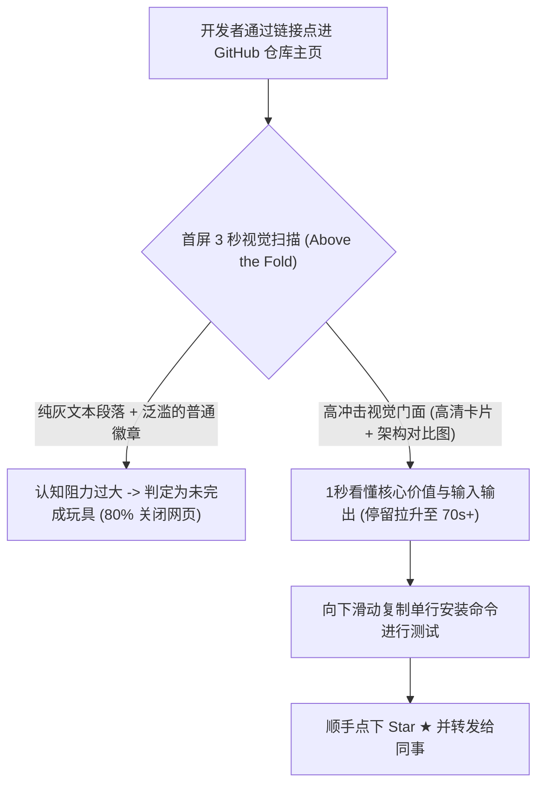

每一个开源作者都体会过这种心碎时刻：

你耗费了整整半年业余时间，用 Rust 编写了一个性能吊打全网、显存开销极小的高性能网络框架。代码模块化设计、单元测试覆盖率高达 98%，基准测试图表让人血脉偾张。

你满怀期待地把仓库发布到 GitHub，并在 V2EX 和 Hacker News 上发帖宣传。

然而 48 小时过去了：收获 12 个 Star，跳出率高达 85%。

为什么会这样？在 2026 年，**绝大多数开发者在评估一个开源项目时，根本不会先去 `git clone` 你的源码**。他们完全是通过你仓库的 **`README.md` 视觉门面**，在 3 秒钟内对你的项目做出死刑或信任判决。

当访问者点进一个全是纯灰色文字、密密麻麻塞了 200 行安装配置的手册时，他们会本能地认定这个项目维护质量低下或极其复杂；而当他们看到一张高对比度、带精致架构图与代码高亮卡片的视觉门面时，信任感会在瞬间建立。

本文将拆解顶级开源项目的视觉心理学，并提供一套**「3 秒仓库门面架构」（Repository Facade Architecture, RFA）**，助你的开源项目 Star 涨幅实现数倍跃迁。

---

## 一、GitHub 访问者的“3 秒心智决策窗口”

当代开发者在信息爆炸的今天，挑选开源类库的耐心被压缩到了极限：



### 优秀工程师在 3 秒内必须看到的 3 个视觉证明：
1. **即时视觉隐喻（Instant Metaphor）**：一张清晰的输入 $\rightarrow$ 输出对比图（例如：左边乱糟糟的代码 vs 右边一键美化的优雅卡片）。
2. **“一行代码见奇迹”的代码卡片**：用极具美感的等宽字体与语法高亮，展示极简的 API 调用形态。
3. **架构正统性证明**：一张工整、现代的高对比度系统架构拓扑图，证明作者具备顶尖的系统工程把控力。

---

## 二、3 秒仓库门面架构 (RFA) 设计蓝图

为了实现极致的 Star 转化率，你的 `README.md` 首屏必须严格按**「3 秒门面架构」（RFA）**布局：

```
┌──────────────────────────────────────────────────────────────┐
│  [Hero 顶部品牌横幅：1200x400 宽屏黑曜石暗黑风]             │
│  专属 Logo + 一句话粗体刺穿痛点的核心使命宣言               │
├──────────────────────────────────────────────────────────────┤
│  [极简数据徽章带：当前版本 | MIT 协议 | 零外部依赖 | 纯 Rust]│
├──────────────────────────────────────────────────────────────┤
│  [核心特性视觉锚点：Markdown 转高清对比卡片]                 │
│  ┌────────────────────────────────────────────────────────┐  │
│  │  传统冗长 40 行胶水代码  vs  本项目极简 3 行优雅调用   │  │
│  └────────────────────────────────────────────────────────┘  │
├──────────────────────────────────────────────────────────────┤
│  [一行命令快速开始：一键复制的 npm / cargo 安装代码]         │
└──────────────────────────────────────────────────────────────┘
```

| 门面模块 | 常见的新手翻车写法 | Top 1% 开源顶级作者做法 |
| :--- | :--- | :--- |
| **标题区** | 简陋的 Markdown 一级标题 `# my-project` | 定制的高清暗黑主题 Logo 视觉横幅图 |
| **痛点交代** | 连续 4 个段落的长篇大论阐述背景 | 一张高反差卡片，直接 Diff 旧方案与新方案的耗时与行数 |
| **API 展示** | 杂乱无章的普通文本代码块 | **Retina 高清、带毛玻璃阴影的精致代码语法卡片** |
| **系统架构** | 字符拼凑的丑陋 ASCII 字符画 | 清晰规范的 Mermaid 图表或矢量 SVG 架构拓扑 |
| **安装说明** | 列举 10 个环境变量与前置编译环境 | 单行 `curl -fsSL ... | sh` 或单一安装命令 |

---

## 用 NavoKit 整理一张 Markdown 卡片

在 [NavoKit Markdown 转图片](/zh/tools/markdown-to-image) 中粘贴README 简介或快速上手示例。用标题、列表、表格或代码块组织内容，检查实时预览，再导出 PNG。转换在浏览器中完成，图片包含 NavoKit 标识。

当前界面采用固定的白色卡片样式，没有主题、语法高亮、窗口边框、透明背景或画幅比例选择器；也不提供 PDF、矢量或批量导出。图片高度随内容变化，长内容需要先拆分。

制作轮播或演示文稿时，请逐张整理和导出，再在发布平台或演示工具中组合。 保留可复制的原始文本与代码链接，让图片起到辅助说明的作用。

## 结语

在开源生态白热化竞争的今天，酒香最怕巷子深，代码再美也怕门面太烂。

赋予你的代码库应有的视觉尊严。落地 3 秒门面架构，把干瘪的说明文档变成高颜值的视觉卡片，让你的开源项目在 GitHub 上狂揽属于它的万颗星标！
